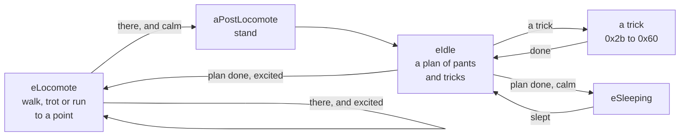

What the dog does is DOGZDLL.DLL's class `PetModule`. It is a state machine: each state pushes scripts ([[format:scp]]) onto the dog's queue, and reacts as the queue plays out a frame a tick. Every choice is `rand() % n` of Borland C's `rand` (seg1:4f11). `src/behaviour/pet.ts` reimplements the states a dog left to itself goes through, and the viewer's **Live** box runs it.

## States

- [[read out]] The engine has 109 states, named in its string table from 10000: 0 `eNOTASTATE`, 4 `eIdle`, 5 `eSleeping`, 7 `eLocomote`, 0x2b `eTrickBegging` to 0x65 `eTrickBalanceBall` (the 59 tricks), to 108 `eIconBeg`. `StateDispatch` (seg21:503f) calls each state's handler; `NewState` (seg21:5bb8) calls the old one leaving, glues the dog by the chest unless the queue is already glued, and calls the new one entering, at once.
- [[read out]] Above the states are global states, from 1000: idle, begging for a treat, playing ball and others, which set what the states do with the user (`NewGlobalState`, seg21:5dfa). Left alone the dog is in 1000, and `EnterIdle` starts it walking.
- [[read out]] A handler pops the queue each tick (`ScriptSprite::PopScript`), which shows a frame and returns flags: 1 when the queue has run out, 2 when the dog has reached its target, 8 when the queue says which state to go to next (`0x8b07 n`).

## Positions and transitions

- [[read out]] Every script goes from one of 59 positions to another ([[format:scp]]), and each position has a kind, the word after its name: 1 moving, 2 lying, 4 on its back, 8 sitting, 16 standing, or a sum (`GetNeutralType`, seg7:2cfd). `walking` is 17.
- [[read out]] `LoadScripts` keeps, for each pair of positions, the first script in the file from the one to the other (seg7:2180). Its test for a flagged script and its test for any are in the same pass, so the flag changes nothing.
- [[read out]] To play a script, `PushStoredScript` (seg7:4367) first takes the dog to where it starts (`PushTransitionToNeutralPos`, seg7:3d2f): the pair's script, or the first two that join, or the first three, each later one glued by the chest; then glues by the belly, unless the script is the one just played. A sitting dog standing up stands up excitedly instead (script 202 for 73) when `rand() % 30 + 30` is below its excitement; a clumsy one trips (224 for 10).

## The kennel

- [[read out]] Shown the first time, the dog comes out of its kennel (`eLeaveKennel`, 2, seg21:3fc8 — unless on the desktop, where it guards the screen): `DoPlayAnimation` (seg14:017a) sets its angles straight, drops its script, and has it come out (script 93 or 92, one at random), put with the middle of its rectangle at the middle of the kennel's — `PetParams` +0x50 to +0x56, less the stage's place (+0x1c) — and then leaves it alone. The kennel is the toolbox's dog button, a window of [[file:DOGZ.DOG/DOGZ.WAD]]'s beside the playpen (seg4:6951); on the oracle's screen its middle is 226 left of the playpen's top left corner and 98 above it, so the dog comes out off the stage and walks on.

## Idle

- [[read out]] Entering idle with no plan, the dog stands, if `rand() % 100` is below its excitement, or sits, and makes a plan (`SetupIdle`, seg16:0104): `rand() % (13 − e/10) + 6 − e/20` items, e its excitement. Each is a trick if `rand() % 100` is at most e; otherwise one to four runs of one to three pants, each run maybe followed by a pant looking about.
- [[read out]] A longer pant is meant to follow too, but the engine tests `(rand() == 0) % 3`: one time in 32,768.
- [[read out]] As the queue runs out the next item plays (`DoIdle`, seg16:02ce): a pant is script 2 standing or 74 sitting. When the plan is done the dog sleeps if `rand() % 30 + 30` is more than its excitement, and otherwise walks off. A dog of excitement 59 or more never sleeps so; one below 30 always does.
- [[read out]] The 30 there is the module's `+0x1220`, set to 30 as it is made (seg21:04be) and never changed. Before it, in the screen saver (`PetParams` `+0x5e` 3, seg21:0000), a dog of excitement over 70 goes to state 11 instead (seg16:05ca): not reimplemented.
- [[measured]] The idle plan against the engine, in the playpen harness (`harness/dogzpen.c`, `test/harness/dogzpen_test.ts`; "The playpen harness", below): over 3,000 frames left alone the dog made 13 plans, and each of `idlePlan`'s (`src/behaviour/pet.ts`) drew as many times as `SetupIdle` did, to the same `rand` seed. None ran out -- each time the dog was taken off idle first, by a trick or by being off the screen (state 8).
- [[measured]] With its plans cut short while idle (`DOGZ_PLAN_DONE=1`, "The playpen harness"), each end of its queue decides where it goes: 13 ends over two days of 3,000 frames, each to the state `idleEnd` gives from the draw returning to seg16:05f0 -- walking off ten times, its excitement 59 to 99, and, its excitement put at 20 (`DOGZ_CALM=1`), walking twice and going to sleep once.

## Tricks

- [[read out]] An idle trick is chosen by picking one of the 59 at random until one passes, in this order (seg16:0724 to 088f), every test against [[format:tdt]]:
  1. the dog's excitement is within the trick's range of the excitement it suits;
  2. its idle weight is at least `rand() %` the sum of all idle weights;
  3. `rand() %` each of ham, sickness, groom and bark is at most what the trick tolerates of it;
  4. it is not a trick with the ball.
- [[measured]] Every idle trick the dog chose in the playpen harness is as `Pet.pickIdleTrick` chooses it: over 3,000 frames, 37 choices of 15 tricks, each the same trick from the first draw of the engine's loop (the draw returning to seg16:0729), with the engine's own table (`ds:0x3b74`) and the dog's factors as the frame began, and `rand`'s seed the same as `NewState` was called. One choice took 620 draws.
- [[measured]] How many times a trick's script plays (`PushTrick`, seg21:7844, for the tricks without a case of their own): `rand() % extra + repeats` from the engine's table of the tricks' scripts (`ds:0x216e`, its extra at least 1), as `trickRepeats` has it -- all 18 in the 3,000 frames, each that many pushes of the trick's script to the dog.
- [[read out]] Barking (0x37) pushes script 112, or 191 sitting, `rand() % 3 + 1` times (seg21:75c3), and sneezing (0x46) script 159 `rand() % 3 + 2` times with the belly glued between (seg21:72fb), as the model has them.
- [[read out]] The dog then turns to face the user, if it faces further away than the trick allows: turning round on the spot if that is enough, otherwise walking round (`DoBeggingTrick`, seg18:0722). Rotation 0 faces the user.
- [[read out]] `PushTrick` (seg21:708a) plays a trick's script, from a table of six bytes a trick at DS:0x216e, `repeats + rand() % extra` times, with cues before and around it. Five tricks it plays its own way: roll-and-wiggle one of four rolls at random, run-in-circles a run drifting 8 to 11 a frame round, bark sitting or standing, boing spinning, sneeze glued between.
- [[read out]] When begging, `PickTrickState` (seg21:6907) asks the brain ([[topic:brain]]) first, and picks at random only when "brain has no opinions".

## Sleep

- [[read out]] Unless on its back, a dog going to sleep circles (script 212) and lies down (213). It sleeps through a plan of 10 to 24 stretches, each one of five sleeping scripts played a few times, broken every six to twelve stretches by one of two others (`PushSleepScripts`, seg16:1f61, the scripts at DS:0x20a4 and 0x20b8). Then it goes back to idle. Being disturbed wakes it; not yet played.
- [[measured]] The plan against the engine: the one sleep of the calm day (`DOGZ_PLAN_DONE=1 DOGZ_CALM=1`) drew as `sleepPlan` (`src/behaviour/pet.ts`) does, with the engine's own kinds and breaks, as many draws to the same seed. It slept the rest of the 3,000 frames.
- [[read out]] Asleep (`DoSleeping`, seg16:198e), as each script ends the dog is glued by the belly and given the next of its plan, then `8ae1 100`, a blink held 100 frames, its eyes kept shut (seg16:1ed5): the model leaves that blink out. Off the screen, or its plan done, it goes back to idle (seg16:1d0d). Before that, a block gated on the module's `+0x222`, `+0x218`, `+0x21a`, `+0x19e` and `+0x6a` (seg16:1b39 to 1e43) draws twice and may change its state or make a new plan: by what it reads, the dog disturbed; not reimplemented.
- [[measured]] With its sleep cut short as well (`DOGZ_WAKE=1`), the calm day's dog fell asleep at frame 276 and woke to idle (5 to 4) at 422, as its script ended; its excitement climbing again on its cycle, it walked and did tricks for the rest of the day and did not sleep again.

## Walking about

- [[read out]] `PickLocomotionAction` (seg21:837c) walks (13), trots (71) or runs (9) by `((rand() % 21 + e − 10) × 3) / 100`; a hammy dog sometimes struts (241) or marches (111), and a dull one walks sadly (220). `GetNewTarget` (seg16:177b) picks a point on the stage, 60 pixels in from its edges, at least 400 pixels away — or, on a smaller stage, half the diagonal inside those margins less 50.
- [[measured]] Each point the dog was sent to in the playpen harness is as `pickTarget` (`src/behaviour/pet.ts`) picks it: 24 over the two forced days, from the dog's place (its sprite's `+0x86`, `+0x88`) and the distance asked, the same point in as many draws. Each asked for 400; on the default playpen, 292 by 273, the inner diagonal's half less 50 is 65, and that is how far each had to be.
- [[read out]] Reaching it, the dog stops if `rand() % 150` is at least its excitement, and otherwise picks another (`DoLocomote`, seg16:1263).
- [[measured]] In the playpen harness, every way the dog went (`PickLocomotionAction`) is as `pickGait` (`src/behaviour/pet.ts`) has it, and every arrival walking (`DoLocomote`, the draw at seg16:1413) goes on or stops as `keepsWalking` says: over the three forced days of 3,000 frames, 31 gaits -- 18 runs and 13 trots, never a walk, its excitement high or climbing -- the same action in as many draws, and 44 arrivals, each on to a new target or to post-locomote (8). A new target walking is `GetNewLocomotionTarget` (seg16:1720), `GetNewTarget` asked for 400.
- [[read out]] Steering is the sprite's (`ScriptSprite::SetTargetLocation`, seg7:295e; `PopScript`, seg7:6b38 to 6d24). A target is a point, a rate of turn — 6 in 256ths of a turn a frame — and a box. Each frame the target is reached if it falls in the box: as wide and high as given, centred ahead of the nose (ball 55) by the box's diagonal over a distance, 4, the way the dog faces (`MakeFocusRect`, seg7:3565). Otherwise the dog's rotation is set turning towards `atan2(−dy, −dx) × 256 / 6.283 + 64`, wrapped to ±128, from the middle of the rectangle it is drawn in, the shorter way round (`AngleFudger::SetTarget`, seg4:0e98).
- [[read out]] The box is the pet's standard size — frame 35 drawn side on (`FigureOutStandardWidthAndHeight`, seg21:0289) — times 0.8 walking, 0.5 trotting, and 1.2 by 0.7 of its width running (`GetLocomotionFudge`, seg21:85ad). Walking about, the target is set again at the start of each stride (cue 4).

## Chasing

- [[read out]] `DoTargettedLocomote` (seg21:79d4) runs every state that chases something: the cursor (3, and 0x13 to be petted), the treat held (0x26), a wall (0x54), the ball. It walks, trots or runs — trotting after the cursor to be petted, running at the wall, by excitement after a treat — steering at the target each stride. A user waggling the target hurries it: a walk to a trot, a trot to a run (`PickFasterLocomotionAction`).
- [[read out]] Reaching it, the dog waits to be petted, does a trick for the treat (`PickTrickState`), or lunges at the wall (`DoLungingWall`, seg16:22c1: turned to it, scripts 263, 228, and 227 two to four times). Running or trotting, a clumsy dog trips (`DoLocomoteTrip`, seg21:8735: script 155 or 24 out of a run, 204 out of a trot) and goes back to what it was doing; stopped out of a run, it skids (script 205) one time in three.
- [[read out]] The wall chased is the far one: the stage's right edge less the standard width if the dog is in the left half, else its left edge plus it, at its height give or take 70, kept 150 from the top and bottom.

## Excitement and the factors

- [[read out]] A dog's nature is eleven factors, from 1 to 100: excitement, naughty, grab object, clumsy, groom, ham, bark, sickness, spray fear, frustration and age, in the order of the breed's `[Default Factors]` ([[format:lnz]]). Each line is a centre and a spread. `LoadFactors` (seg21:1ec5) sets each factor to its centre moved, either way, by `spread − √(rand() % spread²)`: near the centre more often than not. Age sets factor 10, and a younger dog is clumsier, by (100 − age) / 3.
- [[read out]] Before `LoadFactors`, `InitPetModule` sets each factor from the INI's sliders (`Control Val0` on, read by `LoadSliderVals`, seg2:03e5, into `PetParams` `+0x1ee` on, each kept to 0 to 100), at least 1 (seg21:0c07 on). `LoadFactors` then draws every factor but the second, naughty, afresh about the breed's centres; so naughty is `Control Val1`, 30 as Dogz installs it ([[file:DOGZ.DOG/DOGZ.INI]]). The model left it at 0 (read as 1); it starts so now (`SLIDERS`, `src/behaviour/pet.ts`).
- [[measured]] With the driver writing the seed as `LoadFactors` begins and ends (`factors in`, `out`): 66,307 draws after the module's seed of 1 (the fur's speckles and the rest before it), the model's `LoadFactors` from that seed draws as the engine's -- 20 draws, to the same seed -- and its factors are the engine's on frame 0, all eleven. The rest of `InitPetModule` draws another 62 before frame 0, and the engine's dog is walking (7) as frame 0 begins, where the model's `start` has it come out of its kennel: the model's dog run beside the engine's (`followLockstep`, reported, not held) parts there.
- [[measured]] Those 62 (the driver hooks `rand` once `LoadFactors` returns, `initdraw`, each with where it returns to), in order: the `ScriptSprite` constructor's -- one `rand() % 2` (seg7:1372), then 50 into a table of the game's own (`ScriptSprite::theirSavedThings` `+0xa` on, seg7:1568 to 157f) and its place in it, `rand() % 49` (`+0x6e`, seg7:1581) -- one of a sprite of segment 20 (seg20:39e5), two of `FindStartingLocation` (seg21:5845, 5860), one of `InitPetModule`'s own (seg21:1d74), then `CheckDesktop` (seg16:215a), `PickLocomotionAction` (seg21:83b4), `GetNewTarget`'s two (seg16:17fe, 181a), `GetEyelidHeightFromExcitement` (seg21:7912) and `DecideIfClumsy` (seg21:8a7d): the dog put at a starting place and sent walking, idle (0x3e8, state 7), before the first frame -- there is no kennel to come out of.
- [[read out]] The table's numbers are taken in turn, its place moved on and back to 0 at 50, by `CountFrames` (seg7:38d8, for a variant of -1) and by the transitions (seg7:416d); `CountFrames` keeps the place as it found it (seg7:3a40). So does `PushStoredScript`, for its script's variant (seg7:44df, the number modulo the variants), and `PushScript`, for each `0x8b05` number (seg7:4aa5, 4b99, low plus the number modulo the range). The model's dog made by `startInPen` takes its variants, its numbers and `0x8b09`'s variants so (`tableNext`); made by `start`, without a table, from `rand()` as before. [[measured]] The engine's pushes at the start draw none of their own, where the model's take a variant and an `0x8b05` number from `rand()`: so a script's variant, and its numbers, come from the table (not yet followed).
- [[read out]] `FindStartingLocation` (seg21:5805) draws the point the dog's frame is placed from (the renderer's slot 0x30, then `MoveSpriteRect`, seg21:5876 to 58cb): across 100 + `rand()` % (the width less 200, at least 10), down 100 + `rand()` % (the height less 200), the width and height kept at `ds:0x3bcc`, `0x3bca` (292 and 273 in the harness, the stage's rectangle at `ds:0x3bc2`); and `GetNewTarget` (seg16:177b) puts the target 60 + `rand()` % (the width less 120) across, and so down, far enough from the dog's middle (`+0x86`, `+0x88`), not its belly -- the model measured from the belly, and now from the middle. `Pet.startInPen` makes the model's dog so: on the harness's day of 300 frames it is walking, idle, at frame 0 as the engine's is. But the engine's dog stands far from where the model's point would put it (its rectangle 159 to 282 across, 199 to 285 down, at frame 0, the model's middle 140, 116), so `GetNewTarget` keeps its first target where the model's dog, too near it, draws three more: what moves the engine's dog between is not yet found.
- [[measured]] More of the start, against the lockstep on the harness's day of 300 frames (the driver writing the sprite after `FindStartingLocation`, `started`, and after `InitPetModule`, `inited`): placed, its rectangle's left is the point across and its top 37 below it, on frame 0; made, it is on frame 38, standing panting (neutral position 14), its middle at (224, 242), and its first frames are script 28's (14 to 9, frames 38 back to 35) then running's start (script 10). The model's dog, so placed and on frame 38 (`startInPen` pops a frame, and blinks once for that pop's pulse), its middle taken from `inited`, is in step with the engine's for 26 frames: the same state, frame and seed each; with the changes below, for 33, the same rectangle too.
- [[measured]] `PopScript` is done (flag 1) only once it finds nothing more to show: what follows a script's last frame -- a frame held to place the next by, the end -- is taken up on the next call, a tick after the last frame is shown, and the state, given more, has `PopScript` called again in the same tick (frame 27 of that day: a dry call, script 9 pushed, a second call showing frame 15 placed from the held 25). The model's `pop` had taken the end with the last frame shown, a tick early; it now pops dry, the frame held carried over. The second call is `DoLocomote`'s own: run dry, it pushes the next gait and calls `PopScript` again (seg16:1536). Idle does not: at frame 264 of the lockstep's day the dog went idle from a trick's end, popped dry, pushed its panting and showed its next frame only a tick later; the model had popped again for every state. Arrival at the point steered to (flag 2) is asked of the frame just placed, at the end of `PopScript` (seg7:7144 to 71d0): the model asks it so (`Stage.peek`), where it had asked it of the frame before; the turn toward it stays as it was, from the frame before. The blink goes on once a `PopScript` call (`ScriptSprite::Pulse`), so the model's once a pop.
- [[measured]] The dog's standard size, as `FigureOutStandardWidthAndHeight` (seg21:0289) measures it as the module is made, is frame 35's rectangle at rotation 64 -- `GetFrame`'s box, 2 more each way -- and at all but grown scales: 161 by 119 for the harness's puppy (the driver writes `ds:0x3bd0`, `0x3bd2`, `stage`), where the model's was its balls' extent at its own age, 108 by 81. The model's is so now (at an age of 99, the fit; what scales the engine's is at then is not yet read out), and the running steer box is the engine's, 193 by 112. With it, the poke day's clicks all hold still (the slop a seventh and a third of it).
- [[read out]] The engine's clock is `timeGetTime` over 17 (seg9:0668); the driver writes it each frame (`clock`): about 96 milliseconds a frame in the harness. The lockstep ticks the model's dog by it, and holds to the engine's dog -- state, frame, rectangle, blend and every draw of `rand` -- through all 300 frames of its day (the excitement put to the engine's each frame). On a day of 3,000, trick 90 (script 295, which calls scripts 2, 9 and 296) parted it at frame 445: the engine took the dog to each called script's start, drawing for `DecideIfClumsy` as it went to run; the model had played the called scripts in place. It now pushes them as `PushScript` does ([[format:scp]]). With the cycle's bare `(1 + sin) / 2` from frame 1 on, the model's excitement is the engine's on every frame after the first: put once in 538. The driver now writes the place in the game's table of 50 numbers as each frame begins (`table`, `theirSavedThis` `+0x6e`) and the clock as `PulseTrickData` reads it (`pulsed`): the drift's next time is whole ticks of 17 ms, read afresh a few milliseconds into the frame, and timed by the frame's own clock the model drifted a frame early (frame 527 of a later day). Given that clock, its excitement is the engine's on every frame, none put. An operand drawn from the table (`0x8b05`) is drawn once as the script is pushed, its value written into the queue, so a repeated block has the same; the model's timeline drew a random repeat count twice and each pass's operands anew. With these the lockstep holds 960 frames of the day of 3,000. After a reference frame `PopScript` moves the rectangle by `GetCenterOffset` -- the new frame's box and the reference's, about the origin (`+0x38`), their sums' difference halved toward 0 (seg10:26c7) -- and then by `MoveFrameRect` as for any frame (seg7:6e8e to 6f28): the model had moved by the centres alone, so a reference frame met while the dog turned (frame 1407) put it 49 pixels out. The heading is not kept within a turn: `0x8ae5` adds to it unwrapped (seg7:5c74), and it stays so -- 203, 587, 715 in the trace -- until the rotation's fudger next moves it, easing (`DoIncrement`, seg4:1094) or drifting (`DoDrift`, seg4:118e, only where the drift is not 0), when it is written back within -128 to 128, both kept (seg11:1f32). What reads it meanwhile reads it so: at frame 1592 `DoBeggingTrick` found 249 beyond trick 55's facing and walked the dog round to face, where the model, wrapping to -7, had not.
- [[read out]] Every `PushScript` first moves what is left unread of the queue to its front, the read index back to 0 (seg7:47fc to 4899). A repeat (`0x8ad1 n`) keeps its count and the index after it on a stack (`+0x20ac`, `+0x20ae`, `+0x20d6`), and `0x8ad2` sets the read index back to that index, as it was (seg7:5a5a to 5b33): so a push while a repeat is under way sends each pass after back to a place further on by as many words as had been read. [[measured]] Trick 91's second time in the day of 3,000 (frame 2104) went round its block of calls from frame 16 each pass after the first -- script 10 and frame 15 of script 9 passed over -- where its first time (frame 636) went round from frame 1. The model had played a repeat out as it was pushed, whole each pass, and parted there (frame 2167). Its queue now does as the engine's: a repeat is left in it (`repeat`, `endRepeat`) and gone round as it is popped; each item knows its words -- a frame one, with the opcodes before it, an opcode and each operand one, the script's `0x8b0c` none, `NewState`'s `0x8ad7` one where other glues take two; every push lets go of what was read; and a repeat goes back to its place counted in words from the front as it was. Where that place falls among a frame's opcodes, the engine reads from there: at word 27 of trick 91's block, the last of frame 15's seven (`8ad0 8ae3 4 8adb 39 3a f`), so frame 15 with no cue or sound -- or on another day the next frame (16), from word 28. The driver writes the queue as each frame begins (`queue read write depth place count: words`); the lockstep holds the model's words unread and its repeat to the engine's each frame, and so found the words the model had not queued: the soft reset's end (`8ae3 3 8b0b`, seg7:3362), `DoLocomote` leaving (`8ae3 3 8ae6 0 0`, seg16:129b), `DoBeggingTrick` entering (`8ae6 0 0`, seg18:07bf), and `PushTrick`'s look at nothing and level tilt (`8af9 7ffe 7ffe 8ae6 0 0`, seg21:70f3, after its ball trick, before which it does not glue). With them it holds 2,755 frames of the day of 3,000. A tick whose pop runs dry places nothing: no `MoveFrameRect`, no `HeadTrackPrep`, the rectangle left as it was, though the fudgers move the angles on; the next placing moves on from that rectangle (`Step.still`). [[measured]] After such a tick, its head tracking, the engine places the frame before afresh ahead of the module's pulse (a `head 0` line before `pulse`, 7 times in the day of 3,000, every one after a still frame) -- its head's wobbles moved on, and a glue then reads the frame before so placed; what places it is not yet read out. The wobbles' clock is milliseconds as `HeadTrackPrep` read it (the trace's head line), which the lockstep gives the model. With these it holds 2,869 frames. A glue reads the frame before placed afresh where its head tracks: early so after a still tick, else in the glue itself (`MoveFrameRectBall`, frame 2869). And a new target is measured from the dog's middle as the pop just placed it (`+0x86`, `+0x88`: the trace's `target 400 109 184`), not as the frame before had it. [[measured]] With these the lockstep holds all 3,000 frames of the day: state, global state, frame, rectangle, every draw of `rand`, the place in the table, the queue's words and repeat, and the head wherever it tracks, each frame as the engine's. `MoveFrameRectBall` places the frame before afresh only where the old state differs from the one Ballz last placed (seg10:2b55 to 2ce4, field by field); [[inferred]] the model takes a new state in the tick before the glue for that, as frame 2869 of that day re-placed it and frame 113 of the ball's day, begging on, did not. The driver now writes what each frame is handed (`params x y buttons slot taken`: `PetParams` `+0x12`, `+0x14`, `+0xe`, `+0x16`, `+0x18`), and the lockstep hands the model the same -- the cursor, its button, the ball taken out (slot 8) held where the cursor is and let go of, thrown. On the ball's day of 1,500 it so holds 125 frames; the begging handler's level tilt as it enters (`8ae6 0 0`, seg18:0d07) and its shuffle's `8ad7 8af2 0 0 0 0 0 8ae6 0 0` (seg18:1044) were wanting. `PopScript` steps the fudgers (`Fudger::ForAll`, seg7:6d3b) before `UpdateHeadTracking` (seg5:00c2, at 6de2), so the head is aimed against the heading as this frame has it; the model had aimed it first. Any ask for a ball of the dog (`GetBallOffset`: steering's nose, a target's focus box) places the dog as it is, so a glue after it reads the frame before afresh (`MoveFrameRectBall`'s comparison): the model now so places it again only after such an ask. Waiting after a trick, for a treat or at play for the ball (`DoBeggingTrick`, seg18:0928 to 0abd, before its pop): the cursor looked at if it moved; then if neither the cursor (the module's `+0x86`) nor its `+0xfa` (never set) is in a focus box 1.8 times the standard size about the dog's middle (`ds:0x20f7`, distance 3), it chases (0x26); else, the cursor waggling, a new trick (`PickTrickState`). The model had asked only with a treat, and whether the treat was near the dog, and after its pop. The waits' looks (`8afb`, `8afe 6`, `8afe 7`) are now queued, and `PushBegWaitLoops` glues with `8ad7`, a word. With these the ball's day holds to the throw at frame 300. `ScriptSprite`'s vtable (seg7:814c, from the constructor's `+0x34`) names the calls: `+0x28` `ResetScript`, `+0x2c` `ResetScriptSoft`, `+0x30` `ResetScriptHard`, `+0x34` `ResetParams`, `+0x3c` `IsScriptGlued`, `+0x40` `PopScript`, `+0x58` `PushStoredScript`, `+0x5c` `PushTransitionToScript`, `+0x60` `PushTransitionToNeutralPos`, `+0x64` `GlueScripts`, `+0x68` `GlueScriptsIfNotGlued`, `+0x6c` `PushScript`, `+0x70` `PushScriptElements`, `+0x8c` `SetTargetLocation`, `+0x98` `SetEyeTarget`, `+0x9c` `SetHeadTarget`, `+0xa0` `LookAtUser`, `+0xa4` `LookAtRandomPoint`, `+0xa8` `LookAhead`, `+0xc8` `MakeFocusRect`. `ResetScript(glue)` (seg7:2dd0) lets the script playing play out (`ResetScriptSoft`) where it may not be cut short -- `+0x952`, cleared by cue 9 and set by cue 8, by its end (`0x8b0b`, seg7:6688) and by `ResetParams` -- or where it moves the dog from one position to another and is past its first frame (`+0x94e`, its frames shown) but not at its end (`+0x94c`); else it clears the queue to the glue given -- a ball of the dog's, else `IsScriptGlued`'s, else the chest -- and an end, resets the params, and puts the dog where the script started, or past its first frame where it ends (and at 21, glued by the belly). `ResetScriptSoft` too takes the glue given before `IsScriptGlued`'s. The model's `resetScript` had always cleared the queue. Thrown, the ball glues the dog by ball 36 and resets the script so (seg20:2253 to 2294): at frame 300 the trick's turn round, between its cues 9 and 8, played on. The ball's day holds to frame 325. The ball's sprite moves on before the dog's state acts, so a chase aims four frames on from where the ball now is. The chase's steering distance is a word `GetLocomotionFudge` never sets, left on the stack (`DoTargettedLocomote`, seg21:80fa): [[measured]] 1 chasing the ball, 4 bringing it back. Reaching the ball, the chase draws `DecideIfClumsy` and grabs (0x1d) or misses (0x1e) where it will not bounce and is not moving fast (seg21:8183 to 81db). The grab's enter (`DoGrabbingBall`, seg19:099b to 0c80) ends in a pop of its own, its first frame the tick's: running (position 21), it counts the frames of script 11 (`CountFrames`, the table's place left as it was) and queues a chest glue, steering at where the ball will be after them, the chin aimed there (`8af4 55`), a transition to standing, cue 3 and the grab (`8b03 0`); else, the ball 7 frames on not bouncing (or once, by `rand() % 3`), `ResetScript` and `PushBallGrabAction` at it, or back to the chase; then `DecideIfClumsy`, a fumble (scripts 185 and 186, `8b04 1`). `PushBallGrabAction(point)` (seg19:2bf9): a chest glue; the ball not moved and no point, a pounce (cue 7, script 29, cue 6); else reaching (82), a turn toward it where the chin is on the far side for the way it faces (`8ae8 1 d |d / 2|`), the chin aimed (`8af4 55`, at nothing without a point), the grab (81); a chest glue. The aim (`0x8af4`) is played ahead once the frame it comes with is placed (seg7:7144 on): the trace's look-ahead pops follow that frame's glue, and the slide begins the frame after, over the frames played ahead past it; the model had played ahead from before that frame, it among them, and slid it at once. A pop that runs dry goes straight to the pop's end (seg7:59a5 to 7144), past the steering and the fudgers. [[measured]] Still, at frame 325 the grab glues from frame 14 at a heading of -118, 6 on from the -124 the frame before was shown at, and the new frame at -112: two of the steering's steps in the one pop, or one in the chase's dry pop -- not yet read out. [[measured]] The driver now writes each step of the fudgers (`forall`, `Fudger::ForAll`, ordinal 39: three a pop, the heading moved by the third), the blink as each frame begins (`blinking`) and as each pop pulses it (`pulsing`). So frame 325 is read: the chase's pop places frame 14, turning the dog to -118; the chase, arrived, enters the grab, whose pop glues frame 25 from it at -112. Two frames placed in one tick: the model's tick now tells the stage of every frame its pops placed before the last (`Tick.passed`), and a pop the user's act makes between ticks -- the ball taken out or thrown, as the engine takes them in the frame -- belongs to the next tick. Leaving, the targeted walk looks at nothing, calls `ResetScript(-1)` and eases its tilt level (seg21:7b71 to 7bf2), so its soft reset's cue 3 reaches `ResetParams`, which puts the blink at its shut length; the look-ahead that follows pulses the sprite like any pop (the blink ending there, drawn for good), plays its sounds and its steering -- the dog steered afresh each pop from where it is by then -- and starts from the frames placed so far in the tick; `SaveEnvironmentVars` and `RestoreEnvironmentVars` (seg7:3aeb) copy the whole sprite, 0x8e36 bytes, its blink among it, but not `rand`'s seed. With these the ball's day holds to frame 335, the ball taken in the mouth. The ball's day as now recorded takes a course its earlier recording did not, and two of the trace's own checks fail on it: the ball's roll off the stage's edge at frames 770 to 772 (`followRoll`), and a plain move while turning and sliding at frames 1312 and 1313 (`followPlacing`) -- open. [[measured]] At frame 335, the ball taken into the mouth, the model's dog was turned 6 further than the engine's (-81 for -75): the frame-box check, on the engine's own pose, boxes the frame exactly, and the driver's `balls` line (each ball as `GetBallOffset`, 203, has it, on a frame something is taken up or let go in, the head not tracking) showed every ball out as a turn would put it. [[read out]] `ResetParams` (seg7:33ae) stops the steering (`+0x2108` 0, seg7:3484) and any slide (`-0x71f2`), puts the focus distance back at 4 and the eyes' and head's targets to none; and `0x8af2` turning steering off stops the rotation's fudger (seg7:6583 to 65ad). The model's `ResetParams` had left the steering on, so a cue 3 popped as the grab ended let it steer the dog on another step. With it the ball's day holds to frame 350. Releasing the ball (`DoReleasingBall`, seg19:035c on), the dog still moving (its position's kind, `GetNeutralType`, with its first flag, seg19:039f to 03ac) is first taken to standing, waiting (state 1), and comes back (`8b07 33`); waiting (`DoWaitState`, seg21:6073) lets its script play out as it leaves (`ResetScriptSoft(-1)`, seg21:6097). With these the ball's day holds to frame 400. Waiting for the ball (`DoAnticipatingBall`, seg19:1241 to 13e9), the dog chases it or, grabbable, pounces, where it is not all on the stage (`IsPetTotallyOnscreen`) or the cursor -- kept 100 in from the stage's edges -- is out of a focus box 1.8 times the standard size about its middle (distance 4); the script reset by ball 36 (`ResetScript(36)`), and no pop of its own after the new state's. Whether the ball has moved (`BallSprite::HasMoved`, seg20:1f28; `RecordPosition`, seg20:2015) is the ball's own middle and the dog's ball 36, in the old state, against where they were recorded -- more than 6 pixels either way; the model had taken the chin. With these the ball's day holds to frame 569. The waiting play's script done, a trick pushed and the waits, the dog pops again, the trick's first frame the tick's (`DoAnticipatingBall`, seg19:15d2); a state queued (`8b07`) resets the script first (`ResetScript(-1)`, seg19:14e2). A glue reads the frame before afresh after a pop that ran dry earlier in the tick too (frame 569: the old state copied as it ended differs from the one Ballz last placed), and by the old state's tracking, the head now tracking or not -- then the wobbles put back (`headrest`). `PushStoredScript` draws the variant from the game's table before the transition to the script's start (seg7:44df, then 459b): the model had drawn it after, so where a transition drew too, a later number (frame 569, script 199's look). The driver's `stored` and `neutral` lines now end with the table's place. With these the ball's day holds to frame 617. [[read out]] The scruff handler asks, every frame the dog is not scruffed (`DoScruffHandler`, seg21:4ec0 to 4f1c), where the neck (ball 54) is -- of the old state (`+0xec`), not the dog's own. So Ballz's last placed is the old state as each frame begins, and a glue reads the frame before afresh only where something has since placed the dog as it now is, or the old state has changed (copied anew by a pop that ran dry). That ask is also, it seems, what places the frame before afresh after a still frame, ahead of the pulse (the `head 0` before `pulse`), the old state changed by the dry pop's copy. With the model's scruff ask no longer counted as placing the dog, the ball's day holds to frame 719. Its excitement on the first frames goes 73, 59, 73 -- 59 its centre as `LoadFactors` left it. On frame 0 the slider is still the 59 while the excitement is 73, so `PulseTrickData` sets the excitement to 59 and takes the drift's next time from it: 1,064 ticks on, the engine's factors drifted at frame 184 of the lockstep's day. The lockstep puts the model's excitement to the engine's each frame, and its slider too only where the two were the same.
- [[read out]] The factors are kept with sliders (`PetParams` `+0x1ee` on, the INI's `Control Val`s as the module is made): `SetFactor` sets both (seg14:2288); `SetExcitement` sets the excitement to what it inverts the value to -- with an exponent of (101 less the centre) over 25 -- and its slider to the value itself (seg14:2363 to 2461). Each frame `PulseTrickData` (seg14:1783) sets the excitement to its slider if the two differ, and else takes it from the cycle into both; then every factor its slider's, kept to 1 to 100 (seg14:18b5 to 191c); then the drift; and its caller every slider its factor's after (seg21:4bf9 to 4c27). So `LoadFactors`' excitement of 59 shows as 73 on frame 0, the slider's 59 on frame 1. The model keeps sliders so now, and every factor it changes it changes through `setFactor`, as the engine does.
- [[measured]] On frame 1 the cycle gives the excitement as 73, its phase as `SetExcitement` left it (0.2967, written by a probe of `PulseTrickData`): `(1 + sin)` over 2 is 0.73, and its power `(100 − 59) / 25` would make it 59. Over the 298 frames after, the engine's is the bare `(1 + sin) / 2`, times 100 -- 288 to the number -- never the power of it. Borland's `pow` (seg1:1251) takes a whole-number exponent's way when `FRNDINT` of it raises no precision exception; winbox.js's `FRNDINT` raises it, by its code, so why the engine's is the bare value under winbox.js is not yet known: the emulator's or the engine's. The model keeps the power, as the code reads; the lockstep puts the model's excitement to the engine's each frame, to follow the rest past it.
- [[read out]] Most of the engine's state handlers go on from entering to their tick's work -- a `PopScript` among it -- in the one call: `NewState` dispatches the new state with `+0xe2` set (seg21:5d9c), and the handler's enter block falls through into the rest (`DoLocomote`, seg16:12cd to 1365; `DoPostLocomote`, seg16:1568 to 15a5). Read from every handler of `StateDispatch`'s table (seg21:534a): all go on but waiting (1), scruffed (10), grabbing (29) and leaping for (31) the ball, the owner too close (34), faking (35), tumbling (36) and eating (40), which return. So a state entered shows its own first frame that tick, the frame popped before it passed over (frame 34 of the lockstep's day: walking stopped, frame 22 popped and frame 23, standing's, shown). The model's `newState` goes on so for those states (`ENTER_RUNS_ON`), and the dog's start pops its frame 38 so, by idle and walking going on; and every sound popped is played, a frame passed over keeping its own, as `PopScript` plays them. With it the lockstep's dog is the engine's for 46 frames, to its first idle trick. (A state that goes on into another as it runs on leaves the other's frame: frame 46, stopping, idle and a trick in the one tick, three pops, the trick's 2956 shown.)
- [[read out]] Walking stopped and done, on the stage (`IsPetTotallyOnscreenMargin`, seg21:59c9, its margin half the standard width and 5 more, at most half the stage less the standard size each way -- the across margin taken for the left and top, the down one for the right and bottom), the dog draws `rand() % 40` against its excitement and goes idle either way: the jump that would put it to sleep is never taken (`DoPostLocomote`, seg16:15b2 to 15ff). The model now draws so, and asks so (`isOnscreenMargin`). Off it, the dog is taken to the walk's start by the belly (`PushTransitionToScript`, or else `GlueScripts(-1)`, a glue of no ball, so none), queued to steer at the stage's middle (`0x8af2`, as the walk begins, not at once), given the walk (script 13), taken on to position 24, and popped again, the walk's first frame shown in the same tick (seg16:160d to 1713). A glue below 0 or from 65 is none: the frame placed as it is (seg7:6e33 to 6e44). Idle, its plan's script done, asks `IsPetTotallyOnscreenMargin` too, with half the standard width less 5 (seg16:0594 to 05b2), not whether its middle is on the stage: at frame 611 of the day of 3,000 the engine's dog went to `ePostLocomote` where the model's did another trick.
- [[measured]] At frame 46 of the lockstep's day the model's dog drew its blink's end a pulse before the engine's: a probe of `PopScript`'s queue (`+0x209c`, from `+0x20a8` to `+0x20a4`) and blink (`-0x720e`, `-0x7212`, `-0x7218`) as each call began showed the engine's idle popping only a chest's glue and its own, and no cue 3 -- `DoPostLocomote` leaving does nothing (seg16:1554 to 155c), where the model's soft reset queued one, which reset its blink (`ResetParams` sends a blink waiting or under way to its end, seg7:33e3, as `0x8ae0` does). The model now leaves so.
- [[read out]] `ResetScriptSoft` (seg7:31f1) keeps the queue to the end of the script playing (`0x8b0b` or `0x8b0c`), or all of it where none ends, and queues cue 3, the script's end, and a glue: the one given, or, given none, the one `IsScriptGlued` finds ahead (seg7:36fb: the last glue that no frame follows), or else the chest (seg7:320b to 3248). And it puts the dog where the script playing -- the one whose start (`0x8b0a`) was last popped, `+0x948` (seg7:65ee) -- leaves it, and makes that the last script pushed (seg7:331e to 3345), whatever had been pushed after: a trick cut short in a script it called leaves the dog standing as that script does, and the next transition starts from there. `IsScriptGlued` scans the queue from where it is read: a glue makes it glued, a frame unglued, and anything else -- an end among them -- leaves it be; `GlueScriptsIfNotGlued` asks it (seg7:46a1). The model had asked only whether the last thing queued was a glue, and dropped the glue a script ends with (script 219's chest, or one just before a call) with what follows its last frame; it now queues it as a glue. A glue a pop meets and runs dry after stands for the next frame shown (`+0x950`, done with only once used): the model's pop had let it go. The model's had dropped all where none ended and taken its glue only from what followed the end, so gluing a trick by the chest where idle had queued the belly (frame 46). With both, the lockstep's dog is the engine's for 154 frames. What puts the engine's dog at 14, and on frame 38, and where it stands, are taken from the trace, not yet read out.
- [[read out]] Every sound opcode (`0x8ada` to `0x8ade`) draws `rand() %` its count as `PopScript` plays it (seg7:620a), a single sound too; the model drew it as the script was pushed, and now as the frame is played (`deferSounds`). The blink's first wait is 20 as the script sprite is made (`-0x7218`, seg7:12b0); the model's was 0.
- [[read out]] Excitement is not fixed: it is `100 × ((1 + sin(φ + π t / 24,000)) / 2)^((100 − c) / 25)`, t the engine's clock in ticks of 17 milliseconds, c the excitement's centre (`PulseTrickData`, seg14:1783). It rises and falls over about 13 minutes, and a calmer breed spends longer low. Setting it moves φ so that it is the value set, now (`SetExcitement`, seg14:2363).
- [[read out]] Now and then the other factors step 1 back towards their centres, as the trick weights do ([[format:tdt]]).

## The cursor

- [[read out]] [[file:DOGZ.DOG/DOGZ.WAD]] hands the engine the cursor, in the playpen's coordinates, and the primary and secondary mouse buttons, read with `GetAsyncKeyState` the way `SwapMouseButton` says they are (seg4:014d and 0187 of `DOGZ.WAD`). It draws a frame every 45 milliseconds at most (`ReallyDoDrawFrame`, seg21:3dee), so about 22 a second.
- [[read out]] Each frame the engine keeps the cursor's last thirty positions and buttons, and works out whether it waggles: over the last five frames, moving 8 pixels a frame or more, but never more than 100 from where it is now (seg21:4700 to 4899).
- [[read out]] What is under the cursor is a ball: `Ballz::HitTest` (seg10:46d8) tries the balls nearest first, each a square as wide as it is drawn. Each ball is a part of the body, set one by one in the `Ballz` constructor (seg10:0051 on): 0 the head, ears and neck, 1 the tongue, 2 the face, 3 the hindquarters and the root of the tail, 4 the right leg, 5 the left, 7 the tail, 8 the chest, belly and shoulders.

## Petting

- [[read out]] Every frame, `DoPettingHandler` (seg17:0000) takes for petting the button held down over the dog for four frames running, with the cursor moving in at least two of them; not while a treat is held, not while the dog is running. Petting starts the global state 0x3f3.
- [[read out]] Nor while the dog is grabbing a treat (0x29) or leaping for the ball (0x1f) (seg17:0170): the model had only the first. While it is petting, the handler animates the petting hand, the cursor's frames 4 to 7 back and forth (`+0x1232`, its step `+0x1236`, -1 as the module is made and 1 as petting begins): each time its count (`+0x1234`) runs below 0, a step on and the count put at `rand() % 2 + 2`, asked of the program as the cursor (`PushCursorRequest`, seg17:01da to 0292). Good petting begins it at frame 4, its count 2 (seg17:0e92); not petting, the request is cleared. The model now does so (`stepHand`, `Pet.hand`): its draw had been missing, so a petted model's `rand` went its own way from the first stroke.
- [[measured]] Petted in the playpen harness (`DOGZ_PET=1`: the button held and the cursor moved 6 either side of the middle of the dog, from frame 100 to 700), the dog went into petting (0x3f3) and through aligning (0x17), waiting (0x14) and good petting (0x15), again and again; let go, it waited, then walked off. On all 568 frames petted from start to end, the hand's frame, count and step went as `stepHand` steps them, its 120 draws among them.
- [[read out]] A click on a standing dog's face, a leg or the tail is a poke: `ePettingBad` (seg17:1416). Its bark factor rises by 5; poked in the face it shies or snaps (one of DS:0x20ca), elsewhere it growls or flinches; three times in four it shakes it off.
- [[read out]] The area is `Ballz::HitTestBodyArea` (seg10:461e) at the cursor, the ball found by `Ballz::HitTest` (seg10:46d8) -- the frontmost whose box holds the point, its half-size widened by half the slop -- given by the petting handler a seventh of the dog's standard width and a third of its height as slop (`DS:0x3bd0`, `0x3bd2`; seg17:002c to 0078). It pokes only a standing dog (its neutral position's type with 0x10, `GetNeutralType`), not one still reacting (0x16), and only where the area is the one the cursor was over the frame before (`+0x1230`, `+0x122e`). The model had tested the balls without the slop, so a click a little off a leg or the face missed. [[measured]] The driver writes the dog's neutral position at each click (the sprite's `+0x94a`) and its type (`GetNeutralType`, `poking`): on a rerun of the poke day (the brain made, so the dog's course its own), each of the 20 clicks is as that rule has it -- 7 poked, all reacting as `pokeReaction` does; 7 off a poking area, 4 on a dog not standing (positions 6, 8 and 46, of type 8), 1 while it still reacted, and 1 where the area under the cursor had changed since the frame before. [[read out]] The engine's `+0x94a` is the neutral position the script now playing ends in: `PopScript`, reaching a script's `0x8b0a s`, keeps the script (`+0x948`) and its record's `to` (`+0x94a`; seg7:65c8 to 6654). The model takes standing so too (`playingKind`, from the script it last began to play).
- [[measured]] Clicked on in the playpen harness (`DOGZ_POKE=1`, 20 clicks about its rectangle), the dog was poked six times: four times, poked elsewhere than the face, it growled and shook it off, once in the face it reacted with 233, and once it flinched. All six, the model's dog posed as the engine's was drawn, found a poking area under the cursor (with the slop; without it, two missed), the face where the engine reacted to the face; and each reaction drew as `pokeReaction` does, the same scripts in as many draws to the same seed.
- [[read out]] The dog wants petting on one of three spots, picked by chance — the chest, 20 in 100, the belly, 30, the rump, 50 — for a few strokes before it picks another (`PickNewPetSpot`, seg17:192b). The cursor is on the spot within 0.8 of the spot's ball's drawn width either side of it, at any height within 300 pixels (`IsCursorOverPetSpot`, seg17:17de).
- [[measured]] Each spot picked in the petting day is as `pickPetSpot` (`src/behaviour/pet.ts`) picks it, with the engine's table of spots (`ds:0x20d0`): both, the same spot and strokes in as many draws.
- [[read out]] Facing the user or away, the dog first turns side on and walks back or forth until its spot is under the cursor (`DoAligningPetting`, seg17:08f7); then it waits, panting, 20 to 39 pants before it gives up (`DoWaitPetting`, seg17:0410); a cursor that leaves it is followed.
- [[read out]] Waiting (seg17:060a), it counts `rand() % 20 + 20` pants, and gives up, back to idle (0x3e8), when the count, before it is taken down, is 0 or less (seg17:07dc). Before each pant it looks about (`8afb`) one time in two (`rand() % 2`), else, by a second draw, at the cursor (`8af9`) one time in two (seg17:07ec to 0862). The model drew once only; `waitLook` now draws as the engine does (the looks themselves are not yet played).
- [[measured]] In the petting day, all 31 looks before a pant drew as `waitLook` does: a second draw (returning to seg17:0825) exactly where the first was even.
- [[read out]] Each stroke (`DoPettingGood`, seg17:0e25) raises how much it has enjoyed the petting, up to 16. Stroked on the head or body it leans into the hand (scripts 47 and 45), on the hindquarters it thumps a leg (64, 65, 66), and once it has enjoyed it enough it may roll onto its back instead: where `rand() % 16 + 7` is under its enjoyment (seg17:1056, 111f), never before its eighth stroke and at most nine times in sixteen. On its back it wriggles (DS:0x20c4); enjoyed past 14, rolled on its back, and calm enough by `rand() % 150` against its excitement, it falls asleep.
- [[measured]] The model had left out the 7, so its dog rolled over from the first strokes. With it (`rollsOver`), all 23 strokes of the petting day hold: the 7 that rolled over (the wriggle drawn after, seg17:0fa9, once its eyes are put, `PushPettingEyePos`), and the 16 that did not -- among them, at its sixth stroke, a draw whose 16th part was 2.
- [[read out]] After its first push each way -- rolled onto its back, or glued by the belly to lean or thump -- the dog's eyes are put (`PushPettingEyePos`, seg17:12f7, through the module's slot `0x18`): one time in two shut, a blink of `rand() % 15 + 30` frames (`8ae1`); else one time in two a look at the user (`8afb`); else a look at a random point (`8afa`), and four times in five that blink after it. The model had none of it; `pettingEyes` now pushes them as script tails.
- [[measured]] All 26 times the petting day's dog had its eyes put, the engine drew where `pettingEyes`' branch draws (seg17:1306, then 1318, or 134a, 13a1 and 13b3), to the same seed.
- [[inferred]] How the dog turns side on to be petted is not yet read; the reimplementation turns it a quarter turn.

## Food and treats

- [[read out]] The food sprites are, in order, `Food`, `Water`, `BlueTreat`, `GreenTreat` and `RedTreat` (`FoodSprite::theirNames`), and each is a global state, 0x3eb to 0x3ef. `FoodSprite::Update` (seg20:0de4) sets them: a treat picked up starts the dog after it; put down, the dog goes to eat it; picked up again while it eats, it begs again; put back in the box, it is left alone.
- [[read out]] For a treat held — or the ball, or the shoe — the dog sits up and begs, five to ten times (script 14; `DoBegging`, seg18:0bec). Settled (cue 0), it follows the cursor, by two boxes about its belly ahead of it the way it faces (`MakeFocusRect`), one twice its standard width, one its width: the cursor out of the first, it chases what it begs for (`eBeggingChasing`, 0x26, at the thing itself, `0x11d4`); come into the second, it reacts (script 41); both now and six frames before outside the second, it chases on its hind legs (`DoBeggingChasingHindLegs`, seg18:23f2: script 33 once or twice, steering with a box half its standard width and 40 more) if the cursor is level with its middle — within 10 of 256ths of a turn (seg11:1f57) — 60 times in 100 (`0x1ce4`, set by `ResetParams`), and else shuffles after it (15, steering at it, then 18). Waggled at a settled dog, the treat brings a trick at once.
- [[read out]] Begged out, the dog's brain is woken. Then `ActivateBrain` (seg18:290d) wakes the brain ([[topic:brain]]), telling it the treat was brought out, and `PickTrickState` chooses: the dog's frustration rises by 4, and if `rand() % 420` is below it, and again below its grab-object factor, it snatches the treat from the user's hand (`DecideIfGrabFromUser`, seg14:215e). Otherwise it does a trick: the brain's choice, or, when "brain has no opinions", one at random that needs no ball.
- [[read out]] After a trick done begging, it pants and waits for the treat, from `(100 − e) / 20 + 1` pants to nearly four times as many, sitting more often the calmer it is (`PushBegWaitLoops`, seg18:25e0). Waggling the treat while it waits has it do another trick at once; taking the treat away has it follow.
- [[read out]] Its looks while waiting (seg18:2787 to 285a): every other pant or two (`rand() % 2`), at the user (`8afb`), the cursor (`8afe 6`) or what is held (`8afe 7`), by `rand() % 3` drawn again until it is not the last look -- the first time, not the cursor's. The model drew the look once; `begWaitLoops` now draws as the engine does (the looks themselves are not yet played).
- [[measured]] With a treat taken out of the toy box and held over the pen (`DOGZ_TREAT=1`), the dog went into the blue treat's global state (0x3ed), chased it (0x26), begged (0x2a), did two tricks, and, the treat let go lower down, ate it (0x28). Both waits after its tricks drew as `begWaitLoops` does.
- [[read out]] A look at the user also puts the count back to 0 (seg18:2827), so it looks again two pants on; the model had left that out.
- [[measured]] With the ball (`DOGZ_BALL=1`: taken out of the toy box at frame 100, held, swept across the pen and let go at 300), the dog went into playing ball (0x3f0), begged and did tricks for it held, chased it thrown (0x18), grabbed it (0x1d), brought it back (0x19), let it go (0x21) and waited for the next (0x1b), and so again. All eight of its waits after a trick, the ball's way (seg18:266b: `(130 - keen) / 20 + 1`, keen its excitement and 30 for the ball held), drew as `begWaitLoops` does, given the engine's own values -- a move pushed between, the ball let go, may draw (seg7:40f1) -- five of them drawing a look again, and one looking again two pants after a look at the user.
- [[read out]] A trick done for the ball (`PickTrickState`, seg21:69b0 to 6aa4) is one of the 59 at random, kept if its play weight is at least `rand() %` the play weights' sum, and never one with the ball while the ball is held or in the box, or cannot be grabbed (`IsBallGrabbable`). That sum (`ds:0x3d90`), like the idle weights' (`ds:0x3d94`), is summed once as the module is set up (seg21:0df6) and never again as the weights drift; the model summed the play weights at each choice, and now keeps them as made, as it did the idle weights.
- [[measured]] All seven tricks chosen for the ball on the ball day drew as `pickPlayTrick` does (`src/behaviour/pet.ts`), as many draws -- 66 in one -- to the same seed, with the trick table and its sum as the day began; the four whose tricks were done within the frame, the same tricks.
- [[read out]] Snatching (`DecideIfGrabFromUser`, seg14:215e) draws against a range of 210, doubled to 420 when the reduced global state it is given is food or a treat (0x3eb): so 420 for a treat, as the model has it, and 210 for the ball (seg21:697a), as the model's fetch has it too.
- [[read out]] A treat put down is eaten in one bite (script 86; `DoEating`, seg18:12cb). Its cue 10 is the bite: the treat is gone, the dog's frustration settles to its centre, and, only if the brain was not yet woken, the trick last done is rewarded ([[format:tdt]]). So the trick weights learn only from a treat given before the dog has begged; once it has, what it learns is the brain's.
- [[read out]] Each food is a picture: `InitFoodSprite` (seg20:0a5e) loads bitmap `0x283a + kind` for a treat — 10300 the blue, a doughnut; 10301 the green, a triangle; 10302 the red, a bone; each 32 by 32 — and four, `10000 + 10 × kind` on, for the bowls of food and water as they empty. Held or put down, a treat is drawn as the ball is, over or under the dog by its facing (see Fetch), and its rectangle is kept on the stage and picked up by a click anywhere in it.
- [[read out]] Snatched, script 240's `0x8b03 2` takes the treat into the mouth (`GrabObject`, slot 2, the food): `PickTrickState` has allowed the dog to take it from the hand (`0x96`, seg21:6b1d), and it is drawn at the chin (`FoodSprite::StaticDrawGrab`) until it is eaten.
- [[read out]] Eating, at cue 0 the food's own sprite is hidden and `DoEating` has the dog draw it, where it lies, just before the first of the breed's `[Head Balls]` (`FoodSprite::StaticDraw`), so under the head, and a bowl's front picture after them (`StaticDrawFront`); cue 10 eats a treat, and cue 13 or leaving gives the sprite back (seg18:1c62 on).
- [[read out]] A bowl taken out of the toy box is filled with `rand() % 11 + 25` servings (`FoodSprite::Update`), and shows full, half or empty, its picture `((full − left + 2) × 2) / full`, at most 2: half once half are gone, empty with two left. A dog held a bowl begs for it as for a treat, but never snatches it: only a treat is grabbed from the hand (`PickTrickState`, seg21:6927).
- [[read out]] To eat, `DoEating` first clears the queue (`ResetScript`, seg7:2dd0) and eats only if the box ahead of its nose meets the food's rectangle (seg18:1460 on); otherwise it goes after it. Lined up, it sits up unless running, eases its turn towards the food if facing the other way, by a third of how far the nose is from it, at most a quarter turn, and slides its nose to above the food, by `(age − 1) × 10 / 100 + 40` (`× 13 / 100 + 49` running), and by `−rotation / 16` across (seg18:14d9 to 16f1).
- [[read out]] At a bowl of food it stands over the bowl (script 37) and eats a mouthful (36) for every serving left, now and then a second (54, one in six) and every 5 to 15 a pause (328); after each, cue 12. At water it laps (262) three to six times (`rand() % 4 + 3`, seg18:1a14), no more than the servings the bowl was filled with — by how full the bowl was filled, not by what is left. [[measured]] In the playpen harness (`DOGZ_WATER=1`), over 3,000 frames the dog went to the water four times and lapped as the model has it each time (17 laps; `lapsOf`). Cue 14, before the first, checks that the tongue (ball 63) is on the bowl, within 14 of its sides and up to 20 above it; else the dog goes after it again (seg18:2041).
- [[measured]] With the bowl of food taken out of the toy box and put down at once (`DOGZ_FOOD=1`), the dog went into the food's global state (0x3eb), went to it (0x26) and ate from it (0x28) for some 900 frames, then walked off. The bowl was filled as `fillBowl` fills it (its draw at seg20:0e3a, 35 servings), and the dog's mouthfuls drew as `bowlPlan` does (`src/behaviour/pet.ts`; seg18:18ba on), 35 mouthfuls with a second twice, as many draws to the same seed. `bowlPlan`, like `begWaitLoops`, gives its steps one at a time, so that what the model pushes between its draws -- a push may itself draw, moving the dog -- comes between them as in the engine.
- [[read out]] Cue 12 takes a serving from the bowl, and from the food bowl makes the dog fuller (`0x188`), one a mouthful, one worn off every 420 ticks (`FoodSprite::Update`). Fuller than half again the bowl, it stops, stands, is sick (script 287) and its excitement drops below 10, and it is 5 fuller (seg18:1f2d on). Fuller than that by 7, it will not eat from a bowl put down or held while it eats.
- [[read out]] Left alone, a dog goes to a treat out of the box at once (`CheckDesktop`, seg16:20b6). Otherwise it picks one of the things out, not the one it last left: a bowl once long enough has passed since it was last eaten from or held — `(315 − 300 × left / full) × 60` ticks for food, `(325 − 275 × left / full) × 60` for water, so about 15 seconds for a full bowl of food and five minutes for an empty one — and anything else only if its excitement is 70 or more.
- [[inferred]] How the dog walks to food put down is simplified: it steers to the food as when chasing, and starts eating when the box ahead of its nose a walk's size meets the food. `CheckDesktop` starts at a random one of all the stage's sprites; the reimplementation picks among the things out at random. Not yet read: the further lift of 0 to 7 that `DoEating` gives when the pet sprite's method at 0x80 returns 1, and `0x8ae8 0 0 6`; a slide is taken to end when the queue is cleared.

## Fetch

- [[read out]] The ball is a sprite of its own, `BallSprite` (seg20). Taken out of the toy box it starts the global state 0x3f0, playing ball (`EnterFetch`, seg19:0000): held, the dog begs for it as for a treat, and picks tricks by their play weight ([[format:tdt]]); a frustrated, grabby dog may leap and snatch it from the hand (`PickTrickState`, seg21:6907). Put back in the box, the dog is left alone.
- [[read out]] The ball is a picture: `InitBallSprite` (seg20:1c68) loads bitmap `10200 + 10 × kind` of [[file:WINDOWS/DOGZDLL.DLL]], and `InitPetModule` makes one ball, of kind 0 — 10200, a red ball 31 by 29 pixels. Its rectangle is that size, centred on where it is, half the size rounded down to the left and above (`XSprite::MoveSpritePt`, seg11:01a1). A click anywhere in the rectangle picks it up (`GrabSprite::Update`, seg20:018c).
- [[read out]] Held, the ball's rectangle is centred on the cursor and kept on the stage, and its speed is half how far the cursor moved since the frame before (`BallSprite::Update`, seg20:20b8). Let go, each frame it loses a fortieth of its speed, stops once below a pixel a frame each way, moves by the whole pixels of its speed, and bounces straight back when its rectangle is past an edge of the stage, moving out (`UpdateLocation`, seg20:2634). It is moving fast above 120 pixels squared a frame (`IsMovingFast`), and `ProjectLocation` rolls it on so many frames to say where it will be and how often it will bounce.
- [[measured]] Thrown in the playpen harness (`DOGZ_BALL=1`, the cursor swept 9 a frame and let go), the ball left at a speed of 4 -- half the cursor's last move, in whole pixels -- and rolled 3.9, 3.8025, ... a frame. The engine keeps its speed at 0 while it is held and gives it that speed only as it is let go; the model keeps half the cursor's move while it is held, which comes to the same as it is let go. Its speed is a float (`+0x174`, `+0x178`), stored back each frame: with them so, every one of the 48 frames the day's ball rolled free is as `rollBall` rolls it (`src/behaviour/stage.ts`), its place and its speed to the bit, its bounce off the right of the stage among them; with the model's doubles, as it had them, one. The two frames it was caught (`BallSprite::Stop`) are left out.
- [[read out]] Thrown, the dog's frustration settles, and it chases the ball, if `rand() % 30` is below its excitement plus 10 or its head is off the stage; otherwise it sits and watches, six to ten pants, and loses interest (`DoObservingBallThrown`, seg19:022b).
- [[read out]] Chasing (0x18), it steers at where the ball will be four frames on (seg21:7a8f). Running, if the ball will pass within 75 of a point 200 above its chin in the next fourteen frames without bouncing — or bouncing once, if at the throw `rand() % 105` beat `50 + (clumsiness − 1) × 50 / 100` (`0x19e` of the ball, seg20:22b6; the ball's method at 0x40 reads it) — it leaps for it (seg21:7f4d: scripts 26 and 25, `DoJumpingGrabbingBall`, seg19:0e30); a clumsy dog misses (60 to look again, maybe). Reaching a ball that will not bounce in four frames, it grabs it (`DoGrabbingBall`, seg19:0941): a pounce (29) if the ball has not moved since it put it down, otherwise reaching down (82) and grabbing (81) (`PushBallGrabAction`, seg19:2bf9); a clumsy dog fumbles it (185, 186) and chases it again.
- [[read out]] `0x8b03 slot` and `0x8b04 slot` in a script grab and let go of the object at play (`GrabObject`, seg14:04e4, and `ReleaseObject`): slot 0 is the mouth, ball 51, the chin, and slot 1 a paw, ball 45. Held, the ball goes where that ball of the dog goes; let go, it rests at the chin, whichever held it (`ActualReleaseObject`, seg14:0da0). `GrabObject` takes the ball wherever it is, only not from the user's hand unless the dog is snatching it.
- [[read out]] `0x8af4 ball x y` slides the dog so that its ball meets a point; `0x7ffd` for x is the ball at play (`PopScript`, seg7:5e98 and 7144 on). `PopScript` saves itself (`SaveEnvironmentVars`) and plays the queue ahead, its easing and drift too, until the end of the next script (`0x8b0b`), a cue 2, a state named, or the queue's end (seg7:667e); it reads where the ball is then, restores itself, and moves the dog by a share of the difference each frame for that many frames. Cue 2 ends a slide early (`ProcessCue`, seg7:7c1d), and cue 3 resets the dog's easing and drift (`ResetParams`, seg7:33ae). So the grab lands the chin on the ball, the leap meets it in the air, and the dog's nose comes to its food.
- [[read out]] With the ball, a dog decides whether it is naughty, `rand() % 100` below its naughty factor (`DecideIfNaughty`, seg14:20a6). Good, it runs back to the user (0x19: at the cursor, kept within 100 of the dog); naughty, somewhere far from the dog and the user (0x1a, `GetNewNaughtyTarget`, seg19:275f). There it stops, turns round if facing more than 0x50 away, and drops the ball (script 8; `DoReleasingBall`, seg19:033d, `PushBallReleaseAction`, seg19:2a84). A naughty dog snatches it back when the cursor reaches for it.
- [[read out]] Then it waits for the next throw, doing a trick or two by play weight between pants (`DoAnticipatingBall`, seg19:101d; a naughty dog guards it instead, below); if the cursor moves off, it takes up the ball and brings it again, and after enough it loses interest and goes back to idle. A trick with the ball needs the ball free and within a box half again its standard size ahead of it (`IsBallGrabbable`, seg19:018e): nosing it (102), walking on it (88, 89), bouncing on it (87), throwing it (97) and chasing it, balancing it (85) (`PushBallTrick`, seg21:6bde).
- [[read out]] The dog and the ball are drawn in an order kept every frame (`GrabSprite::Update`): the ball over the dog when the dog faces the user, within 0x41 of it, and under it otherwise. Held by the dog, the ball is drawn with it: `ActualGrabObject` (seg14:0842) hides the ball's sprite and gives the chin, ball 51, a bonus drawing (`Ballz::SetBonusDrawProc`), which `DisplayBallzFrame` calls just after drawing the chin ([[topic:drawing-a-dog]]). It draws the picture centred on the chin (`StaticDrawMouth`, seg20:293d) or on the toe, ball 45 (`StaticDrawFoot`); so the nose and whatever else is nearer than the chin is drawn over it.
- [[read out]] A naughty dog guards the ball (`DoGuardingBall`, seg19:1ec7): `(naughtiness − 1) × 4 / 100 + 2` rounds of panting, a play trick between, then it stops being naughty and waits for the throw. Called (a double click), unless it decides to be naughty again, it gives in at once. Its head off the stage, it takes the ball off, or goes after it. The cursor within 180 of the ball (`0x1246`, set by `EnterFetch`), or come 40 nearer it over the last three frames, and the owner is too close (`DoOwnerTooCloseToBall`, seg19:22ca): it takes up the ball and growls over it (script 55, two to seven times); the cursor within 180, or by chance one frame in 150, it runs off with it; growled out, it runs off one time in 20, else drops it and guards again.
- [[read out]] A throw pulled back fools it (`BallSprite::Update`, seg20:20b8 to 25fe): with the ball held and the dog moving, standing or sitting up, each frame the cursor's distances from its places the last four frames are taken in turn, and one falling by more than the fake distance (`BallSprite::theirFakeDistance`), with none rising by more after it, is a fake — the fourth place, as the engine reads it, being the ball's holder flags, (0, 0) while held. The distance starts at 0, grows by 50 with each fake, and each throw takes 13 off it, to no less than 50. Fooled (`DoFakingBall`, seg19:1a98), the dog runs (script 9), steering from each stride with a box its standard width by half that, at a point fifteen times the longest step of the ball's last four places on from the earlier — the step's x used for its y as well — and then negated, so up and to the left off the stage; at the end of its run, or once wholly off the stage, it looks about (60) if it is wholly on it, and begs for the ball still held, or waits for a throw.
- [[read out]] Naughty, bringing the ball back the long way has its own handler (`DoReturningBallIndirect`, seg19:1632; `StateDispatch` at seg21:50e3), not the targeted walk's. Leaving, it only resets the script (`ResetScript(-1)`): no look at nothing, no level tilt, no hard stop. Entering (to seg19:170a), it lets its script play out (`ResetScriptSoft(-1)`), grabs the ball (`PushBallGrabAction`, nothing if it is in the mouth), queues cue 0 (`8ae3 0`), picks a target at least 300 from the dog -- or, if smaller, half the diagonal of the stage taken 120 smaller each way, less 50 -- and at least 300 from the user, or as far as the cursor now is if further (`GetNewNaughtyTarget(300, 300)`, seg19:2771 to 287e: tried for until both hold, the user's distance less 1 each try, to no less than 20), picks a gait (`PickLocomotionAction(0, 0)`) and is not waiting (`0x222`); it pushes no script and no eyelids of its own, and goes on to the tick's work. Each tick: the cursor moved more than 30 over the last two frames (`0x19e` and `0x1a0`), and the dog walking (script 9 begun, `+0x948`), it steers for the stage's middle and 256 on away from the user, and picks a new target; else, waiting, it steers for its target -- either way at 5 a step, the standard size, distance 4. Called (`0x21c`) and not naughty, it brings the ball straight back (25), and goes on all the same. Then its pop: cue 4 waiting; the script done, its gait again (`PushStoredScript(gait, -1)`); the target reached, clumsy and all on the stage, it tumbles (36, `DoTumbling`); else the cursor in a focus box twice the standard size about the dog (`MakeFocusRect`, distance 4), its gait again, or it lets the ball go (33). `SetTargetLocation` with no point stops the rotation's fudger too (seg7:29c7 to 29ef). `MakeFocusRect` (seg7:3565) puts the box ahead of the dog's middle (the sprite's `+0x86`, `+0x88`, as the last pop placed it) by the box's diagonal over the distance: across by the cosine of the tilt and the sine of the turn, up or down by the sine of the tilt (seg7:35ef to 3644). [[measured]] With these the ball's day holds to frame 856: at frame 762 the cursor was a pixel inside the box about the middle as the frame before had it, and outside the one about the middle the pop had just placed, and the dog let the ball go.
- [[read out]] Guarding the ball (`DoGuardingBall`, seg19:1fb9), the dog asks whether its head is on the stage (`IsPetHeadOnscreen`, seg21:5a73): across, from ball 50 to ball 55 of its state as it now is (`GetBallOffset`), up and down its rectangle, all strictly within the stage; off it, it takes the ball off or chases it, and goes to the end with no pop of its own (seg19:1fea), as letting go of the ball does when the user reaches for it (`DoReleasingBall`, seg19:065c). Whether the owner is too close is measured from the ball's sprite's middle (`+0x86` of the ball, seg19:2130 on), and while the dog holds the ball its sprite is hidden and keeps the middle where the ball was taken up -- [[measured]] the trace's `ball` line keeps one rectangle all the while the dog carries it (frames 740 to 780) -- so the model's ball keeps that place (`Ball.taken`). `XPointInXRect` (seg11:1b40) is strict on the left and top as on the right and bottom; [[measured]] not every check the model makes with a rectangle is so (made strict throughout, the ball's day parted at frame 280), so the model uses it (`inXRect`) only where the engine is read to call it. Facing away (more than 0x50 either way) as it lets the ball go (seg19:0463 to 0598), the dog turns round (219) if the cursor is within its rectangle grown a quarter of its standard width and half its height each way; else it walks round (13: a transition to its start glued by the belly, `8ae6 1 ±0x4c`, the script), the turn the way it faces, or the other way within twice its standard width of the stage's side. `LookAtUser` (`8afb`, seg7:2a78) asks where ball 55 is of the dog as it now is, adds the turn across and 10 down, and `SetHeadTarget` (seg5:0000) keeps that less the sprite's middle. Asked in a pop, before its frame is placed, the ask places the frame before afresh at once (its head tracking: the turn and nod as they were, the wobbles moved on), ahead of whatever the handler draws after the pop. And where the pop has stopped the breathing first (`8b00`), the state's blend is none already, its box too: `GetBallOffset` (seg10:3213) puts the ball at the sprite rectangle's corner plus the ball less the corner of the box the state asked about has, so the unblended ball is moved by how that box's corner differs from the blended one's (`Stage.unblendedBall`). [[measured]] With these the ball's day holds to frame 1346.
- [[read out]] Nosing the ball (ball trick 0x61, `PushBallTrick`, seg21:6e50 to 6f02): the ball let go of if held, the dog looks at nothing (`8af9 7ffe 7ffe`); the ball moved (`BallSprite::HasMoved`), it takes it up (`PushBallGrabAction`) and lets go of it again where it lies (`8b04 0`, then a chest glue: words of their own, no frame), and noses it one to four times (102). Whether the ball will be in the mouth after the queue counts such bare grabs and releases too. Owner too close (`DoOwnerTooCloseToBall`, seg19:22ca), the enter ends in a pop of its own (seg19:2372), its frame the tick's; running off with the ball, it goes to the end after `NewState` with no pop of its own (seg19:24ae). [[measured]] A pop that runs dry copies the state into the old, so the first ask of the dog as it now is after it, in the same tick -- frame 1346 of the ball's day, `PushBallGrabAction` asking where the chin is -- places it afresh, its head too where it tracks (the trace's `head 0`, mid-handler); then the next tick has nothing to place afresh before its pulse, and nothing for a glue to read again. An ask before the tick's pop (`IsPetHeadOnscreen`, guarding) is of the state Ballz last placed and places nothing. The lockstep takes the wobbles' clock from such a placing too. With these the ball's day holds all 1,500 frames.
- [[read out]] Aligning to be petted (`DoAligningPetting`, seg17:08f7). Entering (to seg17:0b74): whether the cursor is over the spot -- `IsCursorOverPetSpot` (seg17:17de), the spot's ball found, a box 0.8 of its diameter either side and 300 up and down, the cursor strictly within -- then glued by the belly; side on, facing right (turn 20 to 108) or left (-108 to -20), the cursor not over the spot, it walks forward (21) where the cursor is behind the spot (to its left facing right, its right facing left), else backwards (210), the way kept (`0x1228`, 1 or -1); facing the user or away it walks round (13), the turn eased (`8ae6 1`) to 38 or, past a quarter turn, 90, the way it faces; then the belly, cue 0, the belly, not waiting; and it goes on to the tick's work. Its script done (seg17:0c4d to 0e1b), it asks where the spot will be once it has stopped (`ComputeActionOffset`, seg7:2d28, of the stop, 22 or backwards 211: the sprite saved, the stop pushed and popped to its end, the sprite put back -- [[measured]] the stop stays queued, its variant drawn, the pops' pulses of the blink kept), that spot's box stretched 300 the way it would walk on (behind it by the old state's turn, where it walks forward); the cursor in it, it waits (20); else it stops (the belly, a transition, the belly, the stop, the belly) and pops again. Waiting (`DoWaitPetting`, seg17:0410) and being petted (`DoPettingGood`, seg17:0e25) go on from entering to their tick's work too, and waiting goes to its new state -- the chase (19), aligning again (23), petted (21) -- with no pop of its own (seg17:07a0 to 07ae). A stroke resets the script by the belly (`ResetScript(48)`, seg17:1152), soft or hard as `ResetScript` chooses: [[measured]] frame 134 of the new petting day, hard, the blink set to its shut length and ended the next pulse. A pushed ease (`8ae6 1 to`) spreads its turn over the frames `Fudger::SetTargetFudge` (seg4:0f37) counts: from the read index, still at the ease's last operand, each word to the script's end that is not an opcode, an opcode's operands passed over by the opcode table's count (ds:0xc22, 0x23 bytes an entry); so a positive angle counts as a frame, a reference frame counts, and a negative angle is taken for an opcode, passing over what its entry says -- [[measured]] -90, 4 words (its entry, ds:0xffd4, lies past the DLL's initialised data); the speed is the turn over the count, and 1 (seg4:0fe6). A look a script has before a frame (`8afa` to `8afc`) is read in the pop before that frame's head is tracked, so the head turns that frame. [[measured]] The petting day recorded again with the lockstep's lines (`DOGZPEN-PET-1500`) holds to frame 199.
- [[read out]] `IsCursorOverPetSpot`'s box is 0.8 of the spot ball's width as Ballz's vtable `+0x38` (seg10:5c49) has it -- the ball's size times the ball scale, `>> 8` -- not twice the drawn radius (`>> 9`), so an odd width is a pixel wider: [[measured]] 37 for the drawn 36 on the new petting day, the box 29 either side, not 28 (frame 137: the cursor 28 from the spot, over it). `DoTumbling` (seg19:253d, state 36, after a clumsy arrival bringing the ball back the long way): a tumble (script 24), its enter popping its first frame; at cue 12 the ball let go of and flung `rand() % 30 + 20` the way the frame before faced (across by the cosine of its tilt and the sine of its turn, up or down by the sine of its tilt, both away); its script done, after the ball if it moves fast (`IsMovingFast`, the ball sprite's vtable `+0x3c`), else back to the state before (`+0xc2`, the second of `NewState`'s history at `+0xc0`). [[measured]] The head, on the petting day: a pop that runs dry skips the head's tracking too; each `HeadTrackPrep` reads the clock afresh (`Lube::curtime`), so a placing early in a frame has an earlier clock than the frame's own (frame 199: 43281, then 43391), and the lockstep hands the model each; each frame a tick's pops place is placed with its head, the wobbles moved on each time (frame 299: the stroke's glue, then aligning's own pop), the glue the first's; after a pop that ran dry, the first ask places the dog as it is, and a glue then reads the frame before as that ask placed it -- its head, the wobbles moved on (frame 257) -- and neither the glue nor a look at the user places it again (frames 199, 299). Only an ask made before the frame is placed tells a glue that Ballz last placed something else (frame 205: the stroke's spot check, after its pop, does not); and an ask once a frame is placed is of that frame (frame 207). With these the petting day holds to frame 334.
- [[read out]] What Ballz places again: `GetCartesianCoordinates` (seg10:367a) keeps the last five states it placed and works a state's balls out afresh -- its head placed, the wobbles moved on, where it tracks -- only if it matches none of them, field by field (seg10:3770 to 39a8): the three scales, the turn, tilt, spin and roll (`+0xc` to `+0x12`), `+0x14`, the blend (`+0x32`, `+0x34`), the frame (`+0x18`), the head's turn, nod and tracking (`+0x1a` to `+0x1e`), `+0x42`, an 80-bit float at `+0x41c`, `+0x48`, the eyelids (`+0x20` to `+0x26`), `+0x40c` and `+0x414`. The model's rules for when an ask, a glue or a copy places the dog again (a frame before not as last placed, a pop run dry, an ask before the frame) stand in for this cache; [[measured]] where they part, the petting day's frame 419 -- a look at the user after a dry pop's ask placing again where 299 and 436, alike to the eye, did not -- the cache is the reason, not yet followed. `ComputeActionOffset`'s pops each place their frame, the head too where it tracks (glued, the frame before afresh first), and the wobbles, being Ballz's and not the sprite's, are not put back with it ([[measured]] frame 334: ten placings, three waits drawn). With this the petting day holds to frame 419.
- [[read out]] [[measured]] Ballz's five, followed. `PopScript` stamps the dog's state with `GetTickCount` as it starts (`+0x48`, seg7:5822), and that stamp is one of the fields Ballz compares, so a state stamped anew is worked out afresh; the wobbles read the clock again for themselves (`Lube::curtime`), which may be later. The driver now writes each state Ballz works out (`cart whose missed slot draws ...`, hooking `GetCartesianCoordinates`, 210: whose 1 the dog's own state, 2 its old, 0 another; missed if the ring's index moved on) and each pop's stamp (`popped stamp flags draws`, hooking `PopScript`, 69); its other fields are constant through the petting day (`+0x14` 202, `+0x42` -1, `+0x44` 0, the 80-bit `+0x41c`, `+0x40c` and `+0x414` 0). The model keeps the five (`Pet.workOut`, keyed on frame, turn and angles, head, blend, eyelids and stamp) and works out what the engine does: the old state for the scruff handler's ask; the state as it is for any other ask -- steering's nose, a look at the user, a spot check; in each pop, glued, the old state set to the new angles first, then the new frame's, then, moved plainly and turned, the old at the new angles again (that one too the old state itself, `whose 2`); placed by a reference frame, a state with that frame (`whose 0`, frame 27); in `ComputeActionOffset`'s pops each frame's, the five not put back after; and the state as drawn at the tick's end, unless nothing new was shown (a still frame is not drawn afresh: its newly stamped state is first worked out by the next tick's scruff ask, the `head 0` ahead of the pulse). The eyelids it holds are as its last frame placed set them: a blink ending at a pulse since leaves the state as it was (frame 199). The lockstep compares whose states each frame Ballz worked out afresh with the engine's (`CARTCHECK`); on the petting day recorded with these lines they agree to frame 257. The rules the model had stood in with -- a frame before freshened after a still tick, the steering's ask, a glue after an ask or a pop run dry, the first ask after a dry pop, a look at the user -- all follow from the five, and are gone. With them the plain day holds all 3,000 frames and the ball's all 1,500; recordings without `popped` lines stand in for the stamps with the head's clocks, or the frame's.
- [[read out]] [[measured]] An ask (`GetBallOffset`, seg10:3213) finds the ball of the state Ballz has just worked out, at the sprite rectangle's corner plus the ball less the corner of that state's box: its head as worked out, the wobbles moved on, may move the box and the ball a pixel (frame 257 of the petting day: the look at the user's target -50 -19, as the driver's new `aimed` line, hooking `SetHeadTarget`, 46, writes it; the model had -51 -20, its nod then a step out two frames on). The model so asks (`Stage.askedBall`), unblended as before where the breathing has stopped. `ComputeActionOffset` hands the spot check the rectangle the dog starts from (the sprite's `+0x58`, copied before the sprite is put back), so the spot is where the last frame's box puts it at that corner, not where the frames would walk the dog (frame 333: 247 146, the model's 264 135 had it walked); and `RestoreEnvironmentVars` puts the queue's indices back with the rest of the sprite, the dog's position too as it was before the script was pushed: the script pushed is dropped, its words left past the queue's end, written over by the next push (frame 333, aligning's own stop then the only one) or taken up again by a soft reset, which reads on to the end of a script (frame 134, the stop shown after). With these the petting day holds to frame 342.
- [[read out]] [[measured]] Played ahead (`ComputeActionOffset`, the sprite saved, `ScriptSprite::theirSavedThis` set), a pop that reaches the end of any script returns flag 4 at once (seg7:6671 to 667e): so the play-ahead stops at the first end -- a transition's, where the script needed one (frame 342 of the petting day: 21's seven frames, not on into the stop) -- and starts from the glue and reference frame a pop that ran dry had taken up. The look-aheads put the stage back whole after, its head, angles and blend too (the model had left the last frame's, the box a head turned short, frame 342). The petting eyes' opcodes take their words in the queue (`8ae1 n` two, `8afb` and `8afa` one). With these the petting day holds to frame 445.
- [[read out]] [[measured]] The part of the dog petted is asked every frame (`DoPettingHandler`, seg17:002c to 0082: `HitTestBodyArea`, the dog's state as it is, the cursor, a seventh of the standard width and a third of its height to spare), Ballz working the state out first; `HitTest` (seg10:46d8) places each ball as `GetBallOffset` does and tries them in the order they were last drawn, from its end -- the list `ZOrder` keeps from frame to frame (`+0x17f`), sorted only where a ball is farther than the one before it by more than the tolerance -- so of two balls as near, or near enough, the one drawn later is found (frames 175 and 280 of the petting day recorded with the driver's `area` lines, hooking `HitTestBodyArea`, 206: the model had tried them by depth afresh). The stage now keeps that order as each frame is drawn (`Stage.noteDrawn`, by the renderer's `drawOrder`). Lying or on its back is told by the position the script begun ends in (`+0x94a`, set as its `8b0a` is read). A frame's breathing (`8aff`, `8b00`) is read before the frame is placed, its reference in the state Ballz works out (frame 286). With these the petting day as recorded with its `area` lines holds to frame 383.
- [[read out]] A stroke beginning (`DoPettingGood`'s enter, seg17:0eb8 to 0ed0) lets the script play out glued by ball 36 (`ResetScriptSoft(0x24)`), not the glue found ahead: [[measured]] frame 383 of the petting day, glued by 36 where the model had the chest. A glue finds the new frame's ball as Ballz works its state out, its head, angles and blend too. The lockstep now compares the head's pivot as well (the neck scaled and the drift, as the head line writes it), so a drift apart shows where it first parts. The petting day so recorded holds to frame 487.
- [[inferred]] On a stage smaller than Dogz's own screen a dog runs far enough to drop the ball off it, and fetches it again and again; the viewer's live stage is 640 by 480, as the game's.

## The spray bottle

- [[read out]] The spray bottle is a sprite with two pictures, 10400 at rest and 10401 spraying (`InitSpraySprite`, seg20:15c2). Held with the button down, it sprays; it is drawn turned left for right when right of the dog's middle, so it points at the dog (`SpraySprite::Draw`, seg20:18b1).
- [[read out]] Let go of, it goes back in its box, and if the cursor is within the dog's drawn rectangle widened on every side by the dog's standard width and height (DS:0x3bd0, set by `FigureOutStandardWidthAndHeight`), the dog is sprayed (`SpraySprite::Update`, seg20:174d): `NegativeReinforcement`, a yelp (`PlaySound(75)`), its script dropped at once (`ResetScriptHard`, glued by the chest), and `eSprayReact`. No global state is entered: 0x3f4, `EnterSpray`'s, is set by nothing.
- [[read out]] `NegativeReinforcement` (seg14:1bc5): a dog that decided to snatch in its last few chances (`0x1262`, `0x1264` on) is 5 less grabby, and forgets them. Otherwise, left alone, the trick it was at is 5 less likely, idle, never less than 1: the state before the one it is in (`0xc2`, the second of `NewState`'s history at `0xc0`) if the last trick (`0x8b06`) began under a second ago, else that trick; either gives way to the other if it is no trick and the trick was within ten seconds. At play, it is 5 more naughty, or 5 less if it was being naughty, and changes its mind about being naughty.
- [[read out]] `DoSprayReact` (seg14:0f69) lets go of what is under its paw, drops its script again, eases its tilt level, and flinches (script 68) and, glued by the chest, shakes itself off or runs (323, seven variants); then waits for the ball at play, or is left alone. The brain is not told: it has no input for spraying.
- [[read out]] Script 68's flinch bristles the dog's fur, `0x8b01` 2, 4, 4, 3, 2 and 0, a frame or two each (below, breathing and bristling); `DoSprayReact` lays it flat again as it leaves.

- [[measured]] Held over the dog in the playpen harness (`DOGZ_SPRAY=1`: taken out of the toy box, slot 3, at frame 100 and held over the middle of the dog, the button down, to frame 160), the spray sprays as it is let go: the dog went straight into its reaction (0x68), flinching (script 68), glued by the chest, and shaking it off (323, the move into it, 67, pushed on the way, as `PushStoredScript` does), drawing nothing; then it walked off. As the model has it.

## The shoe

- [[read out]] The shoe is a sprite with one picture, 10600 (`InitShoeSprite`, seg20:35ce), and its global state is 0x3f5, which `NewGlobalState` enters through `PetModule`'s virtual `EnterTaunt` (seg3:0000) — teasing the dog with it. Picked up, it starts the taunt, and the dog lets go of it if it had it and charges at once (`ShoeSprite::Update`, seg20:3759); let go of, nothing changes: the dog keeps after it where it lies.
- [[read out]] Taken into the mouth (`GrabObject` 4, seg14:07f0), the shoe is taken only while the dog is taunted (0x3f5), and, as any thing, not from the user's hand unless the dog may snatch (the module's `+0x96`; `ActualGrabObject`, seg14:084c): so the dog's grabs at the shoe the user waves take nothing. Taken, it is drawn with the chin (`Ballz::SetBonusDrawProc`, ball 51; `ShoeSprite::StaticDrawGrab`, seg20:386c), its picture centred there, half its size rounded toward 0 to the left and above, as the ball is.
- [[read out]] Lunging with hold of the shoe in the user's hand (0x12, the module's `+0x222`), `DoLungingCursor` puts the dog each frame so that the chin's centre is at the shoe's middle (`+0x86`, `+0x88`), working from the frame now shown (seg3:1a92 to 1b4b); that overrides any slide's move in the frame.
- [[measured]] On the harness's shoe day (`DOGZ_SHOE=1`, 1,500 frames; the driver writes the shoe each frame: held by the user, the snatch flag, its middle, the grip, `shoe`), every frame box is as the model's, 130 of them with the shoe in the mouth (42 on the day as re-recorded with the brain made, 1,492 boxes) boxed by its 32 by 32 picture about the chin (`Stage.heldRect`, which now boxes a shoe or treat in the mouth so), and every placing, 476 of them lunging (re-recorded: 1,475 of 1,476, 500 lunging -- the one apart, frame 368, glued by the chest with the head tracking in a frame of two `PopScript` calls, not yet explained), the chin put at the shoe where it was as the next frame began. Before, the replay had taken every grab at the shoe for one and left 674 frames unfollowed.
- [[read out]] `EnterTaunt`: with the shoe within a box 0.6 of the dog's standard size about its middle (`MakeFocusRect`), the dog grabs at it (0xf); within 2.1, raised by half its height, it lunges (0x12); else it chases (0xd) or charges (0xe) — charges when `rand() % 175` is at most its excitement (`DecideChasingChargingCursor`).
- [[read out]] Chasing and charging (`DoChasingChargingCursor`, seg3:01d9) run at the shoe (script 9), steering at it from the first stride (cue 4) with a box of the standard size. Held still and further than four standard sizes, the shoe makes a chasing dog prowl (0x10). One frame in a thousand for each point of excitement, a shoe within its reach makes it lunge. At the shoe, it grabs, unless the cursor moved 30 or more over the last three frames (`0x19e`, the cursor's travel each frame, kept with its positions at `0xea`).
- [[read out]] Grabbing (`DoGrabbingCursor`, seg3:06ac): on the run it snaps its chin at where it was steering (script 1, which grabs, `0x8b03 4`); standing, it reaches (215, 214, which does not); then shakes it two or three times (130). Grabbed, if the shoe has gone 15 from where it snapped, it missed; else the shoe goes with its chin, and the engine moves the user's cursor with it — a tug of war — until the shoe is pulled 75 from its chin. A grab is seen by `0xe4` of the sprite, the slot the last `0x8b03` grabbed, reset each frame.
- [[read out]] Stalking (`DoStalkingCursor`, seg3:0b08) creeps (script 206, three to five times), steering with a box 1.2 the standard size; prowling (`DoProwlingCursor`, seg3:0f3c) stops, turned towards the shoe if it was running, and pants `(100 − e) / 20` times and up to as many more. In either, the shoe jumping more than 15 from where the cursor was two frames before sets it off: a lunge if in reach, else a chase or charge. Done, a stalker prowls; a prowler lunges if it can, else stalks two times in three.
- [[read out]] Lunging (`DoLungingCursor`, seg3:141a): it gathers itself (187) and, at cue 12, leaps (168) with its chin aimed at the shoe, kept within its reach. At cue 13, within 50 of the shoe, it hangs from it (167, then 169 six to seventeen times, swaying by a drift of −5 to 5): the dog is drawn so its chin is at the shoe (its rectangle moved), so moving the cursor swings it about. Let go of, it drops with the shoe and shakes it (`0x8b03 4`, 130, `0x8b04 4`); swung more than 230 over three frames, it falls off. Missing, it drops back (171) and two times in three looks about (60 or 184). When it is done, the shoe held, or down on the stage 80 in from its sides (and, as the engine has it, a third of the stage's height in from the right), it goes again, unless it hung last time and `rand() % 100` beats its excitement; else it is left alone.
- [[read out]] Left alone, the dog may come back to the shoe as to anything out (`CheckDesktop`): what it last left is skipped only until it has done something else (`0xda`, set as it leaves `eIdle`).

- [[measured]] Waved in the playpen harness (`DOGZ_SHOE=1`: taken out of the toy box, slot 5, at frame 100 and waved 40 either side of a point every 20 frames, held to frame 700), the shoe brought the dog into its global state (0x3f5), chasing (13), charging (14), grabbing at (15) and lunging at it (18). Each choice to chase or charge drew as `chaseOrCharge` does (`rand() % 175` over its excitement, chasing; `DecideChasingChargingCursor`, seg3:1d96) -- 3 -- and each of 63 chances of a lunge as `lungeChance` (`rand() % 1000` under its excitement, factor 0; seg3:0436), the 3 that lunged among those it passed. The dog holding the shoe (slot 4) is not boxed by the model yet: only the ball is.

## The brush

- [[read out]] The brush is a sprite with one picture, 10500, 24 by 32 (`InitPaintSprite`, seg20:2da8), always drawn turned left for right and over the dog (`0x16e`), its paint — the screen's colour 9, bright red — in the brush's colour (`XPicture::XRemapColor`, `PaintSprite::Draw`). Held, it is centred on the cursor, then 10 left and 5 down; its tip is 3 in from its left and 10 up from its bottom (`PaintSprite::Update`, seg20:2f33).
- [[read out]] The colour is the user's choice from a menu [[file:DOGZ.DOG/DOGZ.WAD]] builds (see there): the paint colours are ramps of the palette, set by `XDrawPort::InitStaticDraw` (seg8:0e28) — on 256 colours 20 ramps of 6 from colour 16, painted from each ramp's first; on 16, each of the 16 colours.
- [[read out]] Let go of, the brush goes back in its box, and if its tip is over the dog — the dog's rectangle widened by its standard size, as for the spray — the ball under the tip (`Ballz::HitTest`) is painted, with every ball the breed gives the same `[16 Ball Color]` number, as it came (`0xdd1`, a copy kept of it): each takes the brush's colour, on 256 colours plus its own place in its ramp, its original `[256 Ball Color]` less 16 modulo 6, so keeping its shade (`SetBallColor`, seg10:455f, into the table for the display's depth, `0xdc9`). The tongue (63, 64), the nose and nostrils (55, 17, 41), the eyes (8, 32) and the irises (14, 38) are not painted. The speckles are made again from the new colours (`GenerateSpeckleColors`). The dog does not mind.
- [[measured]] In the playpen harness (`DOGZ_BRUSH=1`, below), the brush let go with its tip over ball 39 painted that ball's group as above, each ball keeping its shade (the breed's 135, the first ramp's last, became 27 in the brush's colour 22), and marked the dog painted; let go with its tip over the dog's rectangle widened but on no ball, it painted nothing. The model's dog, posed as the engine's as the brush was let go, painted the same balls the same colours.
- [[read out]] Painting the head paints the eyelids too, in the head's new colour (`SetBallColor`, seg10:455f). Painting marks the dog painted (`Ballz` +0xbe7), and a painted dog's colours are kept as it closes ([[topic:behaviour]], keeping the dog). `Restore Original Colors` on the Options menu (`StandardButtonSwitch` 13, seg21:54fb) puts the display's colours and the eyelids back to the breed's own, and marks the dog painted, so that is kept too.

## Scruffing and calling

- [[read out]] Every frame, `DoScruffHandler` (seg21:4ec0) picks the dog up by the scruff (`eScruff`, 0xa) when the secondary button is newly pressed within 50 pixels (DS:0x22e6) of its neck, ball 54 — not while the user holds a toy, food or tool (`0x220`, set as the sprites are updated, seg21:4533 on). The primary button is `PetParams` +0x0e, the secondary +0x0c ([[file:DOGZ.DOG/DOGZ.WAD]]).
- [[read out]] `DoScruff` (seg21:637c) lets go of what is under its paw, drops its script at once, sways (a drift of −5 to 5), is picked up (script 4) and dangles (3, again and again) while the button is held: the dog's rectangle is moved each frame so that its neck is below the cursor by half the neck's width (`Ballz` slot 0x38, the ball's drawn size) — held by the top of its neck. Let go of, it goes back to its food or to waiting for the ball, or is left alone.
- [[read out]] Every frame, `DoCallingHandler` (seg21:4d36) answers a call — `PetParams` +0x10, which [[file:DOGZ.DOG/DOGZ.WAD]] sets for one frame on a double click: an idle dog runs to the cursor (`eChasingOwner`), or, with the cursor on it — its rectangle widened by a quarter of its standard size — sits and pants; a dog being taunted with the shoe leaves it and comes.
- [[read out]] Each frame the button is held, once the frame has moved the dog on, `DoScruff` puts its rectangle so that the neck's centre (ball 54, `Ballz` slot 0x34, from the rectangle's top left) is at the cursor as the module has it (`+0x86`, `+0x88`), lowered by half the neck's drawn size (slot 0x38); the sprite's middle is set from it (seg21:6672 to 6783). While it hangs, `ScriptSprite::Fizziks` (seg7:4f08, run while the sprite's `+0x210e` is set, seg7:6dbe) swings it from how the cursor moves, which tilts and spins it: a spring pendulum about the cursor (its velocity and place at `ds:0x1318` and `0x1324`, damped each tick, handed to `ScriptSprite::RotatoPet`), turned on by cue 11 of the pick-up (script 4; `ProcessCue`, seg7:7cc1) and off only by `ResetParams` (seg7:3498). It sets the angles, not the rectangle. Not yet played. Let go of, the engine asks DOGZ.WAD to put the cursor at the dog's middle (`PetParams` `+0x4` 1, `+0x8`, `+0x6`), and the dog goes back to eating (0x28) for food or a treat, to waiting for the ball (0x1b), or to idle (seg21:6789 on).
- [[measured]] In the playpen harness (`DOGZ_SCRUFF=1`), the dog scruffed and dangling for 100 frames was placed by the model's rule, the frame moved on and then pinned so, exactly in all 93 frames the replay follows. The module takes the cursor a frame after the driver writes it: the driver's cursor for frame n is the module's during frame n. Put down, it goes from dangling (neutral position 32) to its feet by script 5, which lowers it onto the floor between its frames by the script's own moves (`0x8aec` 21, 15, 9, 6, 3; [[format:scp]]); with those, all 387 frames the replay follows are placed to the pixel. (Found by hooking `XOffsetRect`: the extra moves came from `PopScript` at seg7:5bc7.)
- [[read out]] The swing (`Fizziks`, seg7:4f08, each tick after the fudgers): a weight on a spring from the cursor, started 10 out the way the dog faces and 50 below -- across by the sine of its rotation (`ds:0x3b62`), in depth by the cosine (`ds:0x3b5e`), each times 10 over 256, negated -- and still. Each tick the cursor sprite's move (`ds:0x3bd8`, its middle now and before) is where the spring pulls to, its up and down taken as depth and reversed; the spring's rest length is 52; gravity `pow(4, 2)`, 16, over `pow(2, 2)`, 4, is added to the velocity, which moves the weight less the cursor's move and the spring's pull, loses a quarter of the pull, and keeps 0.95 of itself -- each cut to a whole number -- and no part of the place is left 0. `RotatoPet` (seg7:5340) then sets the dog's spin to its rotation plus the weight's bearing across (`atan2(−x, −z)` + 3.1415, in 256ths of 6.283), and its tilt to 64 less the weight's angle below the cursor (`atan2(y, √(x² + z²))`), each only where the parts are more than 0.1 from 0, wrapped to −128 to 128 (seg11:1f32). `src/behaviour/swing.ts` (`Swing`) is it; the model's dog swings so from the pick-up's cue 11 until `ResetParams`.
- [[measured]] With the driver writing each call (`fizz`: the swing's start flag and the dog's rotation and the cursor sprite as it begins, its velocity and place after) on the scruff day, all 96 ticks -- two in the frame it starts -- were as `Swing` steps them, and the spin and tilt of all 94 frames the dog hung through as `Swing` gives them. The frame it is let go in, the scruff's leaving eases the spin on after (seg21:63d5).
- [[inferred]] Not yet played: the cursor's shapes the engine asks for (`PushCursorRequest`).

## Where the dog looks

- [[read out]] The dog's head and eyes each look at a point, or ahead (`ScriptSprite::SetHeadTarget`, seg5:0000, and `SetEyeTarget`, seg7:29fc). The point is kept from the dog's place when it is set, not followed as the dog moves. The eyes have three modes, the frame's own (0), toward the point (1) and straight out at the user (2). `LookAtUser` (seg7:2a78) turns the head toward just past its nose, its x by the dog's rotation and its y by 10, and the eyes straight out; `LookAtRandomPoint` (seg7:2b1c) turns both to `rand() % width`, `rand() % height` of the stage; `LookAhead` clears both. Cue 7 clears both and stops anything being looked at until cue 6, and `ResetParams` clears both and lets it look again.
- [[read out]] Each frame (`UpdateHeadTracking`, seg5:00c2, from `PopScript`), with a point to look at, the head turns toward it as if it were 100 away — `angle(−dx, 100)` across, less the dog's own rotation, and `angle(−dy, 100)` up — at most 13 256ths of a turn a frame on the axis furthest to go, the other in proportion; and no further than 51 hundredths of its reach left or right and 42 up or down, each reach a fudger of its own (`HeadTrackMaxLeft`, `Right`, `Up`, `Down`, axes 8 to 11, at `-0x71fc`, `-0x71fa`, `-0x7200` and `-0x71fe`), 100 from the constructor; no script or state moves them (the dog's angles, below). With nothing to look at, it turns back the same way, and stops being turned once it is straight.
- [[read out]] While the head is turned it wobbles (`Ballz::HeadTrackPrep`, seg5:05ba): fourteen `Lube`s (DS:0x1ba on, each 0x48 bytes, set up at seg5:0d1b) each wait until the time in milliseconds passes their next, then glide to a point at random in their range over a random number of frames, and wait again up to 5 seconds. They give the head a roll, within ±42; a drift of the neck, ball 54, it turns about; and an offset, its height less half its depth; each a share of the turn -- the roll and the drift and offset across -- or of the nod -- the drift and offset up and down and back (seg5:092f, 0985, 0a18, 0a52) -- plus a wobble, scaled by the dog's `headWobble` (`0x550` of the pet sprite) in hundredths, or not at all at 0. The model had taken all of them as shares of the turn; it takes the nod's of the nod now. Not turned, the wobbles are put back to rest. The head's balls are turned about the neck, roll, nod and turn, before the dog's own angles ([[topic:drawing-a-dog]]).
- [[read out]] The states set the targets themselves:
  - **Idle**, before each frame, the head and eyes look at the cursor if it moved the frame before; otherwise, after cue 12, at a random point. Idle sets `headWobble` to 100; leaving it clears both.
  - **Begging** looks at the cursor every frame; it sets `headWobble` to 30 and clears both on leaving.
  - Waiting to be petted, doing a trick to beg, waiting for a throw and guarding the ball, the dog looks at the cursor whenever it moves.
  - Watching a ball thrown, it looks where the ball is.
  - Chasing, charging, stalking, prowling and lunging at the shoe, it looks at the shoe every frame. Chasing sets `headWobble` to 20, and back to 100 on leaving, and asks `HeadTrackMaxAll` for 20 and 100, which moves nothing (below).
  - Sleeping clears both on entering, and waiting for a throw and the chases (`DoTargettedLocomote`) clear both on leaving.
- [[read out]] The script opcodes `0x8afa`, `0x8afb` and `0x8afc` ([[format:scp]]) call `LookAtRandomPoint`, `LookAtUser` and `LookAhead`.
- [[inferred]] The wobbles draw from the same `rand()` as the rest, and only while the head is turned. The reimplementation's clock for them is its tick times 17 milliseconds.

## The dog's angles

- [[read out]] Besides its rotation, the dog has `Fudger`s (seg4) that ease its other numbers, made in `ScriptSprite`'s constructor (seg7:0f5b on) with an axis and a mask: 0 its tilt (`BallState` `+0xe`), 1 its rotation (`+0xc`), 2 its spin (`+0x10`), 3 its roll (`+0x12`) — these four `AngleFudger`s, going round the short way — 4 and 5 the left and right eyelids' heights (`+0x24`, `+0x26`, from 100), 6 and 7 their tilts (`+0x20`, `+0x22`), 8 to 11 the head's reach left, right, up and down (100). The names are at seg7:00e3.
- [[read out]] Each has a target and a step a frame (`SetTarget`, seg4:0e32 and 0e98; `DoIncrement`): it steps until less than a step away, then lands on the target; and a drift, a step every frame (`DoDrift`). The scripts set them by axis: `0x8ae6 axis to` eases to `to` over the frames left in the script, a whole step more than the share of each (`SetTargetFudge`, seg4:0f37); `0x8ae7 axis by speed` to the value plus `by`; `0x8ae8 axis to speed` to `to`; `0x8ae9 axis by` drifts (seg7:5cfd to 5e6f, through thunks to the fudgers' slots 0x34 to 0x40).
- [[read out]] An axis from 12 is a group, by a mask in `Fudger::theirMultiFudgeFilters` (seg27:0000): 12 everything, 13 both eyelids' heights, 14 both their tilts, then 1 and 8 — the rotation, and the tilt, spin and roll — for 15 and 16, whose names say the head's reach; from 17, `HeadTrackMaxAll` on, nothing. So the engine's `0x8ae6 17 20` as the dog chases the shoe moves no fudger.
- [[read out]] The scripts turn the dog round with `0x8ae7 1 128 10` (scripts 78 to 80) and a few 256ths at random (172); ease its tilt and spin level (`0x8ae6 0 0`, `0x8ae6 2 0`); and slant both eyelids with `0x8ae8 14`: −30, a frown, shaking off the spray (323), −20 and −10 elsewhere, 30 and 40 drooping, sick of food (283) and calmed (287), and back to 0. Script 283 also opens both lids to 100 (`0x8ae8 13 100 1`).
- [[read out]] `ResetParams` stops every fudger (`Fudger::Reset`: no step, no drift) and eases the eyelids' tilts level at 10 a frame (seg7:3430 to 3453). The engine sets the tilt itself only to level it: scruffing (0 at 10 a frame), leaping for the ball (0 at 4), begging as an icon and birthing (0 at 180) — through the pet sprite's method at 0x80 (seg7:82d1). `0x8af3` would tilt the dog toward the point it steers at (seg7:6c79 to 6d1c), but nothing uses it, and `0x8ae2` only prints a message. So in play the dog is never tilted, spun or rolled.
- `src/behaviour/fudger.ts` plays the fudgers, and the drawing turns the dog by them ([[topic:drawing-a-dog]]).

## Placing the dog

- [[read out]] The engine keeps no origin for the dog: its only place is its sprite's rectangle (`+0x60` to `+0x66`, written by `MoveSpriteRect`, whose middle it keeps at `+0x86`, `+0x88`), and each frame `PopScript` moves that rectangle by how the frame's own rectangle changed. The dog's state now and the frame before are `BallState`s at the sprite's `+0x51a` and `+0xec` (0x42e bytes each): three scales, rotation, tilt, spin and roll at `+0xc` to `+0x12`, the frame at `+0x18`, the head's turn and nod at `+0x1a`, `+0x1c`, the blend at `+0x32`, `+0x34`, and the frame's rectangle in its own terms at `+0x38` to `+0x3e`, an output of `Ballz::GetFrame`. Glued, a ball kept where it was, `MoveFrameRectBall` (seg10:2ad8); placed by a reference frame, `GetCenterOffset` (seg10:26c7); otherwise `MoveFrameRect` (seg10:2788), which takes the frame before at the new angles, so that a turn alone keeps the rectangle's top left where it was. The harness writes which of these moved the dog each frame (`moved`, hooking `GetCenterOffset`, `MoveFrameRect`, `MoveFrameRectBall` and `MoveFrameRectCenter`, 198 to 201) and, for a glued frame, by which ball.
- [[measured]] The frame's rectangle is every ball of the breed's frame -- the frame reshaped by the breed's extensions (`extendFrames`), at its age's scales (`scalesForAge`) and puppiness (100 less its age) -- to its radius, and 2 more each way. Each ball counts at its own size and at the size the frame's extras give it (`frameBox`, `src/behaviour/stage.ts`): a ball a frame shrinks -- the tongue, mostly, put away, but a frame's other balls too (frames 29, 3364 and 3365 shrink balls 64 and 8 at an edge) -- keeps the rectangle it had, as the Catz engine's does. With that, every frame of the harness's seven days boxes as the engine's, 13,780 of them, none a pixel apart; the model had boxed the balls at their resized sizes only, a pixel inside where such a ball was the edge. Over the 300 frames of the harness's dog, all 271 frames whose head was not turned nor blended are so (`ballsBox`, `src/behaviour/stage.ts`), at every rotation it took. The model's `Stage.rect` had left out the 2; it keeps them now. The 29 with the head turned are not yet followed: the head's wobbles (`HeadTrackPrep`) are kept outside the dog's state.
- [[read out]] The head's place for drawing is a block of `GetCartesianCoordinates`' own (`HeadTrackRenderBlock`, 0x18 bytes): the turn, nod and roll; the offset; and, as longs, the pivot -- the neck (ball 54) scaled on each axis by the dog's own scale for it (`BallState` `+0x0`, `+0x4`, `+0x8`, `>>8`) and the drift added, cut to whole pixels. `HeadTrackPrep` fills it only while `BallState` `+0x1e` is set, and `GetCartesianCoordinates` keeps the last five placings it made (its cache, keyed by most of the state but not the wobbles), so the head is placed again, and the wobbles moved on, only for a state not among them.
- [[measured]] Over four more days -- petted, a treat held out, a bowl put down, and the calm dog's -- of some 7,500 frames with the head not turned nor blended, 7,463 boxes are as the model's and 19 a pixel out on one edge, and 7,266 placings as `Stage.show`'s and 15 a pixel out; none else.
- [[measured]] Placing, against the trace: of 3,000 frames of the harness's dog, every frame placed plainly or glued, its head not turned nor blended, is as the model's `Stage.show` now places it -- 2,730 to the pixel and 2 a pixel out (the frame whose far ball the box puts a pixel apart, above) -- and on the ball day all 503. The model had kept an origin fixed as the dog turned, and taken the old glued ball at the old angles: each missed the turns, 18 of 270 frames in 300 and one glued turn. Plainly, the rectangle moves by how the frame's changed from the frame before taken at the new angles (`MoveFrameRect`); glued, the old ball is where the frame before had it at the new angles, its head and blend as they were, from the rectangle's top left (`MoveFrameRectBall`). It is then kept touching the stage, its right no further left than the stage's left and so on each way, unless it steers to a point off the stage (seg7:7058 to 7139, `+0x2108`, `+0x2110`); the model had no such keeping, and now has it (`Tick.steering`). What the dog holds is boxed with it: the ball, held in its mouth (`GrabObject` slot 0) or under a paw (slot 1), adds its own rectangle -- 31 by 29 about the dog's chin (ball 51) or toe (ball 45), as `ballRect` puts it -- to its balls', before the 2 more each way; so the plain move takes it in too. All 95 frames of the ball day the dog held the ball throughout, its head not turned, are boxed so, and placed so; the model had boxed the dog alone, and now boxes what it holds (`Stage.rect`, `boxOf`). Blended frames (`BallState` `+0x32` under 100, toward the frame at `+0x34`) box and place as the model blends them too: of the 11,925 frames boxed across the seven days, 771 of them blended, 11,903 are as the model boxes them and 22 a pixel out on one edge; and their placings are as `Stage.show`'s, glued ones by the old blend -- but for a few, each glued by the belly, ball 48 -- from frame 35 out of a blend (to 54, or 281), and once from 680 to 653, a pixel apart -- not yet explained; the harness lists them apart. Glued by ball 50 the moves are all as the model's. The head, while it tracks (`+0x1e`; a turn or nod without it changes nothing), is placed by the block `HeadTrackPrep` fills (the harness's `head`): taking its turn, nod, roll and offset, and its pivot less the neck scaled as the drift, the model's `project` boxes every head-tracked frame as the engine does -- 448 of the petting day, 286 of the ball day, 268 of the treat day, 552 of the food day -- and `Stage.show` places them so. The engine places the head once a frame in most, `GetCartesianCoordinates` keeping what it placed before (above); but moved plainly and turned -- its rotation or angles changed -- the copy of the frame before at the new angles (`MoveFrameRect`) is a state not kept, and its head is placed afresh, if that frame's head tracked (its `+0x1e`; [[measured]] on the harness's day of 8,000 frames alone, twice the head began to track in a frame that turned, and none was placed for the frame before; the model had placed one), the old turn and nod, the wobbles moved on again (`HeadTrackPrep` a second time, after the frame's own). So over five days every one of 1,475 plain moves with the head tracking: 99 turned, each with its copy so placed, and none other. The model does so now (`Tick.headCopy`, which `Stage.show` takes for the copy, plain or glued), and so moves its wobbles on as often; before, the copy took the frame before's head, and the moves it turned in placed a pixel or two apart. And while the dog steers it places the head once more, before the frame's own: steering asks where the nose of the frame before is (`GetBallOffset`, seg7:6b38 on), the state changed since it was kept, so its head is placed again, the turn and nod as they were -- on 1,358 of 1,360 frames with the head tracking, moved plainly, over four days, the dog placed twice just where it steered as the frame began. (The head is placed for other asks too: being petted, `IsCursorOverPetSpot` (seg17:17de) works out where the spot's ball is, once before the move and once after, and now and then -- 9 frames of a petting day, each before a glued move -- the state is not as kept and its head is placed afresh; the model's spot check moves no wobbles on, so these are one more place its wobbles fall behind. Once, too, a copy of the old state was placed before the move, its nod changed in a blend -- 23 of one petting day's 706 plain moves with the head tracking -- by code not yet found; the harness reports such.) A frame that does not move the dog (no `MoveFrameRect` nor `MoveFrameRectBall` called) leaves its state's rectangle as it was: the blend eased since, the rectangle is the old blend's. The model does so too now, so its wobbles move on as often as the engine's. Each move on is `Lube::Next` (seg5:0468), which the model's `nextLube` follows: its glide from where it is to a point at random in its range (`rand() % 1000`) over 3 to 20 frames (`rand() % 18 + 3`), then a wait of `rand() % 5000` ms (`+0x40`, 5000 for each, set at seg5:0d62) -- as the model has them. Replayed against the engine (`wobbleHead`, `nextLube`, `src/behaviour/pet.ts`): from rest, each of the petting day's 809 head placings in turn, at its clock (`Lube::curtime`, the tick count it read) and scale (`+0x36` hundredths), put back to rest where the head stopped tracking between, and given the engine's own values for the wobbles' draws (seg5:04ad, 04e9, 0580) in turn: every roll, offset and pivot is the engine's, and every draw used just where it drew. The model's wobbles keep time by the pet's own clock, its tick time by 17, where the engine reads the tick count. The engine places a fresh head for some glued copies too, and once more now and then glued: not yet followed by the model, though `Stage.show` places them so, given the engine's head. The slide (`8af4`, seg7:7200 on): the frames to come counted by playing the queue ahead, less one (`-0x71f0`, its limit), the ball of the dog's then found, and its speed each way the distance over that, a float (`-0x71e4`, `-0x71e0`); each frame after, its place, a float too (`-0x71ec`, `-0x71e8`), moved on by its speed, and the rectangle by how the place's whole part changed, after the placing (seg7:6f6b on); it ends after the frame its count, before its increase, passes the limit, or at cue 2. On the ball day the dog slid onto the ball nine frames to grab it, its limit 9, to the full distance (-24, -1): as the model's slide, which now keeps its speed and place as floats; and with the slide so, all 26 slid frames of the day place as `Stage.show` and the slide do. What it holds is known by the thing itself, not by what the dog is asked to take (`GrabObject` may take nothing, the ball in the user's hand): the ball marked held in the mouth or under a paw (`+0x18c`, `+0x18e`). Not yet followed: a frame the dog takes up or lets go in.
- [[measured]] Glued out of a blend, the old ball is taken at the old state's blend as the glue finds it (`MoveFrameRectBall`'s old state, the sprite's `+0xec`; the driver writes it, `glue`). Mostly that is the blend the frame before was drawn with, but not always: on frames where a transition is pushed, the engine runs more than once in the frame -- its pulses (`PetModule::Pulse`) two to four -- and the breathing steps each time, so the old state the glue works from is a breath on (frame 611 of the plain day: drawn at 63, glued from 68, drawn next at 73) or already out of breathing (615: drawn at 88, glued from 100). Taken so (`Step.glueBlend` in `src/behaviour/stage.ts`), every glue of the re-recorded plain, food and water days is placed as the engine placed it; before, three were a pixel or two apart. The rectangle the dog had stays the one drawn. [[read out]] `PopScript` (seg7:57ce) pulses the sprite (`ScriptSprite::Pulse`, seg7:7403, through its slot 0x44 at seg7:590e: the breathing scale, `+0x54c`, eased 5 toward its target, and the module's `Pulse`) as it begins, and as it ends copies the dog's state into the old one (`+0x51a` to `+0xec`, seg7:71eb) -- also when it finds the queue run dry and returns at once for more (seg7:58f9). [[measured]] So on frame 611 the engine called it three times (a probe of `ScriptSprite::Pulse` found only that caller): dry, the breathing stepped and copied into the old state (68); then the state pushed its transition and the next call stepped it again (73) and glued from the old. `0x8b00` stops breathing by setting the scale to 100 at once (seg7:68bf). [[measured]] Frame 615 is the same: a probe of `PopScript`'s entry and exit found two calls in it, the first taking up what followed frame 35 -- a `0x8b00`, so the scale at once 100 -- and finding the queue dry, its copy leaving the old state unbreathing; the transition pushed, the second glued from that. So the old state a glue starts from is the state the tick's last `PopScript` call ended with, where there was one. The model's dog does so: each `pop` keeps the blend it ends with, and a glued step from a later `pop` in the same tick carries it (`Step.glueBlend`).

## Keeping the dog

- [[read out]] As Dogz closes it keeps the dog in three files. A painted dog's colours go to `SAVED.LNZ` (the `Ballz` destructor, seg10:0503): `[256 Eyelid Color]` or `[16 Eyelid Color]`, by the display, then the whole `[16 Ball Color]` and `[256 Ball Color]`; as the breed is read again, `LoadSpecialBallInfo` reads them over its own (seg10:2073). The trick weights go to `TRICKS.TDT` (`SaveTrickData`, seg14:16e4), the title and the current and default tables ([[format:tdt]]). The brain goes to its file (`WriteBrain`, seg15:1527; [[topic:brain]]). The age is kept in the INI as it starts (growing up, below). The factors are not kept: each start draws them afresh about the breed's centres.
- [[read out]] `Clean up Toys` on the Options menu (`StandardButtonSwitch` 12, seg21:5461) has the dog let go of what it holds, puts every toy out and not held away, and leaves the dog alone (global state idle).
- The viewer keeps its dog in the browser: its colours if painted, for its breed; its trick weights and brain, whatever the breed; when the page is hidden or closed, before the live dog starts again, and every 30 seconds. `New puppy` forgets it. `src/formats/tricks.ts` writes the trick file again byte for byte (`writeTricks`).

## Growing up

- [[read out]] The adopted dog is a puppy and grows up a day at a time. As Dogz starts, `InitStaticIni` (seg2:0190) reads the dog's `age` from [[file:DOGZ.DOG/DOGZ.INI]], and the day and month it was last started (`last day use`, `last month use`, by `getdate`, seg2:030a); started on another day, it adds one to the age and writes the age and today back (seg2:0367 to 03a6), with a message, "incrementing age". The year is not kept, so the same day a year on is no new day.
- [[read out]] `PetModule::LoadFactors` (seg21:1ec5) makes the age factor, 11th of the dog's factors, `age × 100 / 10`: ten a day, kept to 1 to 100 by `SetFactor`, so a dog is grown at ten days. With no `Your Pet` in the INI (`PetParams` +0x58, set by `InitStaticIni`) the age is 0 and the factor 99, or 1 if +0x5a is set too. `DOGZ.WAD` sets +0x58 at seg4:06d8 and then +0x5a (seg4:0712), on a path not yet followed.
- [[read out]] The age factor makes a puppy: on every frame drawn (`ReallyDoDrawFrame`, seg21:49a0) `SetBallScaleFromAge` (seg21:4c4c) sets the scales between the puppy's and the adult's by it, and the puppiness, `100 − age`, which enlarges balls by `[Puppy Balls]` ([[topic:drawing-a-dog]]); `LoadSoundList` (seg7:02f1) plays the puppy's sounds until it is past the breed's maturity ([[format:lnz]], `[Sound List]`); and `LoadFactors` makes a puppy clumsier, its clumsiness centred `(100 − age) / 3` higher, up to 33.
- `src/behaviour/age.ts` grows the dog so (`startOn`, `ageFactor`). The viewer keeps its dog's age and the day it was last opened in the browser, as the INI keeps them, and grows it a day each new day; its age slider starts at that dog's factor and may be moved to see any age, and New puppy starts again from day 0.

## Breathing and bristling

- [[read out]] The dog has a heart rate, in tenths, 40 to start (`0x2094`). As each script starts (`0x8b0a`, `UpdateHeartRate`, seg7:79ab), it goes toward the rate of the positions the script goes between — their average, one standing in for the other if it has none — up 1.5 or down 0.5 a script. The rates are `ScriptSprite`'s, a word a position at seg26:0x70: 20 asleep, 30 sitting, 40 walking or panting, 60 standing, 80 sitting up or rolling over, 110 running.
- [[read out]] `0x8aff frame` (scripts 27 and 75, panting from frames 38 and 839) has the dog breathe by it (`0x2096`): every frame (seg7:6aea) its motion scale's target is the heart rate (`GetHeartRate`, seg7:7a80, `SetMotionScale`), and the scale (`BallState` `+0x32`) eases 5 a frame toward its target (seg7:5841). `GetCartesianCoordinates` puts each ball the scale's share of the way from where the reference frame has it (`+0x34`, `SetMotionScaleReferenceFrame`) to where the frame does: a calm dog pants less than the frames show, a dog that has run pants more. `0x8b00` (28, 76 and 202) stops it, the scale back to 100 at once; `ResetParams` stops it too and lets the scale ease back.
- [[read out]] `0x8b01 n` sets how many levels every ball's fuzz is raised by (`+0x46`; `DisplayBallzFrame` adds it to each ball's level, seg10:526c and 528b, and the kernel keeps it to 7): the fur bristles.
- [[read out]] What a script has after its last frame — script 219's turn round (`0x8ae5 1 128`), 28's `0x8b00`, a cue — `PopScript` reaches on its way to the next frame, so it takes effect then. `src/behaviour/timeline.ts` hands it on (`tail`), and the reimplementation does it as the next frame is reached. A `0x8ae5` turn there turns the dog about its middle with the next frame shown, glued from the turn's frame (at frame 154 of the lockstep's day, script 219's turn round: [[format:scp]]).
- [[read out]] `0x8aef frame weight` would blend one frame with another for a frame (`+0x42`, `+0x44`), but no script uses it.

## Blinking and the eyelids

- [[read out]] How far the eyelids are closed, in hundredths, is set every frame by `ScriptSprite::Pulse` (seg7:7403): the greater of where they rest and a blink. A blink comes after a wait of 40 to 49 frames (`rand() % (40 / 4) + 40`, `-0x7216` and `-0x7218`) and lasts 5 frames (`-0x7214`): a third shut, then shut, two thirds shut on its last frame, and open. The wait is drawn as each blink ends.
- [[read out]] The lids rest 30 closed (`-0x721e`, set by `ResetParams`), 20 looking at the user (`LookAtUser`), or as a script's `0x8ae0 n` says, 30 for a negative n; it also drops a blink asked for and cuts one under way short. `0x8ae1 n` blinks for n frames, or the usual 5 for 0 (`DoBlink`, seg7:28fc): at once if a blink is under way, else on the frame after next. The sleeping scripts blink for 5000 frames, so a sleeping dog's eyes stay shut; lying down, the scripts close them by steps.
- [[read out]] Walking and running, before each stride the dog's lids are set by its calm: `(100 − excitement) × 0.4 + rand() % 20`, at most 45 (`GetEyelidHeightFromExcitement`, seg21:78da, pushed as `0x8ae0` by `DoLocomote` and `DoTargettedLocomote`).
- [[read out]] `Pulse` also eases the lids toward their rest by up to 66 a frame (`-0x721c`) before setting them, to no effect. How they are drawn is [[topic:drawing-a-dog]], the eyes.
- [[inferred]] The blinks draw from the same `rand()` as the rest, as each blink ends, in the order the reimplementation runs `Pulse`: after the state's frame, before the brain.

## Not yet

- [[read out]] Guarding the screen (`eGuardingScreen`, 0xb, `DoGuardingScreen`, seg16:08fb), barking at it (`eGuardingBarking`, 0xc) and begging as an icon (global 0x3ea, `DoIconBeg`) are for Dogz on the Windows desktop: they are entered only when `PetParams` +0x5e, the way the pet is shown, is 3 (seg21:0000), or the window is an icon, and the viewer is a playpen. `eGuilty` (0x69, `DoPlayAnimation`), `eBirthing` (0x6a) and `ePoo` (0x6b) are entered by nothing in the engine. None is played; nor, at play, turning to the ball before a grab (`0x8ae8`), or the ball moved during a ball trick (`0x8aed`, `0x8af4`).
- [[read out]] `eTumbling` (0x24, `DoTumbling`, seg19:253d: a trip, script 24, at whose cue 12 the ball is let go of and flies off at 20 to 49 along the dog's angles) is entered by nothing in the engine — no `NewState`, goto or table names it — and is not played.
- [[read out]] `DoTargettedLocomote` passes the target's distance from a local it never sets; the reimplementation passes 4, as `DoLocomote` does.
- [[read out]] `ResetScriptSoft` (seg7:31f1), which a state calls leaving, lets the script playing finish and drops the rest, then queues cue 3 and a glue: the ball given, or the one the queue was glued by, or the chest. `ResetScript` and `ResetScriptHard` drop it all at once and call `ResetParams` (seg7:33ae) themselves; cue 3 calls it once the soft reset's script has played. It stops every `Fudger` easing and drifting the dog's angles, clears what the dog looks at and lets it look again, puts its eyes back to their size and its eyelids and blinks back to how they start. So a turn a trick leaves drifting stops when the next state begins.

## The playpen harness

- [[measured]] DOGZDLL.DLL's own pet module runs on winbox.js's Rust engine, a frame at a time, set up as DOGZ.WAD sets it up (seg4:05c5 on): its `PetParams` (ds:0x27c6, 0x680 bytes) as the program fills them, kept by `harness/dogzcap.c` from a run of DOGZ.WAD (`oracle/build/harness/dogz-params.bin`), with the driver's own window, library, instance and directory (`+0x238`, `+0x242`, `+0x244`, `+0x24e`); `InitStaticIni`, `LoadSliderVals` and `XDrawPort::InitStaticDraw`; a `PetModule` of 0x1280 bytes made and set up (`InitPetModule`) as the first module (`+0x550`); and each frame `OpenScreenDrawPort`, `DoDrawFrame` and `CloseScreenDrawPort`.
- [[read out]] A frame moves the dog on only once the clock has reached the time its sprite (`+0x58`) keeps at `+0xb2` -- 45 ms after its last, unless a toy box button's slot is in `PetParams` `+0x16` (-1 for none) -- and not while the module's `+0x11c8` is set (`ReallyDoDrawFrame`, seg21:42e4); the driver waits for it. The module keeps its state at `+0xc0` (the newest of ten), its global state at `+0xd4`, and its factors from `+0x11de`; C's `rand` keeps its seed at DOGZDLL's ds:0x2d28.
- [[measured]] Dogz writes its files back as it ends, the trick table among them: a run cut short on an older engine wrote `TRICKS.TDT` empty, and with it no idle trick ever passes and `DoIdle` draws forever. Each run is staged from a fresh copy of the oracle's install.
- [[read out]] `FRAMES.TXT` beside the driver is the number of frames and, after it, switches (the test's `DOGZ_FRAMES`, and as below): 1 (`DOGZ_PLAN_DONE=1`), while the dog is idle, its plan's place (`+0x11c4`) put at its length (`+0x11c6`), so the next end of its queue decides where it goes; 2 (`DOGZ_CALM=1`), at the first frame, `SetExcitement` (352) with 20, its excitement's cycle put there; 4 (`DOGZ_WAKE=1`), while the dog sleeps, its plan of sleep (the same two fields) taken to its end; 8 (`DOGZ_PET=1`), from frame 100 to 700, the main button held (`PetParams` `+0xe`) and the cursor (`+0x12`, `+0x14`) moved 6 either side of the middle of the dog. 16 (`DOGZ_TREAT=1`), the blue treat taken out of the toy box at frame 100, held at (146, 80) and let go at (146, 200) at frame 400; 32 (`DOGZ_FOOD=1`), the bowl of food (slot 6) taken out the same way at frame 100 and put down at (146, 200) at 110. 256 (`DOGZ_SPRAY=1`), the spray (slot 3) taken out at frame 100 and held over the dog, the button down, to frame 160. 128 (`DOGZ_SHOE=1`), the shoe (slot 5) taken out at frame 100 and waved 40 either side of (146, 120) every 20 frames to frame 700. 64 (`DOGZ_BALL=1`), the ball (slot 8) taken out at frame 100, held at (146, 80), swept from x 60 to 240 over frames 280 to 300 and let go: thrown; the driver then writes the ball each frame (`ball`: held, in the box, its rectangle). 8192 (`DOGZ_GREEN=1`) and 16384 (`DOGZ_RED=1`), as 16, the green treat (slot 10) or the red (11). 32768 (`DOGZ_AGAIN=1`), with a treat, its taking out, holding up and letting go again every 400 frames. The driver also makes the brain as DOGZ.WAD does (`InitPetzDDE`; [[topic:brain]]) and writes what the brain is given and answers (`brain`, `brained`, `brainzero`, `brainreal`, `pulse`). 4096 (`DOGZ_POKE=1`), from frame 98 every 30 frames to 700, the cursor put at one of five points about the dog's rectangle in turn (its top corners a quarter of the way down; a quarter in from each side and its middle, 5 above its bottom), and two frames on the main button down for one frame; the driver writes the cursor (`cursor`, as for the scruff). 2048 (`DOGZ_SCRUFF=1`), the secondary button (`+0xc`) held from frame 100 to 200 a third of the way down the dog's rectangle as it was at 100, the cursor drifting a pixel a frame right to 150 and back; the driver writes it (`cursor`: the frame, the cursor written, the module's `+0x86`, `+0x88` as the frame begins). The driver writes each tick of the swing too (`fizz`). 1024 (`DOGZ_WATER=1`), the bowl of water (slot 7) taken out and put down as the food is. 512 (`DOGZ_BRUSH=1`), the brush (slot 4) taken out at frame 100 and held at the middle of the dog to 150, then again at 250 and held a quarter of the way in from the dog's left to 300; the driver writes the 256-colour ball colours (`colours`: the frame, painted, then the table at `Ballz` +0xdc9) as each is let go and the frame after. Taking a thing out is as DOGZ.WAD does it when a toy box button is dragged off (its owner-drawn buttons 1000 to 1110, seg4:28a8 on): a frame with command 0 (`+0x2`), the button's slot (`(id - 1000) / 10`) in `+0x16` and `+0x18` 1, the main button down; `StandardButtonSwitch` (seg21:4929) has the thing's `Update` take it into the hand (`GrabSprite::Update`, seg20:01ba), and it follows the cursor until the button is let go, where it was last drawn. The slots: 3 the spray, 4 the brush, 5 the shoe, 6 food, 7 water, 8 the ball, 9 to 11 the blue, green and red treats (`InitPetModule`, seg21:12a1 on); +0x16 is otherwise -1, and +0x18 0. DOGZ.WAD fills those each frame (seg4:42f4): the cursor less the playpen's place, the main and other buttons (`+0xe`, `+0xc`), as `GetAsyncKeyState` has them, and what the user holds (`+0x10`). Each day is kept as `oracle/build/harness/DOGZPEN[-PLAN][-CALM][-WAKE][-PET][-TREAT][-FOOD][-BALL][-SHOE][-SPRAY][-BRUSH][-WATER][-SCRUFF][-POKE][-GREEN][-RED][-AGAIN]-<frames>.OUT`, replayed without the engine with `HARNESS_REUSE=1`.
- [[measured]] The driver follows `rand` (seg1:4f11: each draw's seed and where it returned to), `NewState` (seg21:5bb8) and what the dog is given to play (`PushStoredScript`, `PushTransitionToNeutralPos`, `PushScript`), each through a copy of its prologue, as it may be called again within itself. A run is the same each time; but the engine's clock counts instructions, and the dog's excitement follows the clock, so a driver that does more (a hook added) has a slightly different day. Out of its kennel the dog walks (7) and goes through 18 states in 3,000 frames: post-locomote (8), idle (4) and 15 tricks.
