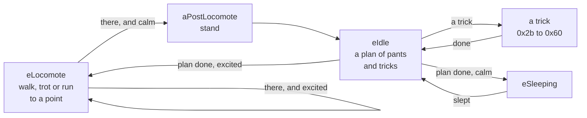

What the dog does is DOGZDLL.DLL's class `PetModule`. It is a state machine: each state pushes scripts ([[format:scp]]) onto the dog's queue, and reacts as the queue plays out a frame a tick. Every choice is `rand() % n` of Borland C's `rand` (seg1:4f11). `src/behaviour/pet.ts` reimplements the states a dog left to itself goes through, and the viewer's **Live** box runs it.

## States

- [[read out]] The engine has 109 states, named in its string table from 10000: 0 `eNOTASTATE`, 4 `eIdle`, 5 `eSleeping`, 7 `eLocomote`, 0x2b `eTrickBegging` to 0x65 `eTrickBalanceBall` (the 59 tricks), to 108 `eIconBeg`. `StateDispatch` (seg21:503f) calls each state's handler; `NewState` (seg21:5bb8) calls the old one leaving, glues the dog by the chest unless the queue is already glued, and calls the new one entering, at once.
- [[read out]] Above the states are global states, from 1000: idle, begging for a treat, playing ball and others, which set what the states do with the user (`NewGlobalState`, seg21:5dfa). Left alone the dog is in 1000, and `EnterIdle` starts it walking.
- [[read out]] A handler pops the queue each tick (`ScriptSprite::PopScript`), which shows a frame and returns flags: 1 when the queue has run out, 2 when the dog has reached its target, 8 when the queue says which state to go to next (`0x8b07 n`).

## Positions and transitions

- [[read out]] Every script goes from one of 59 positions to another ([[format:scp]]), and each position has a kind, the word after its name: 1 moving, 2 lying, 4 on its back, 8 sitting, 16 standing, or a sum (`GetNeutralType`, seg7:2cfd). `walking` is 17.
- [[read out]] `LoadScripts` keeps, for each pair of positions, the first script in the file from the one to the other (seg7:2180). Its test for a flagged script and its test for any are in the same pass, so the flag changes nothing.
- [[read out]] To play a script, `PushStoredScript` (seg7:4367) first takes the dog to where it starts (`PushTransitionToNeutralPos`, seg7:3d2f): the pair's script, or the first two that join, or the first three, each later one glued by the chest; then glues by the belly, unless the script is the one just played. A sitting dog standing up stands up excitedly instead (script 202 for 73) when `rand() % 30 + 30` is below its excitement; a clumsy one trips (224 for 10).

## The kennel

- [[read out]] Shown the first time, the dog comes out of its kennel (`eLeaveKennel`, 2, seg21:3fc8 — unless on the desktop, where it guards the screen): `DoPlayAnimation` (seg14:017a) sets its angles straight, drops its script, and has it come out (script 93 or 92, one at random), put with the middle of its rectangle at the middle of the kennel's — `PetParams` +0x50 to +0x56, less the stage's place (+0x1c) — and then leaves it alone. The kennel is the toolbox's dog button, a window of [[file:DOGZ.DOG/DOGZ.WAD]]'s beside the playpen (seg4:6951); on the oracle's screen its middle is 226 left of the playpen's top left corner and 98 above it, so the dog comes out off the stage and walks on.

## Idle

- [[read out]] Entering idle with no plan, the dog stands, if `rand() % 100` is below its excitement, or sits, and makes a plan (`SetupIdle`, seg16:0104): `rand() % (13 − e/10) + 6 − e/20` items, e its excitement. Each is a trick if `rand() % 100` is at most e; otherwise one to four runs of one to three pants, each run maybe followed by a pant looking about.
- [[read out]] A longer pant is meant to follow too, but the engine tests `(rand() == 0) % 3`: one time in 32,768.
- [[read out]] As the queue runs out the next item plays (`DoIdle`, seg16:02ce): a pant is script 2 standing or 74 sitting. When the plan is done the dog sleeps if `rand() % 30 + 30` is more than its excitement, and otherwise walks off. A dog of excitement 59 or more never sleeps so; one below 30 always does.

## Tricks

- [[read out]] An idle trick is chosen by picking one of the 59 at random until one passes, in this order (seg16:0724 to 088f), every test against [[format:tdt]]:
  1. the dog's excitement is within the trick's range of the excitement it suits;
  2. its idle weight is at least `rand() %` the sum of all idle weights;
  3. `rand() %` each of ham, sickness, groom and bark is at most what the trick tolerates of it;
  4. it is not a trick with the ball.
- [[read out]] The dog then turns to face the user, if it faces further away than the trick allows: turning round on the spot if that is enough, otherwise walking round (`DoBeggingTrick`, seg18:0722). Rotation 0 faces the user.
- [[read out]] `PushTrick` (seg21:708a) plays a trick's script, from a table of six bytes a trick at DS:0x216e, `repeats + rand() % extra` times, with cues before and around it. Five tricks it plays its own way: roll-and-wiggle one of four rolls at random, run-in-circles a run drifting 8 to 11 a frame round, bark sitting or standing, boing spinning, sneeze glued between.
- [[read out]] When begging, `PickTrickState` (seg21:6907) asks the brain ([[topic:brain]]) first, and picks at random only when "brain has no opinions".

## Sleep

- [[read out]] Unless on its back, a dog going to sleep circles (script 212) and lies down (213). It sleeps through a plan of 10 to 24 stretches, each one of five sleeping scripts played a few times, broken every six to twelve stretches by one of two others (`PushSleepScripts`, seg16:1f61, the scripts at DS:0x20a4 and 0x20b8). Then it goes back to idle. Being disturbed wakes it; not yet played.

## Walking about

- [[read out]] `PickLocomotionAction` (seg21:837c) walks (13), trots (71) or runs (9) by `((rand() % 21 + e − 10) × 3) / 100`; a hammy dog sometimes struts (241) or marches (111), and a dull one walks sadly (220). `GetNewTarget` (seg16:177b) picks a point on the stage, 60 pixels in from its edges, at least 400 pixels away — or, on a smaller stage, half the diagonal inside those margins less 50.
- [[read out]] Reaching it, the dog stops if `rand() % 150` is at least its excitement, and otherwise picks another (`DoLocomote`, seg16:1263).
- [[read out]] Steering is the sprite's (`ScriptSprite::SetTargetLocation`, seg7:295e; `PopScript`, seg7:6b38 to 6d24). A target is a point, a rate of turn — 6 in 256ths of a turn a frame — and a box. Each frame the target is reached if it falls in the box: as wide and high as given, centred ahead of the nose (ball 55) by the box's diagonal over a distance, 4, the way the dog faces (`MakeFocusRect`, seg7:3565). Otherwise the dog's rotation is set turning towards `atan2(−dy, −dx) × 256 / 6.283 + 64`, wrapped to ±128, from the middle of the rectangle it is drawn in, the shorter way round (`AngleFudger::SetTarget`, seg4:0e98).
- [[read out]] The box is the pet's standard size — frame 35 drawn side on (`FigureOutStandardWidthAndHeight`, seg21:0289) — times 0.8 walking, 0.5 trotting, and 1.2 by 0.7 of its width running (`GetLocomotionFudge`, seg21:85ad). Walking about, the target is set again at the start of each stride (cue 4).

## Chasing

- [[read out]] `DoTargettedLocomote` (seg21:79d4) runs every state that chases something: the cursor (3, and 0x13 to be petted), the treat held (0x26), a wall (0x54), the ball. It walks, trots or runs — trotting after the cursor to be petted, running at the wall, by excitement after a treat — steering at the target each stride. A user waggling the target hurries it: a walk to a trot, a trot to a run (`PickFasterLocomotionAction`).
- [[read out]] Reaching it, the dog waits to be petted, does a trick for the treat (`PickTrickState`), or lunges at the wall (`DoLungingWall`, seg16:22c1: turned to it, scripts 263, 228, and 227 two to four times). Running or trotting, a clumsy dog trips (`DoLocomoteTrip`, seg21:8735: script 155 or 24 out of a run, 204 out of a trot) and goes back to what it was doing; stopped out of a run, it skids (script 205) one time in three.
- [[read out]] The wall chased is the far one: the stage's right edge less the standard width if the dog is in the left half, else its left edge plus it, at its height give or take 70, kept 150 from the top and bottom.

## Excitement and the factors

- [[read out]] A dog's nature is eleven factors, from 1 to 100: excitement, naughty, grab object, clumsy, groom, ham, bark, sickness, spray fear, frustration and age, in the order of the breed's `[Default Factors]` ([[format:lnz]]). Each line is a centre and a spread. `LoadFactors` (seg21:1ec5) sets each factor to its centre moved, either way, by `spread − √(rand() % spread²)`: near the centre more often than not. Age sets factor 10, and a younger dog is clumsier, by (100 − age) / 3.
- [[read out]] Excitement is not fixed: it is `100 × ((1 + sin(φ + π t / 24,000)) / 2)^((100 − c) / 25)`, t the engine's clock in ticks of 17 milliseconds, c the excitement's centre (`PulseTrickData`, seg14:1783). It rises and falls over about 13 minutes, and a calmer breed spends longer low. Setting it moves φ so that it is the value set, now (`SetExcitement`, seg14:2363).
- [[read out]] Now and then the other factors step 1 back towards their centres, as the trick weights do ([[format:tdt]]).

## The cursor

- [[read out]] [[file:DOGZ.DOG/DOGZ.WAD]] hands the engine the cursor, in the playpen's coordinates, and the primary and secondary mouse buttons, read with `GetAsyncKeyState` the way `SwapMouseButton` says they are (seg4:014d and 0187 of `DOGZ.WAD`). It draws a frame every 45 milliseconds at most (`ReallyDoDrawFrame`, seg21:3dee), so about 22 a second.
- [[read out]] Each frame the engine keeps the cursor's last thirty positions and buttons, and works out whether it waggles: over the last five frames, moving 8 pixels a frame or more, but never more than 100 from where it is now (seg21:4700 to 4899).
- [[read out]] What is under the cursor is a ball: `Ballz::HitTest` (seg10:46d8) tries the balls nearest first, each a square as wide as it is drawn. Each ball is a part of the body, set one by one in the `Ballz` constructor (seg10:0051 on): 0 the head, ears and neck, 1 the tongue, 2 the face, 3 the hindquarters and the root of the tail, 4 the right leg, 5 the left, 7 the tail, 8 the chest, belly and shoulders.

## Petting

- [[read out]] Every frame, `DoPettingHandler` (seg17:0000) takes for petting the button held down over the dog for four frames running, with the cursor moving in at least two of them; not while a treat is held, not while the dog is running. Petting starts the global state 0x3f3.
- [[read out]] A click on a standing dog's face, a leg or the tail is a poke: `ePettingBad` (seg17:1416). Its bark factor rises by 5; poked in the face it shies or snaps (one of DS:0x20ca), elsewhere it growls or flinches; three times in four it shakes it off.
- [[read out]] The dog wants petting on one of three spots, picked by chance — the chest, 20 in 100, the belly, 30, the rump, 50 — for a few strokes before it picks another (`PickNewPetSpot`, seg17:192b). The cursor is on the spot within 0.8 of the spot's ball's drawn width either side of it, at any height within 300 pixels (`IsCursorOverPetSpot`, seg17:17de).
- [[read out]] Facing the user or away, the dog first turns side on and walks back or forth until its spot is under the cursor (`DoAligningPetting`, seg17:08f7); then it waits, panting, 20 to 39 pants before it gives up (`DoWaitPetting`, seg17:0410); a cursor that leaves it is followed.
- [[read out]] Each stroke (`DoPettingGood`, seg17:0e25) raises how much it has enjoyed the petting, up to 16. Stroked on the head or body it leans into the hand (scripts 47 and 45), on the hindquarters it thumps a leg (64, 65, 66), and the more it has enjoyed, the likelier, out of 16, it rolls onto its back instead. On its back it wriggles (DS:0x20c4); enjoyed past 14, rolled on its back, and calm enough by `rand() % 150` against its excitement, it falls asleep.
- [[inferred]] How the dog turns side on to be petted is not yet read; the reimplementation turns it a quarter turn.

## Food and treats

- [[read out]] The food sprites are, in order, `Food`, `Water`, `BlueTreat`, `GreenTreat` and `RedTreat` (`FoodSprite::theirNames`), and each is a global state, 0x3eb to 0x3ef. `FoodSprite::Update` (seg20:0de4) sets them: a treat picked up starts the dog after it; put down, the dog goes to eat it; picked up again while it eats, it begs again; put back in the box, it is left alone.
- [[read out]] For a treat held — or the ball, or the shoe — the dog sits up and begs, five to ten times (script 14; `DoBegging`, seg18:0bec). Settled (cue 0), it follows the cursor, by two boxes about its belly ahead of it the way it faces (`MakeFocusRect`), one twice its standard width, one its width: the cursor out of the first, it chases what it begs for (`eBeggingChasing`, 0x26, at the thing itself, `0x11d4`); come into the second, it reacts (script 41); both now and six frames before outside the second, it chases on its hind legs (`DoBeggingChasingHindLegs`, seg18:23f2: script 33 once or twice, steering with a box half its standard width and 40 more) if the cursor is level with its middle — within 10 of 256ths of a turn (seg11:1f57) — 60 times in 100 (`0x1ce4`, set by `ResetParams`), and else shuffles after it (15, steering at it, then 18). Waggled at a settled dog, the treat brings a trick at once.
- [[read out]] Begged out, the dog's brain is woken. Then `ActivateBrain` (seg18:290d) wakes the brain ([[topic:brain]]), telling it the treat was brought out, and `PickTrickState` chooses: the dog's frustration rises by 4, and if `rand() % 420` is below it, and again below its grab-object factor, it snatches the treat from the user's hand (`DecideIfGrabFromUser`, seg14:215e). Otherwise it does a trick: the brain's choice, or, when "brain has no opinions", one at random that needs no ball.
- [[read out]] After a trick done begging, it pants and waits for the treat, from `(100 − e) / 20 + 1` pants to nearly four times as many, sitting more often the calmer it is (`PushBegWaitLoops`, seg18:25e0). Waggling the treat while it waits has it do another trick at once; taking the treat away has it follow.
- [[read out]] A treat put down is eaten in one bite (script 86; `DoEating`, seg18:12cb). Its cue 10 is the bite: the treat is gone, the dog's frustration settles to its centre, and, only if the brain was not yet woken, the trick last done is rewarded ([[format:tdt]]). So the trick weights learn only from a treat given before the dog has begged; once it has, what it learns is the brain's.
- [[read out]] Each food is a picture: `InitFoodSprite` (seg20:0a5e) loads bitmap `0x283a + kind` for a treat — 10300 the blue, a doughnut; 10301 the green, a triangle; 10302 the red, a bone; each 32 by 32 — and four, `10000 + 10 × kind` on, for the bowls of food and water as they empty. Held or put down, a treat is drawn as the ball is, over or under the dog by its facing (see Fetch), and its rectangle is kept on the stage and picked up by a click anywhere in it.
- [[read out]] Snatched, script 240's `0x8b03 2` takes the treat into the mouth (`GrabObject`, slot 2, the food): `PickTrickState` has allowed the dog to take it from the hand (`0x96`, seg21:6b1d), and it is drawn at the chin (`FoodSprite::StaticDrawGrab`) until it is eaten.
- [[read out]] Eating, at cue 0 the food's own sprite is hidden and `DoEating` has the dog draw it, where it lies, just before the first of the breed's `[Head Balls]` (`FoodSprite::StaticDraw`), so under the head, and a bowl's front picture after them (`StaticDrawFront`); cue 10 eats a treat, and cue 13 or leaving gives the sprite back (seg18:1c62 on).
- [[read out]] A bowl taken out of the toy box is filled with `rand() % 11 + 25` servings (`FoodSprite::Update`), and shows full, half or empty, its picture `((full − left + 2) × 2) / full`, at most 2: half once half are gone, empty with two left. A dog held a bowl begs for it as for a treat, but never snatches it: only a treat is grabbed from the hand (`PickTrickState`, seg21:6927).
- [[read out]] To eat, `DoEating` first clears the queue (`ResetScript`, seg7:2dd0) and eats only if the box ahead of its nose meets the food's rectangle (seg18:1460 on); otherwise it goes after it. Lined up, it sits up unless running, eases its turn towards the food if facing the other way, by a third of how far the nose is from it, at most a quarter turn, and slides its nose to above the food, by `(age − 1) × 10 / 100 + 40` (`× 13 / 100 + 49` running), and by `−rotation / 16` across (seg18:14d9 to 16f1).
- [[read out]] At a bowl of food it stands over the bowl (script 37) and eats a mouthful (36) for every serving left, now and then a second (54, one in six) and every 5 to 15 a pause (328); after each, cue 12. At water it laps (262) three to six times, by how full the bowl was filled, not by what is left. Cue 14, before the first, checks that the tongue (ball 63) is on the bowl, within 14 of its sides and up to 20 above it; else the dog goes after it again (seg18:2041).
- [[read out]] Cue 12 takes a serving from the bowl, and from the food bowl makes the dog fuller (`0x188`), one a mouthful, one worn off every 420 ticks (`FoodSprite::Update`). Fuller than half again the bowl, it stops, stands, is sick (script 287) and its excitement drops below 10, and it is 5 fuller (seg18:1f2d on). Fuller than that by 7, it will not eat from a bowl put down or held while it eats.
- [[read out]] Left alone, a dog goes to a treat out of the box at once (`CheckDesktop`, seg16:20b6). Otherwise it picks one of the things out, not the one it last left: a bowl once long enough has passed since it was last eaten from or held — `(315 − 300 × left / full) × 60` ticks for food, `(325 − 275 × left / full) × 60` for water, so about 15 seconds for a full bowl of food and five minutes for an empty one — and anything else only if its excitement is 70 or more.
- [[inferred]] How the dog walks to food put down is simplified: it steers to the food as when chasing, and starts eating when the box ahead of its nose a walk's size meets the food. `CheckDesktop` starts at a random one of all the stage's sprites; the reimplementation picks among the things out at random. Not yet read: the further lift of 0 to 7 that `DoEating` gives when the pet sprite's method at 0x80 returns 1, and `0x8ae8 0 0 6`; a slide is taken to end when the queue is cleared.

## Fetch

- [[read out]] The ball is a sprite of its own, `BallSprite` (seg20). Taken out of the toy box it starts the global state 0x3f0, playing ball (`EnterFetch`, seg19:0000): held, the dog begs for it as for a treat, and picks tricks by their play weight ([[format:tdt]]); a frustrated, grabby dog may leap and snatch it from the hand (`PickTrickState`, seg21:6907). Put back in the box, the dog is left alone.
- [[read out]] The ball is a picture: `InitBallSprite` (seg20:1c68) loads bitmap `10200 + 10 × kind` of [[file:WINDOWS/DOGZDLL.DLL]], and `InitPetModule` makes one ball, of kind 0 — 10200, a red ball 31 by 29 pixels. Its rectangle is that size, centred on where it is, half the size rounded down to the left and above (`XSprite::MoveSpritePt`, seg11:01a1). A click anywhere in the rectangle picks it up (`GrabSprite::Update`, seg20:018c).
- [[read out]] Held, the ball's rectangle is centred on the cursor and kept on the stage, and its speed is half how far the cursor moved since the frame before (`BallSprite::Update`, seg20:20b8). Let go, each frame it loses a fortieth of its speed, stops once below a pixel a frame each way, moves by the whole pixels of its speed, and bounces straight back when its rectangle is past an edge of the stage, moving out (`UpdateLocation`, seg20:2634). It is moving fast above 120 pixels squared a frame (`IsMovingFast`), and `ProjectLocation` rolls it on so many frames to say where it will be and how often it will bounce.
- [[read out]] Thrown, the dog's frustration settles, and it chases the ball, if `rand() % 30` is below its excitement plus 10 or its head is off the stage; otherwise it sits and watches, six to ten pants, and loses interest (`DoObservingBallThrown`, seg19:022b).
- [[read out]] Chasing (0x18), it steers at where the ball will be four frames on (seg21:7a8f). Running, if the ball will pass within 75 of a point 200 above its chin in the next fourteen frames without bouncing — or bouncing once, if at the throw `rand() % 105` beat `50 + (clumsiness − 1) × 50 / 100` (`0x19e` of the ball, seg20:22b6; the ball's method at 0x40 reads it) — it leaps for it (seg21:7f4d: scripts 26 and 25, `DoJumpingGrabbingBall`, seg19:0e30); a clumsy dog misses (60 to look again, maybe). Reaching a ball that will not bounce in four frames, it grabs it (`DoGrabbingBall`, seg19:0941): a pounce (29) if the ball has not moved since it put it down, otherwise reaching down (82) and grabbing (81) (`PushBallGrabAction`, seg19:2bf9); a clumsy dog fumbles it (185, 186) and chases it again.
- [[read out]] `0x8b03 slot` and `0x8b04 slot` in a script grab and let go of the object at play (`GrabObject`, seg14:04e4, and `ReleaseObject`): slot 0 is the mouth, ball 51, the chin, and slot 1 a paw, ball 45. Held, the ball goes where that ball of the dog goes; let go, it rests at the chin, whichever held it (`ActualReleaseObject`, seg14:0da0). `GrabObject` takes the ball wherever it is, only not from the user's hand unless the dog is snatching it.
- [[read out]] `0x8af4 ball x y` slides the dog so that its ball meets a point; `0x7ffd` for x is the ball at play (`PopScript`, seg7:5e98 and 7144 on). `PopScript` saves itself (`SaveEnvironmentVars`) and plays the queue ahead, its easing and drift too, until the end of the next script (`0x8b0b`), a cue 2, a state named, or the queue's end (seg7:667e); it reads where the ball is then, restores itself, and moves the dog by a share of the difference each frame for that many frames. Cue 2 ends a slide early (`ProcessCue`, seg7:7c1d), and cue 3 resets the dog's easing and drift (`ResetParams`, seg7:33ae). So the grab lands the chin on the ball, the leap meets it in the air, and the dog's nose comes to its food.
- [[read out]] With the ball, a dog decides whether it is naughty, `rand() % 100` below its naughty factor (`DecideIfNaughty`, seg14:20a6). Good, it runs back to the user (0x19: at the cursor, kept within 100 of the dog); naughty, somewhere far from the dog and the user (0x1a, `GetNewNaughtyTarget`, seg19:275f). There it stops, turns round if facing more than 0x50 away, and drops the ball (script 8; `DoReleasingBall`, seg19:033d, `PushBallReleaseAction`, seg19:2a84). A naughty dog snatches it back when the cursor reaches for it.
- [[read out]] Then it waits for the next throw, doing a trick or two by play weight between pants (`DoAnticipatingBall`, seg19:101d; a naughty dog guards it instead, below); if the cursor moves off, it takes up the ball and brings it again, and after enough it loses interest and goes back to idle. A trick with the ball needs the ball free and within a box half again its standard size ahead of it (`IsBallGrabbable`, seg19:018e): nosing it (102), walking on it (88, 89), bouncing on it (87), throwing it (97) and chasing it, balancing it (85) (`PushBallTrick`, seg21:6bde).
- [[read out]] The dog and the ball are drawn in an order kept every frame (`GrabSprite::Update`): the ball over the dog when the dog faces the user, within 0x41 of it, and under it otherwise. Held by the dog, the ball is drawn with it: `ActualGrabObject` (seg14:0842) hides the ball's sprite and gives the chin, ball 51, a bonus drawing (`Ballz::SetBonusDrawProc`), which `DisplayBallzFrame` calls just after drawing the chin ([[topic:drawing-a-dog]]). It draws the picture centred on the chin (`StaticDrawMouth`, seg20:293d) or on the toe, ball 45 (`StaticDrawFoot`); so the nose and whatever else is nearer than the chin is drawn over it.
- [[read out]] A naughty dog guards the ball (`DoGuardingBall`, seg19:1ec7): `(naughtiness − 1) × 4 / 100 + 2` rounds of panting, a play trick between, then it stops being naughty and waits for the throw. Called (a double click), unless it decides to be naughty again, it gives in at once. Its head off the stage, it takes the ball off, or goes after it. The cursor within 180 of the ball (`0x1246`, set by `EnterFetch`), or come 40 nearer it over the last three frames, and the owner is too close (`DoOwnerTooCloseToBall`, seg19:22ca): it takes up the ball and growls over it (script 55, two to seven times); the cursor within 180, or by chance one frame in 150, it runs off with it; growled out, it runs off one time in 20, else drops it and guards again.
- [[read out]] A throw pulled back fools it (`BallSprite::Update`, seg20:20b8 to 25fe): with the ball held and the dog moving, standing or sitting up, each frame the cursor's distances from its places the last four frames are taken in turn, and one falling by more than the fake distance (`BallSprite::theirFakeDistance`), with none rising by more after it, is a fake — the fourth place, as the engine reads it, being the ball's holder flags, (0, 0) while held. The distance starts at 0, grows by 50 with each fake, and each throw takes 13 off it, to no less than 50. Fooled (`DoFakingBall`, seg19:1a98), the dog runs (script 9), steering from each stride with a box its standard width by half that, at a point fifteen times the longest step of the ball's last four places on from the earlier — the step's x used for its y as well — and then negated, so up and to the left off the stage; at the end of its run, or once wholly off the stage, it looks about (60) if it is wholly on it, and begs for the ball still held, or waits for a throw.
- [[inferred]] The distances `GetNewNaughtyTarget` is called with are inferred.
- [[inferred]] On a stage smaller than Dogz's own screen a dog runs far enough to drop the ball off it, and fetches it again and again; the viewer's live stage is 640 by 480, as the game's.

## The spray bottle

- [[read out]] The spray bottle is a sprite with two pictures, 10400 at rest and 10401 spraying (`InitSpraySprite`, seg20:15c2). Held with the button down, it sprays; it is drawn turned left for right when right of the dog's middle, so it points at the dog (`SpraySprite::Draw`, seg20:18b1).
- [[read out]] Let go of, it goes back in its box, and if the cursor is within the dog's drawn rectangle widened on every side by the dog's standard width and height (DS:0x3bd0, set by `FigureOutStandardWidthAndHeight`), the dog is sprayed (`SpraySprite::Update`, seg20:174d): `NegativeReinforcement`, a yelp (`PlaySound(75)`), its script dropped at once (`ResetScriptHard`, glued by the chest), and `eSprayReact`. No global state is entered: 0x3f4, `EnterSpray`'s, is set by nothing.
- [[read out]] `NegativeReinforcement` (seg14:1bc5): a dog that decided to snatch in its last few chances (`0x1262`, `0x1264` on) is 5 less grabby, and forgets them. Otherwise, left alone, the trick it was at is 5 less likely, idle, never less than 1: the state before the one it is in (`0xc2`, the second of `NewState`'s history at `0xc0`) if the last trick (`0x8b06`) began under a second ago, else that trick; either gives way to the other if it is no trick and the trick was within ten seconds. At play, it is 5 more naughty, or 5 less if it was being naughty, and changes its mind about being naughty.
- [[read out]] `DoSprayReact` (seg14:0f69) lets go of what is under its paw, drops its script again, eases its tilt level, and flinches (script 68) and, glued by the chest, shakes itself off or runs (323, seven variants); then waits for the ball at play, or is left alone. The brain is not told: it has no input for spraying.
- [[read out]] Script 68's flinch bristles the dog's fur, `0x8b01` 2, 4, 4, 3, 2 and 0, a frame or two each (below, breathing and bristling); `DoSprayReact` lays it flat again as it leaves.

## The shoe

- [[read out]] The shoe is a sprite with one picture, 10600 (`InitShoeSprite`, seg20:35ce), and its global state is 0x3f5, which `NewGlobalState` enters through `PetModule`'s virtual `EnterTaunt` (seg3:0000) — teasing the dog with it. Picked up, it starts the taunt, and the dog lets go of it if it had it and charges at once (`ShoeSprite::Update`, seg20:3759); let go of, nothing changes: the dog keeps after it where it lies.
- [[read out]] `EnterTaunt`: with the shoe within a box 0.6 of the dog's standard size about its middle (`MakeFocusRect`), the dog grabs at it (0xf); within 2.1, raised by half its height, it lunges (0x12); else it chases (0xd) or charges (0xe) — charges when `rand() % 175` is at most its excitement (`DecideChasingChargingCursor`).
- [[read out]] Chasing and charging (`DoChasingChargingCursor`, seg3:01d9) run at the shoe (script 9), steering at it from the first stride (cue 4) with a box of the standard size. Held still and further than four standard sizes, the shoe makes a chasing dog prowl (0x10). One frame in a thousand for each point of excitement, a shoe within its reach makes it lunge. At the shoe, it grabs, unless the cursor moved 30 or more over the last three frames (`0x19e`, the cursor's travel each frame, kept with its positions at `0xea`).
- [[read out]] Grabbing (`DoGrabbingCursor`, seg3:06ac): on the run it snaps its chin at where it was steering (script 1, which grabs, `0x8b03 4`); standing, it reaches (215, 214, which does not); then shakes it two or three times (130). Grabbed, if the shoe has gone 15 from where it snapped, it missed; else the shoe goes with its chin, and the engine moves the user's cursor with it — a tug of war — until the shoe is pulled 75 from its chin. A grab is seen by `0xe4` of the sprite, the slot the last `0x8b03` grabbed, reset each frame.
- [[read out]] Stalking (`DoStalkingCursor`, seg3:0b08) creeps (script 206, three to five times), steering with a box 1.2 the standard size; prowling (`DoProwlingCursor`, seg3:0f3c) stops, turned towards the shoe if it was running, and pants `(100 − e) / 20` times and up to as many more. In either, the shoe jumping more than 15 from where the cursor was two frames before sets it off: a lunge if in reach, else a chase or charge. Done, a stalker prowls; a prowler lunges if it can, else stalks two times in three.
- [[read out]] Lunging (`DoLungingCursor`, seg3:141a): it gathers itself (187) and, at cue 12, leaps (168) with its chin aimed at the shoe, kept within its reach. At cue 13, within 50 of the shoe, it hangs from it (167, then 169 six to seventeen times, swaying by a drift of −5 to 5): the dog is drawn so its chin is at the shoe (its rectangle moved), so moving the cursor swings it about. Let go of, it drops with the shoe and shakes it (`0x8b03 4`, 130, `0x8b04 4`); swung more than 230 over three frames, it falls off. Missing, it drops back (171) and two times in three looks about (60 or 184). When it is done, the shoe held, or down on the stage 80 in from its sides (and, as the engine has it, a third of the stage's height in from the right), it goes again, unless it hung last time and `rand() % 100` beats its excitement; else it is left alone.
- [[read out]] Left alone, the dog may come back to the shoe as to anything out (`CheckDesktop`): what it last left is skipped only until it has done something else (`0xda`, set as it leaves `eIdle`).

## The brush

- [[read out]] The brush is a sprite with one picture, 10500, 24 by 32 (`InitPaintSprite`, seg20:2da8), always drawn turned left for right and over the dog (`0x16e`), its paint — the screen's colour 9, bright red — in the brush's colour (`XPicture::XRemapColor`, `PaintSprite::Draw`). Held, it is centred on the cursor, then 10 left and 5 down; its tip is 3 in from its left and 10 up from its bottom (`PaintSprite::Update`, seg20:2f33).
- [[read out]] The colour is the user's choice from a menu [[file:DOGZ.DOG/DOGZ.WAD]] builds (see there): the paint colours are ramps of the palette, set by `XDrawPort::InitStaticDraw` (seg8:0e28) — on 256 colours 20 ramps of 6 from colour 16, painted from each ramp's first; on 16, each of the 16 colours.
- [[read out]] Let go of, the brush goes back in its box, and if its tip is over the dog — the dog's rectangle widened by its standard size, as for the spray — the ball under the tip (`Ballz::HitTest`) is painted, with every ball the breed gives the same `[16 Ball Color]` number, as it came (`0xdd1`, a copy kept of it): each takes the brush's colour, on 256 colours plus its own place in its ramp, its original `[256 Ball Color]` less 16 modulo 6, so keeping its shade (`SetBallColor`, seg10:455f, into the table for the display's depth, `0xdc9`). The tongue (63, 64), the nose and nostrils (55, 17, 41), the eyes (8, 32) and the irises (14, 38) are not painted. The speckles are made again from the new colours (`GenerateSpeckleColors`). The dog does not mind.
- [[inferred]] Whether the engine keeps the paint when the dog is saved is not yet read; the viewer's dog keeps it until it is started again.

## Scruffing and calling

- [[read out]] Every frame, `DoScruffHandler` (seg21:4ec0) picks the dog up by the scruff (`eScruff`, 0xa) when the secondary button is newly pressed within 50 pixels (DS:0x22e6) of its neck, ball 54 — not while the user holds a toy, food or tool (`0x220`, set as the sprites are updated, seg21:4533 on). The primary button is `PetParams` +0x0e, the secondary +0x0c ([[file:DOGZ.DOG/DOGZ.WAD]]).
- [[read out]] `DoScruff` (seg21:637c) lets go of what is under its paw, drops its script at once, sways (a drift of −5 to 5), is picked up (script 4) and dangles (3, again and again) while the button is held: the dog's rectangle is moved each frame so that its neck is below the cursor by half the neck's width (`Ballz` slot 0x38, the ball's drawn size) — held by the top of its neck. Let go of, it goes back to its food or to waiting for the ball, or is left alone.
- [[read out]] Every frame, `DoCallingHandler` (seg21:4d36) answers a call — `PetParams` +0x10, which [[file:DOGZ.DOG/DOGZ.WAD]] sets for one frame on a double click: an idle dog runs to the cursor (`eChasingOwner`), or, with the cursor on it — its rectangle widened by a quarter of its standard size — sits and pants; a dog being taunted with the shoe leaves it and comes.
- [[inferred]] Not yet played: the cursor's shapes the engine asks for (`PushCursorRequest`), the dangling dog's tilt (the pet sprite's method at 0x80, setting a fudger's target, and `0x8ae2`), and its being put down by playing the pick-up backwards (`0x8ad6` from the frame shown).

## Where the dog looks

- [[read out]] The dog's head and eyes each look at a point, or ahead (`ScriptSprite::SetHeadTarget`, seg5:0000, and `SetEyeTarget`, seg7:29fc). The point is kept from the dog's place when it is set, not followed as the dog moves. The eyes have three modes, the frame's own (0), toward the point (1) and straight out at the user (2). `LookAtUser` (seg7:2a78) turns the head toward just past its nose, its x by the dog's rotation and its y by 10, and the eyes straight out; `LookAtRandomPoint` (seg7:2b1c) turns both to `rand() % width`, `rand() % height` of the stage; `LookAhead` clears both. Cue 7 clears both and stops anything being looked at until cue 6, and `ResetParams` clears both and lets it look again.
- [[read out]] Each frame (`UpdateHeadTracking`, seg5:00c2, from `PopScript`), with a point to look at, the head turns toward it as if it were 100 away — `angle(−dx, 100)` across, less the dog's own rotation, and `angle(−dy, 100)` up — at most 13 256ths of a turn a frame on the axis furthest to go, the other in proportion; and no further than 51 hundredths of its reach left or right and 42 up or down, each reach a fudger of its own (`HeadTrackMaxLeft`, `Right`, `Up`, `Down`, axes 8 to 11, at `-0x71fc`, `-0x71fa`, `-0x7200` and `-0x71fe`), 100 from the constructor; no script or state moves them (the dog's angles, below). With nothing to look at, it turns back the same way, and stops being turned once it is straight.
- [[read out]] While the head is turned it wobbles (`Ballz::HeadTrackPrep`, seg5:05ba): fourteen `Lube`s (DS:0x1ba on, each 0x48 bytes, set up at seg5:0d1b) each wait until the time in milliseconds passes their next, then glide to a point at random in their range over a random number of frames, and wait again up to 5 seconds. They give the head a roll, within ±42; a drift of the neck, ball 54, it turns about; and an offset, its height less half its depth; each a share of the turn plus a wobble, scaled by the dog's `headWobble` (`0x550` of the pet sprite) in hundredths, or not at all at 0. Not turned, the wobbles are put back to rest. The head's balls are turned about the neck, roll, nod and turn, before the dog's own angles ([[topic:drawing-a-dog]]).
- [[read out]] The states set the targets themselves:
  - **Idle**, before each frame, the head and eyes look at the cursor if it moved the frame before; otherwise, after cue 12, at a random point. Idle sets `headWobble` to 100; leaving it clears both.
  - **Begging** looks at the cursor every frame; it sets `headWobble` to 30 and clears both on leaving.
  - Waiting to be petted, doing a trick to beg, waiting for a throw and guarding the ball, the dog looks at the cursor whenever it moves.
  - Watching a ball thrown, it looks where the ball is.
  - Chasing, charging, stalking, prowling and lunging at the shoe, it looks at the shoe every frame. Chasing sets `headWobble` to 20, and back to 100 on leaving, and asks `HeadTrackMaxAll` for 20 and 100, which moves nothing (below).
  - Sleeping clears both on entering, and waiting for a throw and the chases (`DoTargettedLocomote`) clear both on leaving.
- [[read out]] The script opcodes `0x8afa`, `0x8afb` and `0x8afc` ([[format:scp]]) call `LookAtRandomPoint`, `LookAtUser` and `LookAhead`.
- [[inferred]] The wobbles draw from the same `rand()` as the rest, and only while the head is turned. The reimplementation's clock for them is its tick times 17 milliseconds.

## The dog's angles

- [[read out]] Besides its rotation, the dog has `Fudger`s (seg4) that ease its other numbers, made in `ScriptSprite`'s constructor (seg7:0f5b on) with an axis and a mask: 0 its tilt (`BallState` `+0xe`), 1 its rotation (`+0xc`), 2 its spin (`+0x10`), 3 its roll (`+0x12`) — these four `AngleFudger`s, going round the short way — 4 and 5 the left and right eyelids' heights (`+0x24`, `+0x26`, from 100), 6 and 7 their tilts (`+0x20`, `+0x22`), 8 to 11 the head's reach left, right, up and down (100). The names are at seg7:00e3.
- [[read out]] Each has a target and a step a frame (`SetTarget`, seg4:0e32 and 0e98; `DoIncrement`): it steps until less than a step away, then lands on the target; and a drift, a step every frame (`DoDrift`). The scripts set them by axis: `0x8ae6 axis to` eases to `to` over the frames left in the script, a whole step more than the share of each (`SetTargetFudge`, seg4:0f37); `0x8ae7 axis by speed` to the value plus `by`; `0x8ae8 axis to speed` to `to`; `0x8ae9 axis by` drifts (seg7:5cfd to 5e6f, through thunks to the fudgers' slots 0x34 to 0x40).
- [[read out]] An axis from 12 is a group, by a mask in `Fudger::theirMultiFudgeFilters` (seg27:0000): 12 everything, 13 both eyelids' heights, 14 both their tilts, then 1 and 8 — the rotation, and the tilt, spin and roll — for 15 and 16, whose names say the head's reach; from 17, `HeadTrackMaxAll` on, nothing. So the engine's `0x8ae6 17 20` as the dog chases the shoe moves no fudger.
- [[read out]] The scripts turn the dog round with `0x8ae7 1 128 10` (scripts 78 to 80) and a few 256ths at random (172); ease its tilt and spin level (`0x8ae6 0 0`, `0x8ae6 2 0`); and slant both eyelids with `0x8ae8 14`: −30, a frown, shaking off the spray (323), −20 and −10 elsewhere, 30 and 40 drooping, sick of food (283) and calmed (287), and back to 0. Script 283 also opens both lids to 100 (`0x8ae8 13 100 1`).
- [[read out]] `ResetParams` stops every fudger (`Fudger::Reset`: no step, no drift) and eases the eyelids' tilts level at 10 a frame (seg7:3430 to 3453). The engine sets the tilt itself only to level it: scruffing (0 at 10 a frame), leaping for the ball (0 at 4), begging as an icon and birthing (0 at 180) — through the pet sprite's method at 0x80 (seg7:82d1). `0x8af3` would tilt the dog toward the point it steers at (seg7:6c79 to 6d1c), but nothing uses it, and `0x8ae2` only prints a message. So in play the dog is never tilted, spun or rolled.
- `src/behaviour/fudger.ts` plays the fudgers, and the drawing turns the dog by them ([[topic:drawing-a-dog]]).

## Growing up

- [[read out]] The adopted dog is a puppy and grows up a day at a time. As Dogz starts, `InitStaticIni` (seg2:0190) reads the dog's `age` from [[file:DOGZ.DOG/DOGZ.INI]], and the day and month it was last started (`last day use`, `last month use`, by `getdate`, seg2:030a); started on another day, it adds one to the age and writes the age and today back (seg2:0367 to 03a6), with a message, "incrementing age". The year is not kept, so the same day a year on is no new day.
- [[read out]] `PetModule::LoadFactors` (seg21:1ec5) makes the age factor, 11th of the dog's factors, `age × 100 / 10`: ten a day, kept to 1 to 100 by `SetFactor`, so a dog is grown at ten days. With no `Your Pet` in the INI (`PetParams` +0x58, set by `InitStaticIni`) the age is 0 and the factor 99, or 1 if +0x5a is set too. `DOGZ.WAD` sets +0x58 at seg4:06d8 and then +0x5a (seg4:0712), on a path not yet followed.
- [[read out]] The age factor makes a puppy: on every frame drawn (`ReallyDoDrawFrame`, seg21:49a0) `SetBallScaleFromAge` (seg21:4c4c) sets the scales between the puppy's and the adult's by it, and the puppiness, `100 − age`, which enlarges balls by `[Puppy Balls]` ([[topic:drawing-a-dog]]); `LoadSoundList` (seg7:02f1) plays the puppy's sounds until it is past the breed's maturity ([[format:lnz]], `[Sound List]`); and `LoadFactors` makes a puppy clumsier, its clumsiness centred `(100 − age) / 3` higher, up to 33.
- `src/behaviour/age.ts` grows the dog so (`startOn`, `ageFactor`). The viewer keeps its dog's age and the day it was last opened in the browser, as the INI keeps them, and grows it a day each new day; its age slider starts at that dog's factor and may be moved to see any age, and New puppy starts again from day 0.

## Breathing and bristling

- [[read out]] The dog has a heart rate, in tenths, 40 to start (`0x2094`). As each script starts (`0x8b0a`, `UpdateHeartRate`, seg7:79ab), it goes toward the rate of the positions the script goes between — their average, one standing in for the other if it has none — up 1.5 or down 0.5 a script. The rates are `ScriptSprite`'s, a word a position at seg26:0x70: 20 asleep, 30 sitting, 40 walking or panting, 60 standing, 80 sitting up or rolling over, 110 running.
- [[read out]] `0x8aff frame` (scripts 27 and 75, panting from frames 38 and 839) has the dog breathe by it (`0x2096`): every frame (seg7:6aea) its motion scale's target is the heart rate (`GetHeartRate`, seg7:7a80, `SetMotionScale`), and the scale (`BallState` `+0x32`) eases 5 a frame toward its target (seg7:5841). `GetCartesianCoordinates` puts each ball the scale's share of the way from where the reference frame has it (`+0x34`, `SetMotionScaleReferenceFrame`) to where the frame does: a calm dog pants less than the frames show, a dog that has run pants more. `0x8b00` (28, 76 and 202) stops it, the scale back to 100 at once; `ResetParams` stops it too and lets the scale ease back.
- [[read out]] `0x8b01 n` sets how many levels every ball's fuzz is raised by (`+0x46`; `DisplayBallzFrame` adds it to each ball's level, seg10:526c and 528b, and the kernel keeps it to 7): the fur bristles.
- [[read out]] What a script has after its last frame — script 219's turn round (`0x8ae5 1 128`), 28's `0x8b00`, a cue — `PopScript` reaches on its way to the next frame, so it takes effect then. `src/behaviour/timeline.ts` hands it on (`tail`), and the reimplementation does it as the next frame is reached.
- [[read out]] `0x8aef frame weight` would blend one frame with another for a frame (`+0x42`, `+0x44`), but no script uses it.

## Blinking and the eyelids

- [[read out]] How far the eyelids are closed, in hundredths, is set every frame by `ScriptSprite::Pulse` (seg7:7403): the greater of where they rest and a blink. A blink comes after a wait of 40 to 49 frames (`rand() % (40 / 4) + 40`, `-0x7216` and `-0x7218`) and lasts 5 frames (`-0x7214`): a third shut, then shut, two thirds shut on its last frame, and open. The wait is drawn as each blink ends.
- [[read out]] The lids rest 30 closed (`-0x721e`, set by `ResetParams`), 20 looking at the user (`LookAtUser`), or as a script's `0x8ae0 n` says, 30 for a negative n; it also drops a blink asked for and cuts one under way short. `0x8ae1 n` blinks for n frames, or the usual 5 for 0 (`DoBlink`, seg7:28fc): at once if a blink is under way, else on the frame after next. The sleeping scripts blink for 5000 frames, so a sleeping dog's eyes stay shut; lying down, the scripts close them by steps.
- [[read out]] Walking and running, before each stride the dog's lids are set by its calm: `(100 − excitement) × 0.4 + rand() % 20`, at most 45 (`GetEyelidHeightFromExcitement`, seg21:78da, pushed as `0x8ae0` by `DoLocomote` and `DoTargettedLocomote`).
- [[read out]] `Pulse` also eases the lids toward their rest by up to 66 a frame (`-0x721c`) before setting them, to no effect. How they are drawn is [[topic:drawing-a-dog]], the eyes.
- [[inferred]] The blinks draw from the same `rand()` as the rest, as each blink ends, in the order the reimplementation runs `Pulse`: after the state's frame, before the brain.

## Not yet

- [[read out]] Guarding the screen (`eGuardingScreen`, 0xb, `DoGuardingScreen`, seg16:08fb), barking at it (`eGuardingBarking`, 0xc) and begging as an icon (global 0x3ea, `DoIconBeg`) are for Dogz on the Windows desktop: they are entered only when `PetParams` +0x5e, the way the pet is shown, is 3 (seg21:0000), or the window is an icon, and the viewer is a playpen. `eGuilty` (0x69, `DoPlayAnimation`), `eBirthing` (0x6a) and `ePoo` (0x6b) are entered by nothing in the engine. None is played; nor, at play, turning to the ball before a grab (`0x8ae8`), or the ball moved during a ball trick (`0x8aed`, `0x8af4`).
- [[read out]] `eTumbling` (0x24, `DoTumbling`, seg19:253d: a trip, script 24, at whose cue 12 the ball is let go of and flies off at 20 to 49 along the dog's angles) is entered by nothing in the engine — no `NewState`, goto or table names it — and is not played.
- [[read out]] `DoTargettedLocomote` passes the target's distance from a local it never sets; the reimplementation passes 4, as `DoLocomote` does.
- [[read out]] `ResetScriptSoft` (seg7:31f1), which a state calls leaving, lets the script playing finish and drops the rest, then queues cue 3 and a glue: the ball given, or the one the queue was glued by, or the chest. `ResetScript` and `ResetScriptHard` drop it all at once and call `ResetParams` (seg7:33ae) themselves; cue 3 calls it once the soft reset's script has played. It stops every `Fudger` easing and drifting the dog's angles, clears what the dog looks at and lets it look again, puts its eyes back to their size and its eyelids and blinks back to how they start. So a turn a trick leaves drifting stops when the next state begins.
