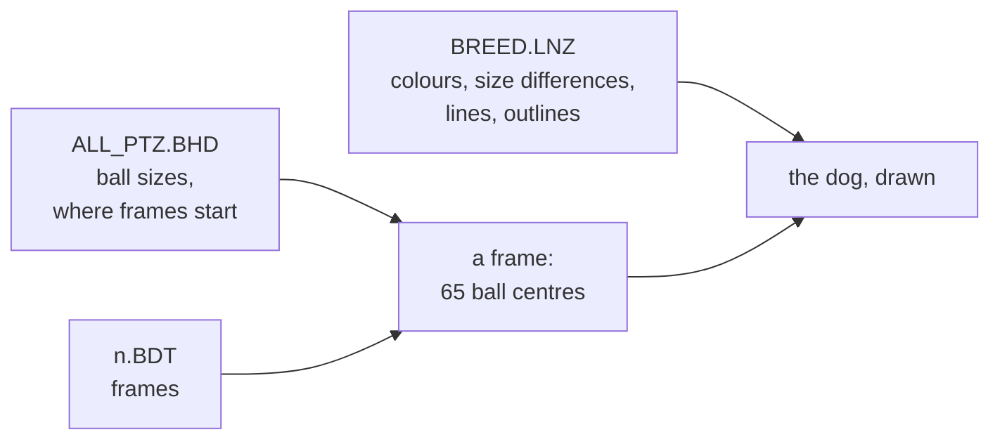

Dogz draws its pets in real time, out of balls: filled circles in three dimensions, drawn nearest last, joined by thick lines. Every breed shares one skeleton of 65 balls and its 36 animations ([[format:bhd]], [[format:bdt]]). A breed file ([[format:lnz]]) says how each ball looks. [[file:WINDOWS/DOGZDLL.DLL]]'s class `Ballz` and `XDrawPort`'s `XFillCircle` are where the game does it.

## What the viewer does

`pnpm dev`, then `/viewer.html`, draws any breed in any frame of any animation, on either display, from the game's own files: the oracle's, in development, or the drive Dogz is installed on chosen in the page, which never leaves the browser.

- [[read out]] Positions: x across, y down, a larger z farther ([[format:bdt]]). Balls and lines are drawn in the engine's order, kept from frame to frame (below).
- Sizes and places: as Dogz places a ball, for the breed's scales at an age and a way the dog is turned (below), shown twice the size.
- Lines: from the `Linez` section, between their two balls, in the first ball's colour, edged in black, as `XDrawLine` draws them (below).
- Outlines: from `Outline Type` and `Outline Color`, as the kernel draws them (below). The half outlines measured against the oracle, held side-on; the thicker not yet.
- Balls: drawn as Dogz draws them, into palette indices a row of pixels at a time, with their fuzz, speckles and outlines (below), and shown through Dogz's own palettes; the irises, pupils and eyelids in their eyes.

## The 16-colour display

`node scripts/oracle/variant.mjs terrier16 --display vga --breed terrier`, then `node scripts/oracle/shoot.mjs terrier16`, runs the oracle's Dogz on Windows' VGA driver with the dog made a terrier, and keeps pictures of it; the same for any breed.

- [[measured]] On the VGA driver the oracle's screen has exactly 16 colours, and the dog is drawn in them solid, without dithering: (0, 0, 0), (170, 0, 85), (0, 170, 85), (170, 170, 85), (0, 0, 170), (170, 85, 170), (85, 170, 170), (134, 138, 142), (195, 199, 203), and full red, green, yellow, blue, magenta, cyan and white. Windows' own colours are among them, by their use: its title bars are (0, 0, 170), its button faces (195, 199, 203).
- [[measured]] By number, 0 to 15, they are those in that order: black, (170, 0, 85), (0, 170, 85), (170, 170, 85), (0, 0, 170), (170, 85, 170), (85, 170, 170), the dark grey, the light grey, then red, green, yellow, blue, magenta, cyan and white — each of 16 of the big dog's balls given one in turn and read off the screen (`--set "16 Ball Color[48]=0"` and so on). `screenPalette16` shows them so (`VGA_SHOWN`), or Dogz's own resource's drawn as meant ([[topic:fidelity]], `driverColours`).
- [[measured]] Each breed is drawn in the colours its `[16 Ball Color]` numbers name, in the order of the files' comment: the big dog red with its legs in colour 1, the terrier in colours 6 and 4 (a teal and a dark blue), the Scottie black, the bulldog in 3 and 1, the chihuahua in 3, 2 and 10 — a green dog. The irises are colour 2 or 3, as `[16 Iris Color]` says.
- [[measured]] Colour 7 is the dark grey, as the comment says ("7dkGry") and Windows' own order does not: the bulldog's 24 balls of colour 7 are drawn in the playpen's own grey, (134, 138, 142), and vanish into it but for their outlines.
- [[read out]] The game's own 16 colours are Windows' standard ones, with 128 for the dark colours, 7 the grey (128, 128, 128) and 8 the light grey (192, 192, 192): resource 10016 (below). [[inferred]] So the oracle shows the dark colours as mixes of 170 and 85 because of how DOSBox's ET4000 displays the VGA driver's palette, not because Dogz asks for them.

## Dogz's palettes

- [[read out]] `XDrawPort::InitStaticDraw` (seg8:0c8b) loads Dogz's palette as a resource of [[file:WINDOWS/DOGZDLL.DLL]] with `XMemory::XLoadResource` and keeps it as the palette table its drawing reads, a far pointer at `ds:3120` (seg8:0dd9 to 0e1e). Which resource depends on the display: on more than 4 bits a pixel, id 10256 (`0x2810`); otherwise 10016 (`0x2720`). Both are of type 32513, and are RGB triples, three bytes a colour: 256 colours and 16. `src/formats/palette.ts` reads them.
- [[read out]] The breeds' `[256 Ball Color]` numbers index the 256-colour palette, and `[16 Ball Color]` the 16. In the 256, a breed's coat is a ramp of shades, one way or the other: the big dog's 130 to 135 run from (111, 16, 0) to (157, 82, 19), the terrier's 28 to 33 are tans from (212, 147, 68) down, the chihuahua's 64 to 69 olives, the Scottie's 100 to 105 near-blacks from (25, 22, 22).
- [[measured]] On the oracle's 256-colour display, every colour Bootz is drawn in is one of these, after the VGA's six bits a channel: its coat is entries 130 to 135, where its file gives 131 to 135, and the darker reds are 46 to 51 and 80, where it gives 49 to 51, 79 and 80. [[refused]] That a ball is shaded down its colour's ramp: entry 130 is the chest's own colour, not a shadow of the head's 131.
- [[read out]] `XDrawPort::XInitScreenPort` (seg8:11c9) also makes three ramps of eight with `MakeColorRamp`, over entries 164 to 171, 172 to 179 and 180 to 187 of the screen's palette (seg8:16c9 to 1775): black toward white, 0.7 of the way (`ds:1cba`, `1cbe`, `1cd2`); white toward (170, 204, 255), half the way (`ds:1cc2`, `1cc6`, `1cda`); and Dogz's colour 3 toward that blue, 0.7 of the way. On an 8-bit display Dogz's colours map to the screen's one for one (`ds:13ae`, seg8:16a5), so these ramps stand in for Dogz's own 164 to 187, which no breed uses. `MakeColorRamp` (seg8:1a71) blends two colours by a share that starts at 0 and adds `amount / (count − 1)` a colour, as a double, each channel clamped at 255 and rounded down: the first ramp is greys 0, 25, 50, 76, 101, 127, 153 and 178. The first is the nose's shine (below). `src/formats/palette.ts` makes them (`screenPalette`). `MakeColorRamp` is a virtual method, slot 17 of `XDrawPort`'s table at seg8:994a, and is called only through it.
- [[read out]] Below 16, Dogz's colours are Windows' static ones: `ds:13ae` maps 0 to 6 to themselves, 7 to 248, 8 to 7 and 9 to 15 to 249 to 255, the rest one for one (seg8:002a, 16a5), and the screen's bitmap takes the first and last ten of its colour table from the system palette rather than Dogz's (seg8:15d2). The breeds' irises are such colours: the big dog's `[256 Iris Color]` is 2.
- [[measured]] The oracle's screen shows Windows' six dark static colours, 1 to 6, at 192 a channel, not the 128 of Windows' own table (`SVGA256.DRV`'s, at file offset 0x4b42) and of Dogz's palette: the big dog's iris is (0, 195, 0) after the VGA's six bits, and so are the window frames' dark blue, (0, 0, 195), and the other dark colours on the screen; the greys are as Windows has them, (195, 195, 195) and (130, 130, 130). This is the display driver's doing, not Dogz's. `screenPalette` gives the screen's colours so.
- [[measured]] The screen's own palette, as the 256-colour playpens [[file:DOGZ.DOG/PLAYPENZ/256GRASS.BMP]], `256BONE.BMP` and `256PFM.BMP` carry it, is laid out as Windows' identity palette: the twenty static colours at 0 to 9 and 246 to 255, and Dogz's colours between, in another order. [[refused]] Reading the breeds' numbers as indices of that palette, or of `DOGZDLL.DLL`'s own bitmaps' palettes: the big dog's 130 to 135 would be a purple, an olive, a pale cyan, a brown, a grey-cyan and a tan.

## Where a ball is drawn

- [[read out]] `Ballz::GetCartesianCoordinates` (seg10:367a) places each ball of a frame. Each coordinate is multiplied by a scale of the dog's state and shifted right by 8, so the scales are in 256ths. The ball is then turned about the upright axis by the way the dog faces, and tilted by a pitch made from that: `-7 - |64 - |yaw|| / 10`, so more from above when the dog faces out (13) than side-on (7). Angles are in 256ths of a turn, from tables of sines and cosines times 256 for -128 to 128 that seg11:1c27 builds. Between come the head turned (below) and the dog's own angles: its roll (`BallState` `+0x12`) turns the ball in the screen's plane, its spin (`+0x10`) about the upright axis, its tilt (`+0xe`) about the across one, each only if not 0 (seg10:3e19, 3e91, 3f09); and the dog is turned by its rotation less its spin (`+0xc − +0x10`). `GetCartesianCoordinates` also blends each ball from a reference frame (`+0x34`) by a scale in hundredths (`+0x32`), as the dog breathes ([[topic:behaviour]], breathing and bristling): `((frame − reference) × scale) / 100 + reference`, before the scaling (seg10:3b0c to 3c4e); and keeps five frames placed to reuse.
- [[read out]] A ball's radius is its size times the dog's ball scale, shifted right by 9 (seg10:367a): its diameter is its size times the ball scale in 256ths. `Ballz::LoadSpecialBallInfo` (seg10:1421) makes the size the skeleton's ([[format:bhd]]) with **half** the breed's `[Ball Size Diffs]`, and `Ballz::SetPuppiness` (seg10:2469) adds half its `[Puppy Balls]` times the dog's puppiness in hundredths. [[read out]] The puppiness is 100 less the age factor: `SetBallScaleFromAge` passes it to `Ballz::SetPuppiness` (seg21:4c4c, through the `Ballz`'s slot 0x50) on every frame drawn ([[topic:behaviour]], growing up).
- [[read out]] `PetModule::SetBallScaleFromAge` (seg21:4c4c) sets the scales from the breed's `[Default Scales]` by the dog's age, its factor 10 of 100: `age × (adult - puppy) / 100 + puppy`, for the pet scale from the first and third numbers and the ball scale from the second and fourth. The big dog's 220, 220, 140 and 200 make a puppy's positions 140 256ths and its balls 200: smaller, with bigger balls for its size.
- [[read out]] `DisplayBallzFrame` gives `XDrawLine` (seg8:4fda, through slot 15) the two balls' centres, each end's width, the ball's radius × 256 / 300 rounded down — and draws nothing if either is 0 — the first ball's colour, and the line's fuzz from `[Linez]` plus the bristling (seg10:50a4 to 5134). `XDrawLine` keeps the fuzz to 6 and does nothing more with it.
- [[read out]] `XDrawLine` makes a four-cornered shape: at each end, `width × (dy, −dx) / length` out either side of the point, rounded toward 0, the line's length its square root rounded down; the corners kept on the bitmap. It sorts the corners from the top down and fills the rows from the top corner's to the bottom's, not that last row: two edges start at the top corner (or at the two ends of a level top edge), the steeper rightward the right edge, each stepped a row at a time by its slope in 1024ths and turning to the next corner when the row of the one it headed for is reached. Each row's leftmost and rightmost pixels are written 0, black, and the colour between: a line has a black edge either side. On a bottom-up bitmap it first turns the points upside down, from the port's bottom (`theirTopDown` 0, seg8:505e), and scans in memory's order, so from the bottom up, its edges rounding the other way.
- [[read out]] Both the kernel and `XDrawLine` find a row of a bottom-up bitmap as the port's bottom less its y, where the bitmap's row is that less one more (its rows run from the height less one). So everything lands a row off, the two the opposite ways: the kernel counts a ball's rows up from below its square (seg8:3637, from `top + D`), so a ball lands a row lower than on a top-down bitmap; a line counts from its points, so it lands a row higher. [[measured]] On the oracle's bottom-up pictures a line sits two rows above where a top-down ball's rows would put its points, and the reimplementation, drawing each so (`circleRows`, `drawLine`), matches them; on top-down ones, none. With `PetParams` +0x22a set — not yet known what that is — it only outlines the shape with `XLineTo`. `src/render/raster.ts` draws lines so (`drawLine`).
- By eye, the viewer's terrier turned side-on is the size and shape of the oracle's, [[guide:reproducing|shot]] on the 16-colour display: `src/render/project.ts` places balls by these rules. Not yet measured pixel for pixel; the dogs' poses on the oracle are not known frame for frame.

## How a ball is drawn

- [[measured]] Close up, each ball on the oracle's 256-colour screen is one flat colour, its own number: the big dog's head and belly 131, its chest 130, its tongue 80. Across them are single pixels three entries up the ramp, 134 in the 131, and black outlines along parts of the balls' edges. There is no gradient: Dogz does not shade a ball, it fuzzes, speckles and outlines it.
- [[read out]] `Ballz::DisplayBallzFrame` (seg10:4d28) draws each ball through `XDrawPort`'s virtual `XFillPartialCircle` (slot 5; seg10:52ea, 56ec and 573f) and joins balls with its `XDrawLine` (slot 15, seg10:5134). A ball's call passes its rectangle, two colour bytes from per-ball tables of the `Ballz` (at offsets `0xdc9` and `0x1461`), a third colour and a mode from two more (`0x1281` and `0x1371`), its diameter, and a level from another (`0x1551`) plus the dog's bristling (the `BallState`'s `+0x46`, [[topic:behaviour]], breathing and bristling). The nostrils and the nose, balls 17, 41 and 55, are passed the mode -4 instead, the ball's own number in place of the third colour, and 0.3 in the `RenderBlock` (seg10:523d to 527a). [[inferred]] The tables are the breed's colour, outline colour, speckle colour, outline type and fuzz.
- [[read out]] Everything reaches `XFillPartialCircleKernel` (seg8:347d, slot 7). It clamps the level to 7 and looks the three colours up through seg8:002a: on a 256-colour display through a table of Dogz's colours to the screen's, on 16 colours as they are. Its square is `W` across, the ball's diameter, its radius each side of the centre (seg10:4ee3 to 4efb); the circle it draws is `D = W − 1` across, rows 1 to `D − 1` from the square's top, each row `w = sqrt(D² − (D − 2r)²)` wide (`theirCircleWidthMemory`) and starting half `D` rounded up less half `w` rounded down in from the square's left — at the centre less `w / 2` — plus the row's move for the level (below). Then, by the mode (seg8:3db8 on):
  - **-1**, no outline: each row is filled in the ball's colour, and each row above the middle (`r < D / 2`) has one pixel at its speckle spot, from the row's start to one past its end, in the third colour.
  - **0**, a half outline: a pixel of the second colour just before each row's start, and the row one shorter; speckles as for -1.
  - **more than 0**, an outline T pixels thick: the rows start instead at the square's left plus `(D − w) / 2` rounded down — a pixel further left for an odd width — plus a move from a table of their own; the first T rows and the last T are wholly the second colour; the rows between, T pixels of it, `w − 1 − 2T` of the ball's colour, T of it again; no speckles.
  - **-2** covers part of the circle up to a line, in the ball's colour (seg8:3995 to 3db5), for the eyelids: it is passed how many rows to cover and an angle. Level (within 2 of 0) it fills the rows above that, less one; upside down (within 2 of 128), the rows below, less two. Otherwise the line runs through a point `d / 2 − cover` from the middle, turned by the angle plus a quarter (`6.283 / 256` a step, `ds:0x1cf2`), crossing each row a slope of `−tan` further on, and each row is filled from the line to its right end for an angle from 1 to 128, or from its left end up to the line for the rest. With a bottom-up bitmap the angle is first taken from 128, so the drawing is the same either way up. `src/render/raster.ts` covers so (`fillLid`).
  - **-4** shades it down its rows from a ramp of eight (seg8:37ae to 398e), for the nose's shine: the top 0.3 of its rows (`RenderBlock`'s double, at least one row) step through a quarter turn of the sine, from 64 down by `−64 / n` (−5 if that is 0) a row, each the ramp's first colour plus `sin × 256 >> 5`, at most 7; the rest are the first colour. The ramp is the first shine ramp, 164, or the second, 172, with the shading upside down, for balls 8 and 32 — the eyes, which are never drawn so — or the third, 180, for ball −1. No outline, no speckles. `src/render/raster.ts` shades so (`fillShaded`).
  - [[inferred]] On a 16-colour display there are no ramps, and the numbers 164 and up are written as they are; the reimplementation draws the nose there as any other ball. Not yet seen on the oracle.
- [[read out]] `XDrawPort::InitCircleLookup` (seg8:200f) builds, for every diameter from 1 to 119, each row's width, `sqrt(d² − (d − 2r)²)` for rows `r` from 1 to `d`, from a table of whole square roots (seg11:1db2); and with the C library's `rand()` — for each row, in turn, how far it is moved right at each level from 0 to 7, `rand() % (level + 1)`, then its speckle spot, `rand() % (width + 1)` (`theirCircleSpotMemory`). `XInitScreenPort` makes the outlines' moves the same way, 256 rows to a level (seg8:14d7). The level is the fuzz: a fuzzier ball has raggeder edges, its rows as wide as ever. The tables are made once, so a ball's edges and speckles are the same every frame it is drawn the same size.
- [[read out]] `InitPetModule` seeds `rand()` (Borland's, seg1:4f11; `srand` seg1:4efa) from the clock's low word (`GetTickCount`, seg21:0ce8), then makes the sine tables (no `rand`), opens the screen port, `XInitScreenPort` (seg21:0de1) drawing the outlines' moves, 8 levels of 256, and then `XStage::XInitStage` (seg21:10dd) opens the stage's first port with `XInitPort`'s last argument 1 (seg11:07f7), which makes the circle tables (seg8:0be3); the second port passes 0. Nothing between draws a number.
- [[read out]] The tables do not hold each row's move: `InitCircleLookup` stores the step from one row's start to the next, the row stride less the change in half the width plus the change in move, which the kernel adds a row at a time. The move it steps from is never reset between diameters, so every row of a ball is moved by its own move less the last move of the diameter before, at its level (`carry`). And on a bottom-up bitmap the kernel walks a ball from its bottom row, taking the table's rows from the bottom up, and gives speckles to the rows past half the diameter as it counts, from the spot table's middle on (seg8:347d on, `theirTopDown` 0).
- [[read out]] Which way up the screen's bitmap is is not Dogz's choice but WinG's: `XInitScreenPort` asks `WinGRecommendDIBFormat` (seg8:13ea), which recommends by its own timing of the display, kept in WIN.INI's `[WinG]` under the driver and the DOS date it timed it on (`...-5D43-...` is 3 October 2026: 46 << 9 | 10 << 5 | 3). The timing's next to last character is 0 or 1.
- [[measured]] 0 is bottom-up, 1 top-down: of six variants timed on one day, five timed 0 and drew bottom-up, and one timed 1 and drew top-down — its held dog matching the oracle in 6 pixels drawn top-down and 187 bottom-up, the others the other way about. Made again and timed again the same day, four of the six timed 1, and each matched the oracle within 7 pixels drawn as its timing said. So the same Dogz draws its fur and lines a little differently on different machines, and on one machine from one day's timing to the next.
- [[measured]] On the oracle's usual, bottom-up bitmap: held side-on in frame 35 with its fuzz and speckles (`--plain --keep-fur`, [[guide:reproducing]]), the big dog drawn from each of the 65,536 seeds differs from one oracle session's picture in 702 pixels or more of about 4,300 — but for seed 219, by 231, with the tables made in that order, carried, and walked from the bottom. Drawn top-down or without the carry, no seed does better than 681. So about 470 pixels of a fuzzy dog, one in nine, are the session's seed's. The dog's starting place in the playpen comes from the same numbers, and the oracle's tick count differs from one session to the next: each picture has its own seed, found by searching.
- [[read out]] The third colour is the speckles'. `Ballz::GenerateSpeckleColors` (seg10:21da) makes it from the ball's colour — on more than 4 bits a pixel only (`PetParams` `+0x568`); on 16 colours a ball's speckles are in the breed's own `[Speckle Color]` number, as it is — for every ball the breed gives a `Speckle Color` of 0 or more, by reflecting it within its ramp: `s + (s + R - 1 - c)`, where `s` is the first colour of `c`'s ramp. `XDrawPort::InitStaticDraw` sets the ramps on a 256-colour display at 20 of 6 colours from 16 — 16 to 21, up to 130 to 135 — and on 16 colours at one colour each.
- [[measured]] That is what the oracle shows: the big dog's 131 speckles in 134, the far end of its ramp from 130. `src/render/raster.ts` draws by these rules, and the viewer with it.

## The engine's sines

- [[read out]] The tables of sines and cosines every turn is made by (`ds:3b5e` and `3b62`, far pointers into `ds:3556` and `395a`) are built at run time for each angle from −128 to 128 (seg11:1c3e): the angle times π, over 256, times 2, its sine or cosine times 256, rounded toward 0. Its π is `ds:1d50`, 3.1415, short of the true one: a quarter turn, 64, is 1.570750 radians, its sine 0.99999999 and the table's 255, not 256. `angle256`'s way back (seg11:1e8a) divides by 2π as 6.283 (`ds:1d60`).
- [[measured]] So a dog side-on has everything on its right a pixel nearer the middle than a true sine would put it: `z × 255 >> 8` rounds down a pixel below `z` for every positive `z`, and not for the negative. Held side-on in frame 35, the big dog's hind end — butt, both hind legs from thigh to toe, tail — is a pixel nearer the head on the oracle than drawn with a true sine, by colour probes of each ball (`--set "256 Ball Color[49]=76"` and so on): the butt matches 881 of its 883 pixels a pixel left. Sitting up in frame 497, where the hind end is not far out, it is not. With the engine's π, frame 35 differs in 256 of about 4,360 pixels, from 506, and frame 497 in 258, from 302. [[refused]] Before it was found: a body extension 2 less, a blend toward another frame, a smaller scale along the body, small tilts, spins and rolls; on frame 497 a shorter body fits worse. `src/render/project.ts` makes its sines so (`sine`, `angle256`).

## The order a dog is drawn in

- [[read out]] `Ballz::ZOrder` (seg10:48ad) does not sort the balls afresh each frame: it keeps their order from the frame before, each ball in turn at first, and makes one pass of an unfinished bubble sort over it, each ball `i` taken back through the ones before it, a pair swapped only when the later is farther by more than 4 (seg10:4dee). Balls about as far apart keep their places, and a dog held still settles over a few frames.
- [[read out]] Then each eye, the left (`+0x365`) and then the right (`+0x363`), nearer than the head — the breed's first key ball — and drawn before it changes places with it; and with the tongue out the jaw, chin and tongue, 53, 51, 63 and 64 (`ds:1d16`), are put in that order among their places.
- [[read out]] `LoadSpecialBallInfo` (seg10:1f96) keeps each line with its end ball, then its start, up to four a ball. `DisplayBallzFrame` (seg10:4e12 on) draws, before each ball in the order, its lines not yet drawn; so a line goes under the first of its two balls drawn. The irises are drawn in their eyes and not here; the tongue, flagged in (`+0x66`, `+0x68`), is not drawn, and a line to it ends its ball's lines (seg10:4fc7). A ball the breed omits is not drawn, but its lines are.
- [[read out]] One ball is never drawn: the right hind leg's middle toe, 45, is where the dog holds a thing it grabs other than in its mouth (`GrabObject`, seg14:06d7: ball 45 or the chin, 51). The pet module marks it omitted (`Ballz` `+0xfb1`, the flags `[Omissions]` sets) as it makes the dog (`InitPetModule`, seg21:0fb9), and again as it reloads the dog's lines (`ReloadLinezFile`), grabs a thing and plays with a ball (`PushBallTrick`), whatever the breed's file says; an omitted ball is drawn, if at all, by a drawing hook of its own (`SetBonusDrawProc`). [[measured]] Made red and 80 larger (`--set "256 Ball Color[45]=80" --set "Ball Size Diffs[45]=80"`), and moved in its frame above the chest, it is nowhere on the oracle's screen; ball 44 so made is a large red ball at the far hind foot.
- [[measured]] Drawn so, the port's big dog side-on (`--plain --hold 35`, [[guide:reproducing]]) differs from the oracle's in 618 of 4409 pixels, from 2060 drawn by depth alone; with the frames' extras (below) and the toe left out, 533; with the engine's sines (above), 256. `src/render/ballz.ts` orders so (`drawOrder`, `marks`); the viewer keeps the order from frame to frame.

## What the dog holds

- [[read out]] Each ball may have a bonus drawing: a function and a sprite set by `Ballz::SetBonusDrawProc` (seg10:24f8). `DisplayBallzFrame` calls it with the ball's centre just after drawing that ball, before its iris, and even for a ball not drawn. The dog holds a ball or treat so, by its chin ([[topic:behaviour]], fetch). Two more procs of the frame, at `0x40c` and `0x414`, are called just before the first ball of the breed's `[Head Balls]` is drawn (seg10:5235) and once all but the last two head balls are drawn (seg10:5334): `DoEating` sets them to draw the food the dog eats under its head, and a bowl's rim over it. The pictures are drawn by `XPicture::XDrawPicture` (seg8:7041), every pixel but those of the colour given, 10, Windows' bright green, copied as it is; their colours are Windows' sixteen, which both of Dogz's palettes hold. `src/render/picture.ts` draws them so.

## A breed's own shape

- [[read out]] Every breed shares the skeleton's frames ([[format:bdt]]), but as `GetRawFramePtr` (seg10:3465) loads an animation it reshapes all its frames for the breed (`Ballz::ModifyBallzData`, seg6:0000, called at seg10:357a) by its extensions, each halved ([[format:lnz]]). The frames' balls are words x, y, z from offset 0xe of each frame's record; all the sums are C's whole numbers, a length the square root rounded down, a division rounded toward 0.
- [[read out]] `ExtendBody` (seg6:1dee) takes the line from the chest (ball 50) to the butt (49) and moves the hind end the body extension along it, backward for a longer body: the butt, the six tail balls and both hind legs from thigh to toes — but not ball 45, the right hind leg's middle toe, which it leaves out — and the belly half as far.
- [[read out]] `ExtendLegLength` (seg6:02a1) rebuilds each leg from its foot up: three segments in turn, each the old segment lengthened — the first by a fifth of the extension, the next two by all of it — from where the ball below now is. The hind legs go foot, ankle, knee, thigh (36, 24, 40, 43 and 12, 0, 16, 19). The front legs go wrist, elbow, shoulder (47, 31, 42 and 23, 7, 18) — but from the hind feet, 36 and 12, not the hands, as the engine has it; the hands and fingers stay. The butt and tail then move as far as the thighs' middle did, the chest and the whole head as far as the shoulders' middle, and the belly half of both.
- [[read out]] `ExtendFace` (seg6:2350) moves the muzzle the face extension along the line from the jaw (53) to the nose (55): the nose, nostrils, chin, jowls and tongue.
- [[read out]] `PostProcess` (seg6:0087) lowers ball 45 in frames 912 to 980 by the front leg and face extensions together times a factor of the skeleton type: 0.9 for type 1, the bulldog, 1.7 for type 4, the big dog, and 0 for the others (`ds:0662`).
- So the big dog stands taller and longer with a longer muzzle, the bulldog is short in body and hind leg with a short face, the Scottie long-bodied and short-legged. A breed with a body extension leaves that one toe where it was, but it is never seen (below, the toe the dog holds things by). `src/render/extend.ts` reshapes so (`extendFrames`).

## The head turned

- [[read out]] When the dog looks at something, `GetCartesianCoordinates` (seg10:367a) turns the breed's `[Head Balls]` before placing the dog (seg10:3c94 on). Each head ball's distance from the neck, ball 54, is turned by the head's roll, then its nod, then its turn, by Dogz's 256ths-of-a-turn sines and cosines in 256ths (`ds:3b5e` and `ds:3b62`), each step shifted down 8; and put back at the neck, moved by a drift, plus an offset. `HeadTrackPrep` works out these angles and offsets each frame ([[topic:behaviour]], where the dog looks). `src/render/project.ts` turns the head so.

## The eyes

- [[read out]] The irises are not drawn with the other balls. After drawing each eye, `DisplayBallzFrame` draws its iris inside it (seg10:5440 to 573f): where the iris is relative to its eye in the frame (eye mode 0), toward a point the dog looks at from its own place (1), or in the middle (2) ([[topic:behaviour]], where the dog looks). The irises share one offset (`Ballz` `+0x177` and `+0x17b`), which moves 0.6 pixels (`ds:1d36`) toward that place on each axis for every eye drawn, so 1.2 a frame for two eyes; the iris is drawn at the whole pixels of it, and then it is kept within the eye, on each axis, by the eye's radius less 0.8 of the eye's radius again (`ds:1d3e`; seg10:5537 takes the eye's, not the iris's) — 2 pixels for the big dog's eye of radius 8. The iris's square is as large as the first iris named, `+0x367`, whichever eye it is in, and is set a pixel left of the eye's centre plus the offset (seg10:5626 to 5669, the `dec ax` at 565d).
- [[measured]] So the big dog side-on, its iris 4 pixels before its eye in frame 35, has it 3 pixels before the eye's centre, as the oracle shows: drawn by the iris's radius instead, 4 before, its iris was a pixel off in every probe ([[guide:reproducing]]); with the eye's, the probes differ by about 25 pixels fewer, and the eye matches.
- [[read out]] The iris is filled flat in the breed's iris colour, without fuzz, speckles or outline. If it is more than 7 pixels across, it is inset 2 pixels on every side and filled again in the pupil colour (seg10:56f3 to 573f).
- [[read out]] `Ballz::LoadSpecialBallInfo` reads the colours: the iris's from `[256 Iris Color]` or `[16 Iris Color]`, by the display, or 3 where the breed gives none, as the bulldog and the chihuahua do; the pupil's from `[Pupil Color]`, which no breed has, or 0. It reads the eyelids' from `[256 Eyelid Color]` or `[16 Eyelid Color]`, and `[Key Balls]` too.
- [[read out]] After the iris, while the lids are closed at all (the `BallState`'s `+0x30`, [[topic:behaviour]], blinking), `DisplayBallzFrame` covers the eye (seg10:5746 to 5b60): the share left open is `+0x24` (the left eye) or `+0x26` (the right) — each eyelid's height, 100 unless a script moves it ([[topic:behaviour]], the dog's angles) — times what the lids leave open, at most 100; the cover is the eye's rectangle's height times the rest, in hundredths. It is drawn in the breed's eyelid colour (`Ballz` `+0x35f`: `[256 Eyelid Color]` or `[16 Eyelid Color]`, else 4) by `XFillPartialCircleRotate` (seg8:3339), which passes the kernel mode -2 (above), the cover, and the angle.
- [[read out]] The angle is the nose's (ball 55) bearing from halfway between the eyes, `−angle(dx, dy)` (0 if both are within 1), plus `+0x20` for the left eye or less `+0x22` for the right — the eyelids' tilts, which scripts set to frown or droop — scaled by the share open, so the lids level as they shut. `DisplayBallzFrame` also works out the bearing of the line between the eyes and a blend of the two, by the eyes' spread against their spread on the first frame it drew (`ds:1d1e`, `1d26`, set once), and then draws by the nose's alone.
- [[read out]] Looking at the user (`LookAtUser`, `+0x2e` set to 1), each eye's rectangle is widened by a pixel on every side before it is drawn (`XInsetRect` by −1, seg10:51aa), and its lid covers the wider eye. `LookAtRandomPoint` and `ResetParams` put it back.
- [[measured]] On the oracle's 16-colour display, the terrier's irises are a dark-yellow ring with a black pupil, colour 3 then 0, and the big dog's green, its `[16 Iris Color]` of 2.

## In Catz

Catz's engine, `CATZDLL.DLL`, draws a cat as Dogz's draws a dog, with these differences, all [[read out]]:

- **Placing the balls** (`XBallz::GetCartesianCoordinates`, seg47:419c) is Dogz's but for its angles and its π:
  - a cat is turned first, by its rotation (`BallState` `+0x10`), then rolled (`+0x14`) and tilted (`+0x12`), and pitched last by the same `-7 - |64 - |turn|| / 10`; Dogz rolls, spins and tilts before it turns;
  - its tables of sines are made with the true π, `ds:1ea6` (seg48:1410), so a quarter turn's sine is 256, not Dogz's 255;
  - a ball's radius, `size × ball scale >> 9`, is not kept from going below 0: a ball sized below nothing is -1 across, and drawn as nothing. A ball a frame's extra changes is worked out again in 16 bits, so a size times the scale past 32,767 wraps; no cat's real scale comes near it;
  - the pitch's −7 is the XBallz's own (`+0x720`), and 0 there leaves the cat unpitched (`project`'s `pitch`).

  - the head is turned before all of it, in the frame's own units, about the neck (key ball 2): cocked in the screen's plane by `+0x20`, tilted by `+0x1e`, turned by `+0x1c`, only the `[Head Balls]` (the first loop of seg47:419c). Dogz turns it after scaling.

  [[measured]] The harness holds `project` to `GetCartesianCoordinates` on 22 cases of frames turned, tilted and rolled, their heads turned: every ball's place, depth and radius.

- **Lines.** A line's end is its ball's radius × the line's own thickness / 100, at least 1 (`XBallz::PrepareDrawLine`, seg47:7008), where Dogz uses 256/300 of the radius and skips a line with an end of 0.
  - **Colour:** the line's own, or the start ball's (-1) or the end ball's (less than -1).
  - **Edges:** the left edge is its left colour, or else the line's own. The right edge is the left colour again where the line gives a right colour, and the line's own where it does not: `XDrawLine` tests the right colour but reads the left's (seg44:70e0). They are never black, as Dogz's are, unless the breed says so. [[measured]] The harness holds `drawLine` to `XDrawLine` on 100 random lines, every pixel ([[guide:reproducing]]).
  - **Rasterizing** is Dogz's but for two things. A row with nothing between its edges is not drawn at all. And two corners alike are made one, the shape walked as three corners (seg44:7387), which is what makes an ear: a line from a big ball to a tip of size 1.
- **Whiskers.** Each is drawn just after its start ball, one pixel a column from that ball's centre toward its end ball, which is never drawn (`XDrawWhiskerLine`, seg44:6d3d).
  - **Its path:** a row further every `k + 1` columns, `k` the columns a row its slope makes, rounded toward 0; so it is never steeper than a diagonal.
  - **What is left out:** the first half-radius of columns, under the ball, and the end's column. Nothing is drawn within 3 pixels of the port's edge.
  - **Colour:** a raw palette number, 8 for the cats, which the screen shows as Windows' static colour 8, (192, 220, 192).
  - **Twitch:** the last 6 of every 36 whiskers drawn have their end moved a random -2 to 2 rows.
- **The tongue.** A line to the tongue put away is passed over, not the end of its ball's lines.
- **Order.** Lines are drawn under the first of their balls drawn, as in Dogz, unless the breed's `[Draw Linez Before Ballz]` says 0. No cat's does.

`src/render/raster.ts` (`drawLine`'s `catz`, `drawWhisker`) and `marks` and `drawPet` in `src/render/ballz.ts` do this.

[[measured]] The probe `pouncer300` (`scripts/oracle/probes.json`) holds Pouncer, the Hunter's kitten, in frame 300 and tells it from the playpen without it (`variant.mjs --hide`); its basket is masked where it may hide the cat.

- **What matches:** drawn from the kitten's file alone (`averageBreed` at 100), the outline lines up at yaw 0, and the whiskers fall where the oracle's do.
- **What did not, at first:** nearly every colour. On 256 colours Catz colours a ball, and then each line, in two steps (all [[read out]]):
  1. **Depth shading** (`GenerateZDepthColor`, seg47:5d04). It shifts the colour along its ramp, ten ramps of ten colours from 28 (`InitStaticDraw`, seg44:0ebe), by up to 6, never past the ramp's ends. The shift is the ball's depth from the middle of the chest and butt, × 6 × 2.2, over the depth the frame's balls span (`ZOrder`, seg47:579c). A line takes half its two ends' shifts together.
  2. **Translation into the screen's palette** (`ColorIndexTranslate`, seg44:0000). The colour goes to its RGB in Catz's palette, cut to four bits a channel, and to the screen colour nearest that, by a table of 4096 (`CreateITable`, seg44:1210). Neighbouring shades collapse: the cat's dark ramp shows only three.

  [[measured]] The shading is checked against the engine's own: the harness ([[guide:reproducing]]) runs `GenerateZDepthColor` on winbox.js for every colour at every shift, and `catzShade` answers as it does in every case.

  The screen's palette is the system's at 0 to 15 and 246 to 255, with Catz's own between (`XInitScreenPort`, seg44:1556). [[inferred]] One of the system's entries 10 to 15 is a dark grey, about (17, 17, 17). The oracle shows the cat's darkest shades as (16, 16, 16), which nothing else comes near, and assuming that grey halves the difference. Which entry it is, and where the system got it, not yet known; WinG's display timing realizes a palette of its own just before, which may be it.

- **Eyes** (`DrawEyeball`, seg47:6752). Catz draws no iris: its colour is set and overwritten before anything is drawn. Only a pupil is drawn, the first iris's size, 2 in from it each side if it is wider than 7, by Catz's plain kernel (below), so a row lower on a bottom-up bitmap. It travels within the eye's radius less 0.63 of it.
- **Outlines.** An outline, however thick, is a pixel before every row and one over its last, with no whole rows (seg44:5434 to 549b).
- **Plain balls** (`XFillNormalCircle`, seg44:4619) are walked otherwise than the emboss and outline kernels:
  - every one of the diameter's D table rows is walked, the last of no width;
  - on a bottom-up bitmap the ball lands a row lower, and only rows past half way are speckled, each by the spot of the table's row before its own, as the spot pointer starts half way and moves on after each;
  - on a top-down one, the rows before half way less one are speckled, each by its own.

  [[measured]] The harness holds `fillBall` to `XFillCircleEx` on 120 random balls of every kernel, fuzz and speckle, both ways up, every pixel.

- **Each eye its own** (`DrawEyeball`, seg47:6752). The eye the cat's lines name at `+0xd89`, the left, takes its lid's height from `BallState` `+0x2c`, how far it may open from `+0x26` and its tilt from `+0x22`; the right `+0x2a`, `+0x28` and less `+0x24`. Where the eyes look is `+0x32`'s mode, 1 adding `+0x2e` and `+0x30` to where the frame has the pupil. [[measured]] The harness holds `drawPet` to it, both ways round: with the eyes the other way, the cases with the lids apart differ by 30 to 375 pixels.
- **Eyelids** (`DrawEyeball`, seg47:6ab6). A cat's lids are shut 20 hundredths wherever its states leave them (`ResetEyelids`, seg14:1d10), so Catz draws a lid over the top fifth of each eye. The lid is Dogz's rotated kernel, slanted by the nose's bearing from between the eyes, but with a whole turn 6.28318530717959 (`ds:1a1c` and `ds:1eb6`; `CATZ_TURN`) where Dogz uses 6.283. On a bottom-up bitmap the kernel walks the rows from the bottom and turns the lid's angle to a half turn less itself (`XFillRotatedCircle`, seg44:3cc4), which draws it the same way up, its rows a row lower than mirrored. [[measured]] The harness holds `fillLid` to the kernel on 240 random lids, both ways up: all to the pixel but 3, each a single pixel where the edge falls within 10⁻¹⁵ of a pixel's, which the x87's own sines and tangents decide. With JavaScript's 2π the bearing came out a step off, and a lid's edge a pixel. Its colour is `[256 Eyelid Color]`, translated, not shaded. The pupil is kept below the lid (seg47:6968). A blink shuts both to 100 for two or three frames, every 30 to 130 (`HandleBlinking`, seg23:0825).
- **Fuzz and speckles.** Catz makes its fuzz tables as Dogz does, with the same 2,048 draws before them, from a seed taken from the clock, the milliseconds over 17 (`srand(GetTime())`, seg34:0559; `InitCircleLookup`, seg44:22ce). So a probe searches the seed as for Dogz.
- **Speckles.** A ball's speckle is its own unshaded colour, so it shows where the ball is shaded.

  `catzShade`, `depthShades` and `drawCatzEye` in `src/render/ballz.ts`, and `catzTranslation` and `catzIdealPalette` in `src/formats/palette.ts`, do this.

- [[measured]] With all this:

  | Probe         | Seed                    | Pixels differing       |
  | ------------- | ----------------------- | ---------------------- |
  | `pouncer300`  | 5,911 (next best 780)   | 762 of the cat's 4,325 |
  | `sophisto900` | 6,945 (next best 1,002) | 1,000 of 3,961         |

  `sophisto900` is Sophisto, the Siamese's kitten, held in frame 900. Drawn other than all their kitten file, both match worse, by hundreds of pixels at 90 hundredths: so the Adoption Kit's kittens are drawn from their kitten files alone.

- **The nose** (`HackSpecular`, seg44:38fc) is shaded down a ramp as Dogz's is, with differences:
  - its band always runs from the top row down, whichever way up the bitmap is;
  - the sine is the true one;
  - the band's colours are translated, while the rest is the ramp's first colour, raw;
  - it is not shaded by depth.

  The oracle's kittens' noses match it, a thin grey band over black.

- [[measured]] **Catz drew top-down on the oracle.** The WinG timing of the runs the Catz probes were shot in ends `1F`: top-down, where Dogz's on the same machine was bottom-up. Drawn top-down, `pouncer300` differs in 151 pixels, and its fuzz seed is found unmistakably (the next best differs in 417), and `sophisto900` in 835 (837 before the whole-frame harness's corrections).
  - **What had been wrong:** the probes had read the orientation from drives with no timing, and so drew bottom-up. That once looked like whiskers sitting two rows below where `XDrawWhiskerLine`'s own arithmetic puts them. They do not. The harness holds whiskers, lines and balls to the engine both ways up.
- [[measured]] **A whole frame**, as `XBallz::DisplayBallzFrame` (seg47:5e0b) draws it into the mix port, is held to `drawPet` by the harness: the Hunter's kitten in 22 frames, turned, tilted, rolled, its head turned, each eyelid shut, tilted and opened its own way and its eyes looking off, both ways up, 4,300 to 7,600 pixels each: every ball's place, the draw order `ZOrder` leaves (seg47:579c), the depth shades and every pixel agree.
- **Still to find:** the edges of the depth shades, here and there. Catz works a ball's shade out again only when its depth has moved by more than 10 (`ZOrder`). A held cat that has turned to face the viewer may keep shades from how it was turned before; which is the session's own.

## Still to find

- [[measured]] With the lines scanned as the bitmap is laid out, the bitmap's way up taken from WinG's timing, and the eyelids where the blink, which goes on while the dog is held, caught them, every probe ([[guide:reproducing]]) matches the oracle's picture to within 9 pixels of 2,600 to 5,600: the big dog side-on with and without fur, sitting (frame 1131), asleep lying (1908) and on its back (1690) to a pixel; playing dead (2651), upside down, to 6; turned to face out (`--turn -64`, found at yaw 0) to 7, and an eighth (`--turn 32`, yaw 96) exactly; and the other four breeds side-on, with and without their fur (`--breed`): the bulldog, its tail omitted, to a pixel, the Scottie exactly, the terrier to 2, the chihuahua to 9; and on the 16-colour display, the big dog side-on to 15 without its fur and 3 with it, and the terrier with its fur exactly.

How fast frames are shown. What the dog does with them is [[format:scp]].
